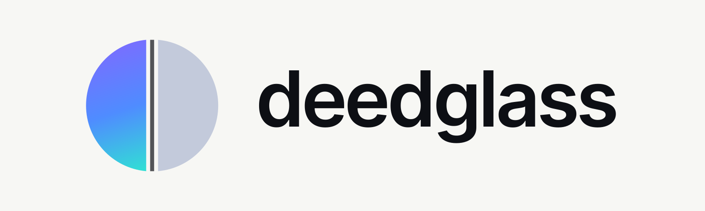
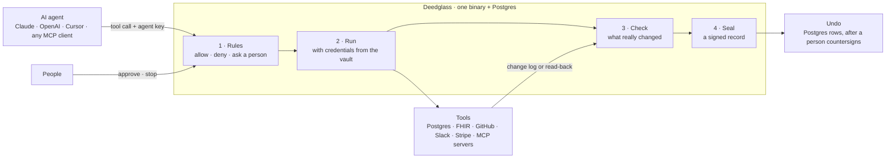

<p align="center">
  <picture>
    <source media="(prefers-color-scheme: dark)" srcset="docs/assets/lockup-horizontal-dark.svg">
    
  </picture>
</p>

<h3 align="center">Check what your AI agents actually changed.</h3>

<p align="center"><b>An agent said it updated 1 row. Postgres changed 301.</b></p>

<p align="center">Safety for AI agents that work on databases and health records. Rules decide each AI agent tool call;<br>
Deedglass checks what really changed and seals a record. Open source, self-hosted, every feature free.</p>

<p align="center">
  <a href="https://github.com/deedglass/deedglass/actions/workflows/ci.yml"></a>
  <a href="https://github.com/deedglass/deedglass/releases"></a>
  <a href="https://www.npmjs.com/package/deedglass"></a>
  <a href="#license"></a>
  <a href="https://pkg.go.dev/github.com/deedglass/deedglass/pkg/deedglass"></a>
  <a href="docs/ATTACK_SUITE.md"></a>
</p>

## Start in one command

```sh
npx -y deedglass
```

**An app opens in your browser.** It runs on your own computer, signed in, with no account, no
sign-up and no Docker or database to set up, and nothing is sent to us. Choose who will use it (a
clinic, hospital IT, or people building with AI), then connect Claude Desktop, Cursor, VS Code, a
record system or a database. You need Node 18 or newer. Read
[Start here](https://docs.deedglass.com/get-started/app/) for a short tour, or try it without
installing anything at [deedglass.com/play](https://deedglass.com/play).

**For developers**, three commands:

```sh
npx -y deedglass start      # an agent reports 1 row, Postgres changed 301, and it's caught
npx -y deedglass protect    # guard Claude Code, Cursor and other coding agents
npx -y deedglass help       # the eight everyday commands; "help all" lists every command
```

Without Docker, `start` plays the same scene inside the binary, every line labelled `live` or
`replay`, in under 30 s. More: [Quickstart](https://docs.deedglass.com/quickstart/) ·
[Docs](https://docs.deedglass.com) · [Healthcare](https://deedglass.com/healthcare) ·
[Benchmarks](#benchmarks) · [Security](SECURITY.md) · [deedglass.com](https://deedglass.com)

**Found it useful?** A star helps other people find Deedglass. To hear about new releases, use
**Watch › Custom › Releases**.

## What it does

<p align="center">
<!-- description:summary (docs/description.json; docs/description_test.go checks it) -->
Deedglass sits between AI agents and the systems they change. Rules decide each tool call, a check
compares what the system really changed with what the agent reported (Claimed, Checked or Proven;
Matches, Doesn't match or Can't check), and each result is sealed as a signed record anyone can
check offline. It can undo the rows an action changed.
</p>

<p align="center">
  <picture>
    <source media="(prefers-color-scheme: light)" srcset="docs/assets/demo-hero-light.svg">
    
  </picture>
</p>
<p align="center"><sub>A real run of <code>make demo-hero</code> (commit 97a524c, 2026-10-14), each line shown at the time it printed.
Source: <a href="docs/assets/demo-hero.cast.json"><code>docs/assets/demo-hero.cast.json</code></a>, recorded by <a href="scripts/demo/capture.mjs"><code>scripts/demo/capture.mjs</code></a> and drawn by <a href="scripts/demo/cast2svg.mjs"><code>scripts/demo/cast2svg.mjs</code></a> (<code>make demo-svg</code>).</sub></p>

## Install

```sh
curl -fsSL https://deedglass.com/install.sh | sh   # macOS and Linux: checks the sha256, copies deedglass into ~/.local/bin
npx -y deedglass help                              # or run it with no install (Node 18 or newer)
npm install -g deedglass                           # or install it from npm
```

| Other ways | Command |
|---|---|
| Binaries | archives for macOS, Linux and Windows on the [latest release](https://github.com/deedglass/deedglass/releases/latest), with `checksums.txt` |
| Go | `go install github.com/deedglass/deedglass/cmd/deedglass@latest` (the CLI, without the Console) |
| Docker | build the image from a checkout: `make web-build docker` (tags `deedglass:dev`; Node 24 builds the Console) |

The install script downloads the release archive for your platform, checks its sha256 against the
release's `checksums.txt` (and the signature, when cosign is installed), and copies `deedglass` into
`~/.local/bin`; read it first: [`scripts/install.sh`](scripts/install.sh). It downloads from a copy
of the release on deedglass.com and falls back to GitHub: about 7 s on one network in India, where the
GitHub-only install took 81-119 s. A public container image is coming; until it's
published, build the image locally as above. Checksums, signatures and SBOMs:
[`docs/INSTALL.md`](docs/INSTALL.md).

## Who it's for

- **Developers with agents on databases.** Claude Code, Cursor or your own agent writes to Postgres.
  Your rules decide each call first, Postgres's change log shows what really committed, and the
  rows one action changed can be undone after a person countersigns. MySQL and other databases can
  be checked from a Debezium change feed ([`docs/WITNESS_DEBEZIUM.md`](docs/WITNESS_DEBEZIUM.md)).
- **Health-tech teams and hospitals on FHIR.** The FHIR connector (beta) puts a FHIR R4 server
  behind Deedglass with SMART Backend Services, reads each write back at the version the server
  reported, and checks Proven on HAPI FHIR JPA 8.x and Medplum 5.x running on Postgres. See
  [deedglass.com/healthcare](https://deedglass.com/healthcare) and the
  [FHIR benchmark](corpus/fhir/BENCHMARK.md).
  To see it on synthetic data first, with no Docker and no server, run `npx deedglass health pilot`
  ([the 15-minute hospital pilot](docs/healthcare/PILOT.md)).
- **Security teams.** Lockdown makes every agent write wait for a person, needs two people for
  high-risk writes and for turning lockdown off, and keeps each agent to one connector
  ([`docs/LOCKDOWN.md`](docs/LOCKDOWN.md)). Records are signed and anyone can check them offline
  with `deedglass verify`.

## Project status

- **Pre-1.0.** Every release is in [`CHANGELOG.md`](CHANGELOG.md) and on the
  [releases page](https://github.com/deedglass/deedglass/releases). The deed format is a versioned
  public spec ([`spec/`](spec/)), so old records keep verifying.
- **One maintainer.** Deedglass is built by Arjun Prabhakaran in India
  ([`GOVERNANCE.md`](GOVERNANCE.md)). Replies are best effort ([`SUPPORT.md`](SUPPORT.md)).
- **Free and self-hosted.** Every feature is free while we grow, including `ee/`, and it runs on your
  machines with your own Postgres. Nothing checks a licence and nothing is sent to deedglass.com
  ([Security](#security)).
- **Not yet:** no SOC 2 report, no outside penetration test and no SSO. Known limits are in
  [`docs/LIMITATIONS.md`](docs/LIMITATIONS.md) and [`KNOWN_ISSUES.md`](KNOWN_ISSUES.md).

## How it works



Every tool call passes through Deedglass with the agent's key. Your rules (policies) decide `allow`,
`deny` or `require_approval`; Deedglass runs the call with credentials the agent never holds; the
check compares what happened with what was asked; and the outcome is sealed as a record in the org's
chain.

## How sure each check is

| Level | What it checks | What it can't see |
|---|---|---|
| **Claimed** | The tool's own answer, against a schema and your postconditions | Whether the answer is true |
| **Checked** | A read-back from the target (GitHub, Slack, Stripe, Notion, REST, Postgres rows) | Side effects the read-back doesn't cover |
| **Proven** | Postgres's change log (logical decoding): every row the transaction committed | DDL, sequences, unlogged tables and anything outside that database's WAL |

Each record claims one level and one result: **Matches**, **Doesn't match** or **Can't check**. When
Deedglass can't tell whether a tool ran, the result is Can't check, never Matches. The API keeps
the short names (`L0`/`L1`/`L2`, `VERIFIED`/`MISMATCH`/`UNVERIFIABLE`); the
[glossary](https://docs.deedglass.com/concepts/glossary/) maps them.

## The 301-row scene

What an agent reports is not always what the system stored, and a log the agent writes itself can't
show the difference. An agent was asked to mark order 42 as shipped. It ran one `UPDATE` and its tool reported 1 row. A
legacy trigger shipped 300 more orders in the same transaction. This is the real output of the
Quickstart's last step on 2026-10-14 (shortened where you see `…`):

```text
$ npx -y deedglass init --trigger
…
✕ UPDATE order 42         Proven · Doesn't match · Postgres changed 301 rows in public.orders. The agent reported 1.
  expected   UPDATE 1 row in public.orders where id = 42 · sets status
  observed   UPDATE 301 rows in public.orders · 300 outside id = 42
…
✓ Trigger off             orders_ship_open_batch dropped
✓ Undo preview            Undo available · 301 rows in public.orders · 301 updates
    policy   undo-needs-approval · a person countersigns first
```

The agent's log says 1 row. Deedglass read Postgres's own change log for that transaction, found
301, sealed the difference as a record, and planned an undo from those rows that runs only after a
person countersigns.

## Quickstart

Docker running with about 2 GiB of free disk, Node 18 or newer, and macOS or Linux, then (from the
[tested Quickstart](https://docs.deedglass.com/quickstart/)). On Windows, `npx deedglass` runs the
native Windows binary, no WSL needed; `deedglass init` uses Docker on macOS and Linux, so on Windows
start with `npx deedglass app`, which needs no Docker:

<!-- quickstart:begin (scripted copy of docs-site/src/content/docs/quickstart.mdx; docs/readme_test.go compares them) -->
```sh
mkdir acme-agents && cd acme-agents
npx -y deedglass init --yes
npx -y deedglass doctor
npx -y deedglass init --trigger
```
<!-- quickstart:end -->

`deedglass init` starts two Postgres 18.6 containers in Docker (Deedglass's own database and a demo
database), runs `deedglass serve` on `127.0.0.1:8080`, creates an org, an agent and the
`postgres-check` policy (reads and writes run, every write is checked at Proven, `DROP` and
`TRUNCATE` never run; use `postgres-safe` in production, where writes wait for a person), and ends
with a blocked `DROP TABLE` and an `UPDATE` checked at Proven. `deedglass doctor` runs seventeen
read-only checks, each with its fix. `deedglass init --trigger` turns on the demo database's legacy
trigger, sends the same one-row `UPDATE`, and ends on the 301-row mismatch and the undo preview shown
above. Its last line is the `undo run` command; the undo waits for a person, and `undo run` prints
the approve link.

Port 8080 or 55432 taken? `npx -y deedglass init --yes --listen 127.0.0.1:8090 --pg-port 55440`
(`--listen` is where `deedglass serve` listens; `--pg-port` is Deedglass's own Postgres, and the
demo database takes the port 10 above it). Every later command run in that directory finds the
ports in `.deedglass/stack.json`. `npx -y deedglass init --purge` removes the containers, the
volumes and the files in `.deedglass/` when you're done.

**Protect every agent in one command:** `npx deedglass protect` adds the shell guard to Claude Code,
Cursor, Codex CLI, Gemini CLI and GitHub Copilot CLI, so a command such as `railway volume delete`,
`supabase db reset --linked` or `terraform destroy` waits for your yes (Codex and Gemini CLI deny it
instead). It backs up each file first and `--undo` puts them back: a second check, not a sandbox
([`docs/protect.md`](docs/protect.md)).

Then put your own Postgres behind it (Supabase, Neon or any Postgres 16 to 18): `npx -y deedglass
connect "$DATABASE_URL"` runs read-only checks and prints a plan; `--apply` sets it up
([guide](https://docs.deedglass.com/get-started/postgres/)).

## Four ways in

| | Command | What it needs | What leaves your machine |
|---|---|---|---|
| **In your browser** | [deedglass.com/play](https://deedglass.com/play) | A browser tab. Postgres runs in the page; it opens on the "said 1, changed 301" scene. | Nothing |
| **In your terminal** | `npx deedglass play` | Node, and deedglass 0.1.1 or newer from npm. No Docker. The rules decide each call live and the records are sealed and checked on your machine; Postgres's lines are replayed from a recorded real run, and labelled as such. | Nothing |
| **Scan your setup** | `npx deedglass scan` | Node. Reads your MCP configs and, if you name one, a database catalog, read-only. Grades what your agents could change, A to F. | Nothing, apart from read-only catalog queries to a database you name |
| **Observe mode** | `deedglass observe run --connector pg-demo -- ./agent.sh` | A Postgres connector with `observe` on. Nothing to rewire: it reads Postgres's change log beside whatever gate you already use. | Nothing |

When a scan finds a trigger or a cascade on a table your agent can write, it says so and points to
the 301 scene. Observe mode is [below](#observe-mode-nothing-to-rewire).

## Observe mode: nothing to rewire

```sh
deedglass observe run --connector pg-demo -- ./agent.sh   # open a watched session, run the agent, close it
deedglass observe show obs_01k… --undo-sql                # the undo as SQL you review and run (free)
deedglass observe run --connector dev --undo-sql ~/deedglass-undo -- claude   # watch a Claude Code session, shell included
```

Turn it on with `witness.observe.enabled: true` in the connector's config. Observe mode reads only
Postgres's change log, through the role and replication slot that `deedglass connector postgres init`
creates, so it works beside any gate you already use, or none.
It shows every row committed on the watched tables while the session was open and seals the session
as a record. It can't tell which program wrote a row, so a session gets no Matches or Doesn't match
verdict; row images are kept 30 days; a `TRUNCATE` can't be undone from the record. Undo SQL is free,
and so is a one-step undo through Deedglass: every feature is free while we grow. Details: [`docs/OBSERVE.md`](docs/OBSERVE.md).

## Add it to your agent client

<!-- install-links:start -->
[](https://cursor.com/en/install-mcp?name=deedglass&config=eyJjb21tYW5kIjoibnB4IiwiYXJncyI6WyIteSIsImRlZWRnbGFzcyIsIm1jcCIsInNlcnZlIl19)
[Install in VS Code](https://vscode.dev/redirect/mcp/install?config=%7B%22command%22%3A%22npx%22%2C%22args%22%3A%5B%22-y%22%2C%22deedglass%22%2C%22mcp%22%2C%22serve%22%5D%7D&name=deedglass) · [LM Studio](https://deedglass.com/install#lm-studio) · [Goose](https://deedglass.com/install#goose) · [Claude Desktop](https://docs.deedglass.com/get-started/claude-desktop/) · [Every client](https://deedglass.com/install)

```sh
claude mcp add --scope user deedglass -- npx -y deedglass mcp serve
```

No link holds a key. Run `npx deedglass init` first; each client asks Deedglass for the key it wrote.
<!-- install-links:end -->

**Claude Code plugin** (the MCP server, the `/deedglass:scan`, `/deedglass:wrap` and
`/deedglass:watch` commands, and skills for reading a scan and for giving an agent Postgres access
safely), from this repo's own marketplace:

```text
/plugin marketplace add deedglass/deedglass
/plugin install deedglass@deedglass
```

Every format, with its source: [`docs/INSTALL_CLIENTS.md`](docs/INSTALL_CLIENTS.md).

## SDKs and clients

- **TypeScript:** `@deedglass/sdk`, with adapters for the AI SDK, the OpenAI Agents SDK, LangChain and the Claude Agent SDK.
- **Python:** `deedglass`, with LangChain and Claude Agent SDK adapters. It isn't on PyPI yet; install it
  from this repo or from a release's wheel ([`docs/SDK_PYTHON.md`](docs/SDK_PYTHON.md)).
- **Go:** `github.com/deedglass/deedglass/pkg/deedglass`.
- **MCP:** `deedglass mcp wrap` governs any stdio MCP server; `deedglass mcp serve` governs remote ones
  for Claude Desktop, Claude Code, Cursor, VS Code and Windsurf.

## Connectors

Postgres (Proven), REST, GitHub, Slack, Stripe (test mode only), Gmail drafts, Notion and remote MCP
servers. Credentials live in an encrypted vault; every outbound call goes through one egress door.
See [`docs/CONNECTORS.md`](docs/CONNECTORS.md).

## Benchmarks

Each benchmark publishes what Deedglass misses next to what it catches.

| Benchmark | Caught | Missed | Source |
|---|---|---|---|
| Postgres: 12 synthetic cases, 11 where the agent's report was wrong | 5 of 11 | 6 (in 2 of them it said it can't check); 0 false alarms | [`corpus/results/latest.md`](corpus/results/latest.md) |
| FHIR on Medplum 5.2.6: 17 scenarios, 11 where the report and what the server stored differ | 4 of 11 (no checker, or trusting the HTTP status: 0 of 11) | 7; 0 false alarms on the 6 controls | [`corpus/fhir/results/latest.md`](corpus/fhir/results/latest.md) |

Every scenario, with the misses named: [`corpus/BENCHMARK.md`](corpus/BENCHMARK.md),
[`corpus/fhir/BENCHMARK.md`](corpus/fhir/BENCHMARK.md) and [deedglass.com/benchmark](https://deedglass.com/benchmark).

Speed:

<!-- numbers:begin (from bench/results/SUMMARY.json; docs/readme_test.go checks every row; an Apple M1 laptop on AC power, Postgres on the same machine) -->
| What | Measured | Target |
|---|---|---|
| Gate · allow, no witness | p50 5.81 ms · p99 19.4 ms | p50 < 5 ms · p99 < 25 ms (p50 missed) |
| Policy · 50 rules | p99 148 µs | p99 < 1 ms |
| Witness · L2 at 100 writes/s | p50 118 ms · p99 317 ms | p50 < 1 s |
| Verify · 100,000 deeds | 1.53 s · 80.9 MiB | < 5 s · < 256 MiB |
| Stop · across 2 instances | max 23.5 ms over 20 trials | < 2 s |
<!-- numbers:end -->

How they were measured, and the misses: [`docs/BENCHMARKS.md`](docs/BENCHMARKS.md).

## What it doesn't do

- Proven checks cover Postgres only, and need `wal_level=logical` and `REPLICA IDENTITY FULL` on watched tables.
- A hijacked agent with a valid key and an in-policy action is allowed. Policies, budgets and
  approvals narrow this; they don't close it.
- Deedglass trusts the Postgres server, its superusers, the host it runs on and its seal key. It
  can't protect you from a compromised host.
- Records hold digests, not payloads. One set of seal keys signs every org on an instance.
- It doesn't replace a least-privilege database role. Use both: the role limits what the agent can
  do; Deedglass checks what it did with that.

The whole list, with workarounds: [`docs/LIMITATIONS.md`](docs/LIMITATIONS.md) and [`KNOWN_ISSUES.md`](KNOWN_ISSUES.md).

## Alternatives

You may not need Deedglass, or you may want it next to one of these. Each has a longer page, with
sources and the date each was checked, at [deedglass.com/compare](https://deedglass.com/compare).
<!-- claims: C-109 (role), C-114 and C-116 (branches), C-117 (Docker's gateway), C-122 and C-123 (traces), C-110 (Claw Patrol), C-119 (Pipelock) -->

| If you need | Use this | Where Deedglass fits |
|---|---|---|
| An agent that only reads | A Postgres role with `SELECT` and nothing else. It can't change data whatever the agent sends, and there's nothing to install. | You don't need it. It's for agents that must write. ([compare](https://deedglass.com/compare/read-only-postgres-role)) |
| A place for an agent to try changes | A database branch: a Neon branch is a copy-on-write clone of your data; Supabase branches start without production data by default. | For the writes that must reach production: rules first, then the check and the record. ([compare](https://deedglass.com/compare/database-branches)) |
| Routing, isolation and credentials for many MCP servers | An MCP gateway, such as Docker's, which runs each server in an isolated container and injects credentials. | Behind the gateway, for the servers that write to Postgres. ([compare](https://deedglass.com/compare/mcp-gateways)) |
| Traces of each step, and evaluations | Langfuse or LangSmith. | Next to them: a trace is the agent's side of the story; the check reads what Postgres committed. ([compare](https://deedglass.com/compare/langfuse-langsmith)) |
| Rules at the wire for Postgres, Kubernetes and HTTP | Claw Patrol, which gates each action against rules over the parsed traffic. | It also decides first; it adds the check of what Postgres committed, records anyone can check offline, and undo. ([compare](https://deedglass.com/compare/claw-patrol)) |
| Scanning what an agent sends out and what its tools return | Pipelock, an agent firewall that scans MCP traffic in both directions. | It adds the check of what Postgres committed after each call, and undo for the rows. ([compare](https://deedglass.com/compare/pipelock)) |

## Security

The attack suite runs 82 cases against a real server and real Postgres on every release candidate:
82 matched, 0 differ (`attack/results/latest.json`, [`docs/ATTACK_SUITE.md`](docs/ATTACK_SUITE.md)).
Another 23 library- and CLI-level cases (groups Y and T: crypto agility, the A2A proxy, the Debezium
witness, the shell guard, timestamps) run with `go test ./attack` on every pull request.
Report a vulnerability privately: [`SECURITY.md`](SECURITY.md).

<!-- description:network -->
Every feature is free while we grow, so nothing checks a licence and nothing is sent to deedglass.com: the scan reads files on your machine and, with `--postgres-dsn-env`, connects only to the database you name. The `deedglass licence` commands, kept for a later paid option, are the only ones that call Dodo Payments or deedglass.com, and only when you run them; `DEEDGLASS_NO_NETWORK=1` stops those calls. `deedglass version --check` and the `--latest` option of `deedglass policy install` and `policy packs` contact GitHub when you use them. Head timestamps are off by default; with TSAs or a transparency service listed in deedglass.yaml, `deedglass deeds timestamp` and each export contact only those.
How the licence path works if a later build asks for a key:
[`docs/LICENSING.md`](docs/LICENSING.md#does-a-licence-phone-home).

## Docs and links

- **Docs:** [docs.deedglass.com](https://docs.deedglass.com) · [Quickstart](https://docs.deedglass.com/quickstart/) · [how it works](https://docs.deedglass.com/concepts/how-it-works/) · [`docs/`](docs/)
- **Agent clients:** [Claude Code](https://docs.deedglass.com/get-started/claude-code/) · [Cursor, VS Code and Windsurf](https://docs.deedglass.com/get-started/cursor-vscode-windsurf/) · [Claude Desktop](https://docs.deedglass.com/get-started/claude-desktop/) · [your own Postgres](https://docs.deedglass.com/get-started/postgres/)
- **Frameworks:** [Vercel AI SDK](https://docs.deedglass.com/frameworks/vercel-ai-sdk/) · [Claude Agent SDK](https://docs.deedglass.com/frameworks/claude-agent-sdk/) · [OpenAI Agents SDK](https://docs.deedglass.com/frameworks/openai-agents/) · [LangChain](https://docs.deedglass.com/frameworks/langchain/) · [Mastra](https://docs.deedglass.com/frameworks/mastra/) · [Pydantic AI](https://docs.deedglass.com/frameworks/pydantic-ai/) · [Google ADK](https://docs.deedglass.com/frameworks/google-adk/) · [CrewAI](https://docs.deedglass.com/frameworks/crewai/) · [LlamaIndex](https://docs.deedglass.com/frameworks/llamaindex/)
- **Healthcare:** [deedglass.com/healthcare](https://deedglass.com/healthcare) · [FHIR connector](docs/connectors/fhir.md) · [PHI mode](docs/PHI_MODE.md) · [Medplum example](docs/integrations/medplum.md) · [FHIR benchmark](corpus/fhir/BENCHMARK.md) · [Hospital pilot](docs/healthcare/PILOT.md) · [IT review pack](docs/healthcare/IT_REVIEW_PACK.md)
- **GitHub Action:** [Deedglass Scan on the GitHub Marketplace](https://github.com/marketplace/actions/deedglass-scan)
- **Security:** [`SECURITY.md`](SECURITY.md) · [lockdown](docs/LOCKDOWN.md) · [attack suite](docs/ATTACK_SUITE.md) · [limitations](docs/LIMITATIONS.md) · [verifying records](docs/VERIFYING_DEEDS.md)
- **Contributing:** [`CONTRIBUTING.md`](CONTRIBUTING.md) · [good first issues](https://github.com/deedglass/deedglass/labels/good%20first%20issue) · [Discussions](https://github.com/deedglass/deedglass/discussions)

## Contributing

Read [`CONTRIBUTING.md`](CONTRIBUTING.md): `make dev`, `make ci`, the tests a change needs, and DCO
sign-off (`git commit -s`). Questions go to Discussions ([`SUPPORT.md`](SUPPORT.md)); how decisions
are made is in [`GOVERNANCE.md`](GOVERNANCE.md).

If Deedglass showed you something your logs didn't, a GitHub star helps other people find it.

## License

<!-- description:licence -->
The core, the SDKs and the CLI are Apache-2.0. The features in `ee/` are FSL-1.1-ALv2 (free to use while we grow), and each release of them becomes Apache-2.0 two years after it ships. The release binary, the `@deedglass/cli-*` npm packages and the container image include `ee/`, so their licence is `Apache-2.0 AND FSL-1.1-ALv2`.

FSL-1.1-ALv2 lets you read, run and change `ee/` for anything except offering a competing product
([`ee/LICENSE`](ee/LICENSE)); everything Deedglass does for safety is free and outside `ee/`
([`docs/LICENSING.md`](docs/LICENSING.md)). The rest is [`LICENSE`](LICENSE); third-party notices
are in [`NOTICE`](NOTICE). Forks are welcome under a new name: [`TRADEMARKS.md`](TRADEMARKS.md).

The record spec ([`spec/`](spec/): the deed format and the export bundle) and the intent-vs-effect
corpus ([`corpus/`](corpus/)) are published under CC-BY-4.0, so anyone can implement, copy or
adapt them with credit.

**In plain words** (a summary, not legal advice; the licence files govern):

| Question | Answer |
|---|---|
| Can a company, hospital or project run all of Deedglass, including `ee/`, for free? | Yes. Self-hosted, every feature, no licence key. |
| Can I read and change the code? | Yes. The core is Apache-2.0. `ee/` is FSL-1.1-ALv2, which allows changes for any purpose except a competing product. |
| What isn't allowed? | Offering `ee/`, or something built from it, to others as a commercial product or service that competes with Deedglass. Each `ee/` release drops that limit when it becomes Apache-2.0, two years after it ships. |
| Can I implement the record format myself? | Yes. [`spec/`](spec/) is CC-BY-4.0: implement, copy or adapt it with credit. |
