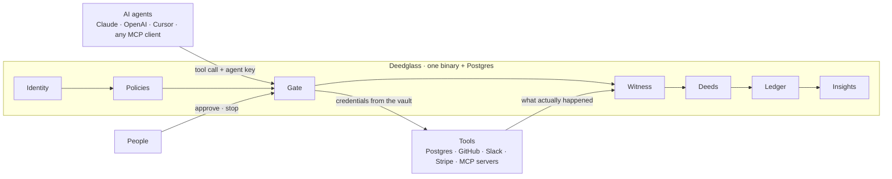

<p align="center">
  <picture>
    <source media="(prefers-color-scheme: dark)" srcset="docs/assets/lockup-horizontal-dark.svg">
    
  </picture>
</p>

**See what your AI agents actually did.**

Deedglass sits between your AI agents and the tools they use. It decides what each agent may do,
runs it under control, checks the result against the system of record, and seals a deed that anyone
with the public key can check offline.

[Try it in your browser](https://deedglass.com/play) · [Quickstart](https://docs.deedglass.com/quickstart/) ·
[Docs](https://docs.deedglass.com) · [Security](SECURITY.md) · [deedglass.com](https://deedglass.com)

```sh
npx deedglass scan    # grades your own agent setup; sends nothing
```

<!-- 60-second demo: docs/assets/demo-60s.gif (recorded 10-13 from a real run; see docs/DEMO_SCRIPT.md) -->

## Why

An agent was asked to mark order 42 as shipped. It ran one `UPDATE` and reported 1 row.
A legacy trigger shipped 300 more orders in the same transaction, so Postgres committed 301.
Agent logs record what the agent asked for; Deedglass reads Postgres's own change log, compares, and
seals `L2 · MISMATCH · Postgres changed 301 rows in public.orders. The agent reported 1.` Then a
person countersigns an undo built from those 301 rows.

## Quickstart

Docker running, Node 18 or newer, then (from the [tested Quickstart](https://docs.deedglass.com/quickstart/)):

<!-- quickstart:begin (scripted copy of docs-site/src/content/docs/quickstart.mdx; docs/readme_test.go compares them) -->
```sh
mkdir acme-agents && cd acme-agents
npx -y deedglass init --yes
npx -y deedglass doctor
```
<!-- quickstart:end -->

`deedglass init` starts Postgres and Deedglass in Docker on their own ports, creates an org, an agent
and the `postgres-safe` policy, and ends with a blocked `DROP TABLE` and an `UPDATE` witnessed at L2.
`deedglass doctor` runs sixteen read-only checks, each with its fix.

## How it works



Every tool call passes through the Gate with the agent's key. Policies decide `allow`, `deny` or
`require_approval`; the Gate runs the call with credentials the agent never holds; the Witness
compares what happened with what was asked; and the outcome is sealed as a deed in the org's chain.

## Verification levels

| Level | What it checks | What it can't see |
|---|---|---|
| **L0 Reported** | The tool's own answer, against a schema and your postconditions | Whether the answer is true |
| **L1 Confirmed** | A read-back from the target (GitHub, Slack, Stripe, Notion, REST, Postgres rows) | Side effects the read-back doesn't cover |
| **L2 Witnessed** | Postgres's change log (logical decoding): every row the transaction committed | DDL, sequences, unlogged tables and anything outside that database's WAL |

Each deed claims one level and one verdict: `VERIFIED`, `MISMATCH` or `UNVERIFIABLE`. When
Deedglass can't tell whether a tool ran, the verdict is `UNVERIFIABLE`, never `VERIFIED`.

## What it doesn't do

- L2 covers Postgres only, and needs `wal_level=logical` and `REPLICA IDENTITY FULL` on watched tables.
- A hijacked agent with a valid key and an in-policy action is allowed. Policies, budgets and
  approvals narrow this; they don't close it.
- Deedglass trusts the Postgres server, its superusers, the host it runs on and its seal key. It
  can't protect you from a compromised host.
- Deeds hold digests, not payloads. One set of seal keys signs every org on an instance.

The whole list, with workarounds: [`docs/LIMITATIONS.md`](docs/LIMITATIONS.md) and [`KNOWN_ISSUES.md`](KNOWN_ISSUES.md).

## Install

| How | Command |
|---|---|
| npx (no install) | `npx -y deedglass help` |
| Docker | `docker pull ghcr.io/deedglass/deedglass:0.1.0` |
| Binaries | signed archives for macOS, Linux and Windows on the GitHub release |
| Go | `go install github.com/deedglass/deedglass/cmd/deedglass@latest` |

Checksums, signatures and SBOMs: [`docs/INSTALL.md`](docs/INSTALL.md).

## SDKs and clients

- **TypeScript:** `@deedglass/sdk`, with adapters for the AI SDK, the OpenAI Agents SDK, LangChain and the Claude Agent SDK.
- **Python:** `pip install deedglass`, with LangChain and Claude Agent SDK adapters.
- **Go:** `github.com/deedglass/deedglass/pkg/deedglass`.
- **MCP:** `deedglass mcp wrap` governs any stdio MCP server; `deedglass mcp serve` governs remote ones
  for Claude Desktop, Claude Code, Cursor, VS Code and Windsurf.

## Connectors

Postgres (L2), REST, GitHub, Slack, Stripe (test mode only), Gmail drafts, Notion and remote MCP
servers. Credentials live in an encrypted vault; every outbound call goes through one egress door.
See [`docs/CONNECTORS.md`](docs/CONNECTORS.md).

## Numbers

<!-- numbers:begin (from bench/results/SUMMARY.json; docs/readme_test.go checks every row; an Apple M1 laptop on AC power, Postgres on the same machine) -->
| What | Measured | Target |
|---|---|---|
| Gate · allow, no witness | p50 5.81 ms · p99 19.4 ms | p50 < 5 ms · p99 < 25 ms (p50 missed) |
| Policy · 50 rules | p99 148 µs | p99 < 1 ms |
| Witness · L2 at 100 writes/s | p50 118 ms · p99 317 ms | p50 < 1 s |
| Verify · 100,000 deeds | 1.53 s · 80.9 MiB | < 5 s · < 256 MiB |
| Stop · across 2 instances | max 23.5 ms over 20 trials | < 2 s |
<!-- numbers:end -->

How they were measured, and the misses: [`docs/BENCHMARKS.md`](docs/BENCHMARKS.md).

## Security

The attack suite runs 68 cases against a real server and real Postgres on every release candidate:
68 matched, 0 differ (`attack/results/latest.json`, [`docs/ATTACK_SUITE.md`](docs/ATTACK_SUITE.md)).
Report a vulnerability privately: [`SECURITY.md`](SECURITY.md).

## Contributing

Read [`CONTRIBUTING.md`](CONTRIBUTING.md): `make dev`, `make ci`, the tests a change needs, and DCO
sign-off (`git commit -s`). Questions go to Discussions ([`SUPPORT.md`](SUPPORT.md)); how decisions
are made is in [`GOVERNANCE.md`](GOVERNANCE.md).

## License

Apache-2.0 for the core, the SDKs and the CLI ([`LICENSE`](LICENSE)). Pro features, when they ship,
will live in `ee/` under FSL-1.1-ALv2, which becomes Apache-2.0 two years after each release.
Third-party notices: [`NOTICE`](NOTICE).
