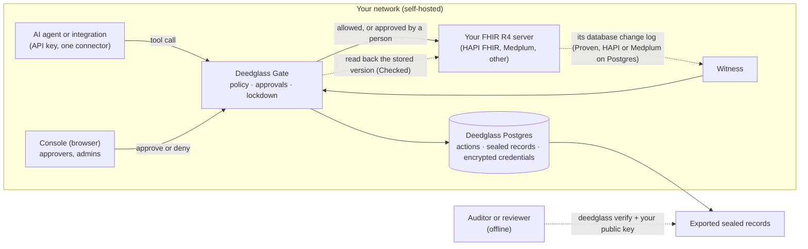

For a hospital's IT, security and quality teams reviewing Deedglass before a pilot. Six short pages,
written to print: architecture and data flow, where data lives, the threat model in summary, answers
to the usual security questions, the clinical-safety boundary, what it takes to run, and how a pilot
is measured. True for Deedglass 0.14.1.

Print it, or write a copy next to you with `deedglass health pilot --print-review-pack > IT_REVIEW_PACK.md`.
`deedglass health pilot` also writes it next to its report.

Deedglass is administrative and data-integrity software. It decides whether a software agent's
request runs, waits for a person or is refused, under rules you write; records each request in a
sealed record; and compares what the target system stored with what the agent reported. It does not
diagnose, treat or recommend, and it never changes clinical content.

## 1. Architecture and data flow

The same picture in words, for a printout without the diagram:

1. An agent calls a tool (for example, create an Observation) with its own API key.
2. The Gate evaluates your policy. The free `healthcare-fhir` pack refuses deletes of clinical
   records, holds orders, medication changes, allergies, the problem list and final notes for a
   clinician you name, and needs two people for claims. In lockdown every write waits for a person.
3. A person approves in the Console (or by email or Slack, when you set those up), or the request
   expires. Nothing reaches the FHIR server before that.
4. The Gate sends the request through the FHIR connector, then reads the resource back at the
   version the server reported and compares the fields the agent sent (Checked). On HAPI FHIR JPA or
   Medplum on Postgres it can also read the server's own database change log (Proven).
5. The outcome is sealed into a hash-chained record (Ed25519, optionally also ML-DSA-65) in your
   Postgres. Anyone with your public key can check exported records offline.

## 2. Where data lives

- **Self-hosted.** Deedglass is software you run on your own infrastructure, with your own Postgres.
  We don't operate a hosted service and we receive none of your data.
- **Nothing leaves by default.** Every feature is free, so nothing checks a licence and nothing is sent
  to deedglass.com. Outbound calls happen only when you ask for them: `deedglass version --check` and
  `--latest` on `policy install` contact GitHub; head timestamps and transparency services you list in
  `deedglass.yaml` are contacted on export. `DEEDGLASS_NO_NETWORK=1` stops the licence commands kept
  for a later paid option (docs/LICENSING.md).
- **What is stored, and where.** Actions, approvals and sealed records in your Postgres; connector
  credentials encrypted with AES-256-GCM under a vault key you hold. Sealed records hold ids, digests
  and outcomes, not clinical content.
- **PHI mode.** With PHI mode on, the action history keeps ids and digests instead of request and
  result payloads once an action is sealed and its checks are done (docs/PHI_MODE.md). Lockdown turns
  it on for an org with a FHIR connector.
- **Residency.** Wherever you run it. Backups are your Postgres backups; exported record bundles
  verify on their own. We hold no copy.

## 3. Threat model in summary

The full model is docs/THREAT_MODEL.md (version 3, 2026-10-21), with the control and test for each
threat. Its framing: assume the model is already manipulated. Deedglass limits and records what an
agent's tool calls can do, what a stolen key can do, what a curious neighbouring org can see, what a
hostile upstream can make Deedglass do, and what a network attacker can forge.

| Threat | Control |
|---|---|
| A manipulated agent writes or deletes records | Policy decides first; deletes of clinical records refused; lockdown makes every write wait for a person; high-risk writes need two people |
| A stolen agent key | Each key belongs to one agent; in lockdown each agent reaches one connector; Stop halts an agent or the whole org |
| A server that answers "201 Created" but stores something else | Read-back at the reported version (Checked); the change log where available (Proven); a gap is reported as "Can't check", never as a pass |
| Someone edits the records afterwards | Hash-chained sealed records; one changed byte fails `deedglass verify` |
| Another org on the same server | Postgres row-level security on every org table; the runtime role can't bypass it |
| Outbound requests to internal addresses | One egress door with a TLS floor that refuses private and metadata addresses in production |

What stays possible, in plain words (from the model's residual risks): a compromised Deedglass host
can sign false records, so keep seal keys on a separate volume and let auditors pin your published
keys; a manipulated agent acting within policy succeeds, and Deedglass records it; writes outside what
a connector checks are not seen by Proven; a copy of the database together with the vault key opens
every stored credential.

## 4. Security answers

Only answers that are true today and checkable. Where something doesn't exist yet, it says so.

| Topic | Answer | Evidence |
|---|---|---|
| Deployment model | Self-hosted on your infrastructure with your Postgres; we have no access to your data, so questions about our data centres, staff access to your data or our backups of your data are not applicable | docs/SELF_HOSTING.md |
| Company | Not yet incorporated; one founder working with AI assistance; first release 15 October 2026 | CHANGELOG.md |
| Who changes the code | One maintainer reviews and merges every change; required CI checks, pinned attack-suite expectations and signed releases compensate; a second reviewer comes with the first hire | GOVERNANCE.md, .github/required-checks.txt |
| Continuity | The core, SDKs and CLI are Apache-2.0; the record format is a public spec (CC-BY-4.0); records verify offline with the public key alone | GOVERNANCE.md, spec/ |
| Change control | Every change goes through a pull request with required CI checks on `main`; architecture and dependency decisions are written as ADRs | docs/adr/ |
| Static analysis | CodeQL runs on pull requests, `main` and weekly; custom static guards run in CI | .github/workflows/codeql.yml, internal/lint |
| Dependencies | govulncheck is a required CI job; every dependency is pinned and has an ADR | go.mod, docs/adr/ |
| Secret scanning | GitHub secret scanning and push protection are on | repository settings |
| Security testing | An attack suite with expected outcomes pinned before the code; against 0.14.0, 82 cases matched their expected outcome, 0 differed; a planted credential is searched for in every log line, answer and record | docs/ATTACK_SUITE.md, attack/results/latest.json |
| Threat model | Version 3, with the control and test for each threat | docs/THREAT_MODEL.md |
| AI-assisted development | Much of the code is written with AI assistance and says so in commit co-author lines; the same checks apply to every change | git history |
| Release builds | One GitHub Actions workflow builds each release from a tag on `main`; actions pinned to commit SHAs | .github/workflows/release.yml |
| Signed releases, SBOM, provenance | `checksums.txt` is signed keylessly with Sigstore cosign; an SPDX SBOM ships with each archive; build provenance is recorded, and npm packages publish with provenance | release assets |
| Image scanning | The release fails on fixable high or critical findings (grype) | release.yml |
| Reproducible builds | The linux/amd64 binary builds byte for byte the same twice on our build; an independent rebuild in CI is not yet in place | `make release-check` |
| Long-term verifiability | Every release keeps one sealed bundle that CI verifies with today's code on every change | testdata/release-bundles/ |
| Network exposure | The server binds to 127.0.0.1 by default; exposing it is an explicit configuration choice | docs/CONFIG.md |
| Encryption in transit | TLS from your reverse proxy or load balancer; outbound calls go through one egress door with a TLS floor | docs/NETWORK_EGRESS.md |
| Encryption at rest | Connector credentials AES-256-GCM, never returned or logged; disk and database encryption are yours to configure | docs/SECURITY_REVIEW_2026-10.md |
| Authentication | Console sign-in without passwords (emailed one-time link or 6-digit code), sessions with idle and absolute timeouts; agents use API keys stored as hashes and shown once. SSO and SAML: not yet | docs/IDENTITY.md, docs/AGENTS.md |
| Authorisation and tenancy | Roles owner, admin and viewer; row-level security on every org table | docs/SECURITY_REVIEW_2026-10.md |
| Audit logging | Every agent action and admin change is a sealed, hash-chained record, verifiable offline with the CLI, the browser verifier, or the Python and Node verifiers; optional RFC 3161 timestamps | docs/VERIFYING_DEEDS.md, verifiers/ |
| Log retention | Set per org, 1 to 3,650 days (default 90) | docs/RETENTION.md |
| Health data | Sealed records hold ids, digests and outcomes; PHI mode keeps ids and digests in the action history | docs/PHI_MODE.md |
| Strictest setting | Lockdown: every write waits for a person, high-risk writes need two people, approvals expire within 15 minutes, destructive SQL refused, turning it off needs a second person | docs/LOCKDOWN.md |
| Console web security | CSP with `frame-ancestors 'none'`, `__Host-` cookies, a CSRF token plus Sec-Fetch-Site | docs/SECURITY_REVIEW_2026-10.md |
| AI models inside the product | The core makes no model calls on your data; optional Insights wording never sees payloads and is off for FHIR connectors in PHI mode | docs/INSIGHTS_PRIVACY.md |
| Reporting a vulnerability | GitHub private vulnerability reporting; safe harbour for good-faith research; no bug bounty | SECURITY.md |
| Response times | Acknowledge within 3 business days, assess within 7, fix or mitigate high severity within 30 days | SECURITY.md |
| Incident response | A written plan with severity levels, roles and notice targets; not yet exercised | on request |
| Breach of our systems | We hold no customer data, so a breach of our systems doesn't expose yours; a software defect is handled as a security advisory and release | SECURITY.md |
| Personal data and PHI | In the self-hosted model we receive none. Our position is that we are neither your processor (DPDP) nor your business associate (HIPAA) here; this is a position for your counsel to confirm | — |
| Audit trails for HIPAA, DPDP or NABH | It helps show which agent changed which record, when, under which rule, and whether the stored result matched the report. It doesn't by itself make a deployment meet any law or standard | — |

## 5. Clinical-safety boundary

| Deedglass does | Deedglass does not |
|---|---|
| Match a request on resource type, interaction, routing codes and amounts, and apply your rule: run, wait for a named person, or refuse | Judge whether a dose, diagnosis, order, allergy or note is right |
| Route a request to a named clinician to approve or deny before it runs | Approve anything itself: the clinician reviews before it runs |
| Read back what a FHIR server stored and report "Doesn't match" when it differs from the agent's report | Correct, edit or generate clinical content, or resolve a mismatch on its own |
| Refuse deletes of clinical records and history rewrites | Delete or rewrite records in a clinical system |
| Record each request as a sealed record of ids, digests and outcomes | Store clinical text, names or identifiers in sealed records |
| Hold an agent's writes in lockdown when a check can't finish, until a person acknowledges | Decide clinical priority, or whether care can proceed |
| Offer an emergency path you design (a break-glass agent, stopped until needed, every action recorded) | Decide when an emergency exists |

We don't hold any medical device registration. The regulatory position is for your counsel and ours;
we don't state that Deedglass is outside any regulation. A hazard log in DCB0129 style is kept and
shared with pilot partners on request; it has not yet been reviewed by a clinician.

## 6. Operational requirements

| Need | What it takes |
|---|---|
| Server | One Linux or macOS host or VM you control; the `deedglass` binary (npm, `install.sh` with sha256 and cosign checks, or the container image) |
| Database | PostgreSQL 16, 17 or 18 for Deedglass's own data; your usual backups cover it |
| Keys | A seal key and a vault key on a volume you control; publish the public seal keys for auditors (docs/SEAL_KEYS.md) |
| Network | The Gate reaches your FHIR server; agents reach the Gate; TLS from your reverse proxy. Nothing else is needed outbound |
| FHIR server | FHIR R4 (HAPI FHIR, Medplum or another). Checked works on any of them; Proven needs HAPI FHIR JPA or Medplum on Postgres and read access to its database change log |
| People | A named owner for the workflow; one or two named approvers (two for four-eyes rules); an admin who can turn lockdown on and off with a second person |
| Settings | PHI mode on; lockdown on; the `healthcare-fhir` or `india-health` pack with your approvers in place of the example addresses |
| Fallback | When Deedglass can't check, lockdown holds that agent's writes; plan the manual path your team uses meanwhile |

Try it first with no setup: `deedglass health pilot` runs four scenes on synthetic data in a couple of
minutes, and `deedglass health pilot --fhir-url https://<your-sandbox>/fhir` repeats the first on
your own test server (docs/healthcare/PILOT.md).

## 7. Pilot success measures

Six weeks, free, synthetic data only, on a test server you control.

| Measure | How it is counted | A useful result |
|---|---|---|
| Mismatches found | Writes where what was stored differs from what the agent reported, each with its reason, each confirmed by your engineer | At least one real mismatch type you didn't already catch |
| False alarms | Flags your engineer judges wrong | None left unexplained by week 6 |
| Hours saved | Week-1 manual checking time minus week-5 time for the same batch, with the raw minutes | A number your IT head is willing to quote internally |
| Coverage | Share of the workflow's writes that end Checked or Proven, not "Can't check" | 90% or more |
| Approval path | Sensitive writes held and decided by a named person; time to decision | Every held write reached a person |
| Your verdict | Would you keep running it, and what is missing | Honest notes |

We report hours and data mismatches only. We make no claim about patient safety or care outcomes.

:::note[Source]
This page is `docs/healthcare/IT_REVIEW_PACK.md` in the Deedglass repo, imported at build time.
:::
