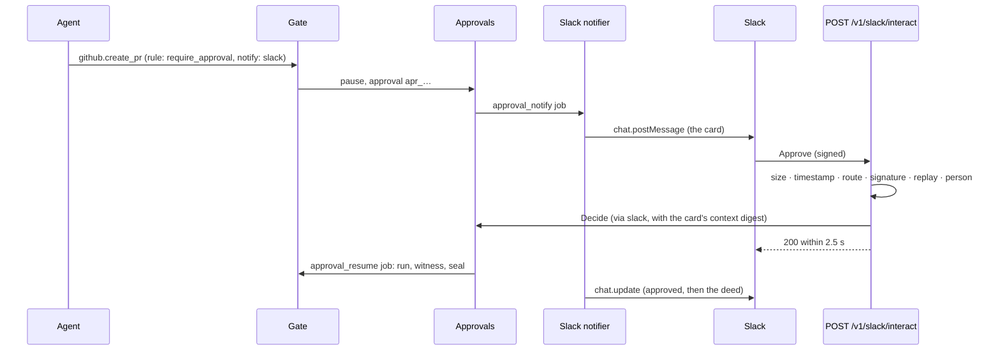

# Approvals: a person countersigns before an agent acts

A rule with `decision: require_approval` pauses an action until a person countersigns it. Nothing
runs while it waits. A countersign is recorded as its own admin deed, and the action's deed names
the approval, who decided and when. Timeout means no: an approval nobody decides expires, and the
action never runs.

This page covers S22: the policy fields, who may countersign, what they see, the emailed link,
resuming from REST, MCP and webhooks, and what is recorded. Webhooks are in
[WEBHOOKS.md](WEBHOOKS.md); the MCP side is in [MCP.md](MCP.md#approvals-deedglasscheck_approval).

## The policy fields

```yaml
rules:
  - id: orders-writes-need-approval
    match: { tool: [postgres.execute] }
    when: sql.writes && "public.orders" in sql.tables
    decision: require_approval
    reason: Writes to the orders database need a person to countersign.
    approval:
      approvers: [role:admin]   # role:admin (admins and owners), role:owner, user:<email>
      required: 1               # how many different people must countersign (four-eyes: 2)
      expires_in: 30m           # 1m to 168h; default approvals.default_expires_in (30m)
    notify: [email]
```

- `approvers` lists who may countersign. `role:admin` means any admin or owner, `role:owner` only
  owners, `user:<email>` that member in any role. Several entries are alternatives.
- `required` is the number of distinct people. A rule that needs more people than the org has is
  refused when the action arrives, with `approval_unsatisfiable`, and nothing runs.
- `expires_in` is how long the approval waits. After it, the approval is `expired`, the action is
  sealed as expired, and the agent is told nothing ran.
- `notify` is accepted. In S22 every approval emails its approvers (`email`); `slack` arrives with
  S29.

The policy is evaluated once, when the action arrives. Approving doesn't evaluate it again.

## Who can countersign

Eligibility is read live: when the approval is requested (to count the people who could
countersign) and again at every vote.

- **People only.** A countersign needs a person's session (the Console), the person's own emailed
  link, or, on a dev server, `deedglass approve --as <email>`. An API key, an agent key or an
  admin key gets `approval_needs_person` (403), and the CLI prints the Console link instead.
- **Four-eyes.** With `required: 2`, two different people must approve. One person voting twice
  gets `already_countersigned` (409). The action runs on the last needed approval.
- **Veto.** One deny is final, whatever `required` says. A deny needs a reason (1 to 280
  characters, no control or direction-changing characters); the agent sees it.
- **The self rule.** When an action runs on a member's behalf (`Deedglass-On-Behalf-Of` names their
  `usr_…` id or email), that member may deny it but not countersign it: `self_approval` (403).
  An org can allow self-countersign (`self_countersign: allow` in the org's approval settings,
  which an owner changes with `PATCH /v1/org`, `settings.approvals`, since S26).
- **Not eligible.** Anyone else gets `approver_not_eligible` (403), naming the rule and its
  approvers.

## What the person sees: the context snapshot

When the action pauses, Deedglass writes a context snapshot in the same transaction: the summary
("claude-desktop wants to UPDATE about 1 row in public.orders."), the agent and its last sealed
actions with their verdicts, the rule and its reason, the arguments with secrets scrubbed, the SQL
facts (kind, tables, writes, whether it has a WHERE) and the connector's estimate. For Postgres the
estimate is the planner's row count from `EXPLAIN (FORMAT JSON)`, never `ANALYZE`, run as the agent
role in a `READ ONLY` transaction within `approvals.estimate_timeout` (500 ms); the page and the
email say "planner estimate". The snapshot holds names and ids, never an email address, and is
capped at `approvals.context_max_bytes` (32 KiB: recent actions are cut first, then extra
sections, then arguments, with a note).

The snapshot never changes once written; a database trigger refuses any edit. Every decision
carries `context_digest`, the sha256 of the snapshot's JCS form, and must equal the approval's:
a person deciding on something they didn't see gets `context_changed` (409).

## The emailed link

Each eligible person gets their own email with their own link:

```text
https://deedglass.example/approve#t=<43 characters>
```

- The token is in the URL **fragment**, so it never reaches a server log, a proxy or a referrer.
  The page reads it, removes it from the address bar, and sends it in a POST body.
- **One person, one use.** A link decides once, as the person it was sent to. Using it again, or
  after the approval ended, answers `approval_link_invalid` (401), the same answer for every
  unusable link. A refused decision (for example a stale context) doesn't use the link up.
- **Up to 24 hours** (`approvals.link_max_ttl`), never past the approval's own expiry.
- Opening the link decides nothing. Only the page's **Approve and run** and **Deny** buttons
  POST a decision.
- `email_links: decide` (default) lets the link decide; `review` makes the page read-only and sends
  people to the Console (`approval_link_review_only`, 403).
- `email_detail: summary` (default) puts only the summary in the email; `full` adds up to 300
  characters of the SQL. The page shows the full context either way.
- Limits: 30 link requests a minute per IP and 10 per token (`rate_limited`, 429).

Email addresses at names reserved for documentation and tests (`example.com`, `.test`,
`.invalid`, `.localhost`, RFC 2606 and 6761) never receive mail when Resend sends; the dev mail log
prints every message.

## After a decision

An approval moves `pending` → `approved`, `denied`, `expired` or `cancelled`. The first final
decision wins; anything after it gets `approval_decided` (409), or `approval_expired` (409) after
the expiry.

- **Approved:** the worker runs the action (the approver never waits for the tool), the Witness
  checks it, and its deed is sealed. The page follows it to the seal.
- **Denied:** the action is denied and sealed in the same transaction. Nothing runs.
- **Expired:** the sweeper ends it at `expires_at`. Nothing runs.
- **Cancelled:** the agent cancelled the action while it waited (`POST /v1/actions/{id}/cancel`).
  An approved action can't be cancelled any more.
- **Agent stopped:** an approval of a stopped agent's action is recorded, but nothing runs while
  the agent is stopped; the action is denied with the stop as its reason.

## Resume from REST

`POST /v1/actions` answers `202` with `status: pending_approval` and a next action:

```json
"next_action": {"type": "await_approval", "approval": "apr_01m3…", "expires_at": "2026-10-02T05:11:00.000Z",
                "poll_url": "/v1/actions/act_01m3…?wait=25"}
```

Long-poll the action until it settles:

```sh
curl -s -H "Authorization: Bearer $DEEDGLASS_AGENT_KEY" \
  "https://deedglass.example/v1/actions/act_01m3…?wait=25"
```

The answer comes back as soon as the status changes, or after 25 seconds unchanged. The approval
itself is `GET /v1/approvals/{id}` (also `?wait=`); `GET /v1/approvals?status=pending` lists them.

## Resume from MCP

The model gets a "Waiting for approval" result and calls `deedglass.check_approval` with
`{"approval_id": "apr_…", "wait_seconds": 10}`. It waits up to 20 seconds for a decision. After an
approval the original call runs once and its result comes back; after a deny the model reads the
person's reason. [MCP.md](MCP.md#approvals-deedglasscheck_approval) has every text.

## Resume from webhooks

Subscribe an endpoint to `approval.requested` and `approval.decided`:

```sh
deedglass webhooks create --url https://hooks.example.com/deedglass \
  --events approval.requested,approval.decided
```

Payloads are thin (ids and states: the approval, its action, agent, tool, rule, status, required
and countersigned counts, and the decision's deed). Fetch the approval with the API for the rest.
See [WEBHOOKS.md](WEBHOOKS.md).

## Approve in Slack (S29)

A rule with `notify: [slack]` also puts a card in your approvals channel. People approve and deny
from Slack, on a phone too, and the card follows the action to its deed. A Slack click goes through
the same `Decide` as the Console and the email link: the same four-eyes rule, the same self rule,
the same context digest and the same admin deed, with `via: slack`.



### Set it up

1. Run `deedglass slack manifest --base-url https://your-host` and create the app from it at
   api.slack.com/apps (Create New App › From a manifest). The request URL is
   `https://your-host/v1/slack/interact`; Slack needs a public HTTPS address (for a laptop, a
   tunnel such as `cloudflared tunnel --url http://127.0.0.1:8080`).
2. Install it to your workspace, then create the connector with `approvals.enabled: true` and the
   approvals channel ([connectors/slack.md](connectors/slack.md)), and store the two credentials:
   `deedglass connector credentials set slack --field bot_token=env:SLACK_BOT_TOKEN --field signing_secret=env:SLACK_SIGNING_SECRET`.
3. Invite `@deedglass` to the approvals channel and run `deedglass connector test slack`.
4. Add `notify: [slack]` to the rules whose approvals should reach Slack. Email still goes out.

One live Slack connector per org receives approvals, and one Slack app routes to one org.

### Who can decide from Slack

Deedglass matches the person who clicked to a member of your org by email:

- Slack must report the email as confirmed, and the account must be a full member of the
  workspace: guests (restricted and single-channel), bots and deactivated accounts are refused.
- With `approvals.require_email_domains` set (for example `[acme.com]`), only those domains count.
- The email must belong to an active member of the org. Then S22's rules apply as in the Console:
  the rule's approvers, the self rule and four-eyes.

Anyone else sees a message only they can see, and nothing is recorded:

| Case | What the person sees |
|---|---|
| No matching member | Deedglass couldn't match your Slack account to a person in this org. Ask an admin to invite you in Console › Settings › Members with the email you use in Slack, then try again. |
| Not an approver of the rule | You can see this request, but policy "pull-requests-to-main-need-approval" needs an admin to approve it. |
| The action is for them | You asked for this action, so someone else approves it. |
| Already decided | Arjun already approved this at 10:14. Nothing else to do. |
| Four-eyes, second click | You already approved. One more person needs to. |
| Expired | This request expired at 11:14. Nothing ran. |
| Slack was slow to say who they are | Deedglass couldn't check who you are in time. Try again in a moment. |

Times are Slack date tokens, so each person sees their own time zone.

### Deny needs a reason

Deny opens a short form: one field, "Reason · recorded with the decision", 1 to 280 characters.
An empty reason keeps the form open with "Add a short reason. It is recorded with the decision."
The reason goes into the decision's admin deed and the agent reads it, as with every deny.

### The card

Facts first, the agent's words fenced and labelled, one primary button:

- **Header:** `Approval needed · github.create_pr`.
- **Summary:** one sentence Deedglass writes from the tool and the connector's facts, never from
  free agent text: *support-bot* wants to open a pull request in *arjun/deedglass-sandbox* from
  `agent/fix-typo` into `main`.
- **Fields:** Rule, Reason (the rule's reason, written by your org), On behalf of, Expires (in the
  viewer's time zone), Approvals (`1 of 2 needed`), Request (`sha256:3f9a…c21e`).
- **Arguments:** under the label *Values below come from the agent's request.*, in a code block of
  at most 1,200 characters, with sensitive arguments shown as digests.
- **Context:** the action, the approval and the policy version, as ids.
- **Buttons:** Approve (with a confirmation: "Deedglass will run github.create_pr as
  support-bot."), Deny (the form above), Open in Console.

Every value on the card is escaped, so an agent can't put a mention (`<!channel>`), a link or a
fake button on it, and a run of three backticks can't close the code block. Each button carries
the approval id and the digest of the context the card shows, so a person countersigns exactly what
they saw (a changed context is refused).

After a decision the header reads `Approval request · github.create_pr` and the card shrinks to two
quiet lines: `✓ Approved by Arjun · today at 10:14`, then `✓ Deed sealed · L1 · VERIFIED` with the
deed id in the context line (or `✕ L1 · MISMATCH · GitHub shows a different title.`);
`✕ Denied by Arjun · today at 10:14 · "Not during the release freeze."`; `○ Expired today at 11:14.
Nothing ran.`; `○ Cancelled by the agent. Nothing ran.` A four-eyes approval shows
`◐ 1 of 2 approvals · Arjun approved today at 10:14. Waiting for one more person.` and keeps its
buttons. Dates are Slack date tokens, so each person sees their own time zone.

### The security model

- **Signature first.** Deedglass reads only the payload's team and app ids before verifying, to
  pick whose signing secret to check. The request must be signed with that org's secret
  (`v0=` HMAC-SHA256 over `v0:{timestamp}:{body}`), its timestamp within 5 minutes, and its
  signature never seen before (replays answer 200 and do nothing). Every refusal is a bare 401.
- **Same rules as the Console.** The handler calls S22's `Decide`; it never runs the action. The
  Gate resumes an approved action in its worker.
- **One winner.** A Slack click and a Console click on the same approval produce one decision; the
  other person is told it was already decided.
- **The card is a job.** Posting and editing it never blocks an approval: when Slack is down, the
  Console and email work, the edit is retried 4 times, and then the card is marked
  `delivery_failed`.

### Honest limits

- Email matching trusts your Slack workspace's admins, who control emails. Use a workspace that
  enforces SSO, and `require_email_domains`.
- A compromised Slack account of an approver can approve, the same as a compromised Console session.
- Slack sees the approval context you send it: the summary, the rule, the reason and the arguments
  on the card.
- One approvals channel per org; per-rule channels are a later addition.
- Slack needs to reach your server over public HTTPS (no Socket Mode yet).

## Decide from the CLI (dev)

```sh
deedglass approvals list
deedglass approvals show apr_01m3…
deedglass approve apr_01m3… --as priya@acme.test --reason "Looks right"
deedglass deny apr_01m3… --as priya@acme.test --reason "Order 42 hasn't been paid yet."
```

`approve` and `deny` work directly on a dev database as the member named by `--as`. On a prod
config they print the Console link and exit 2: in prod, approvals need a person.

## What is recorded

- **Admin deeds.** Every vote seals an admin deed: `approval.countersigned` for each approval of
  a four-eyes approval that isn't the last, `approval.decided` for the decision that ends it
  (approved or denied). They name the person (`usr_…`), the approval, the context digest and how
  they decided (`console`, `email_link`, `slack` or `cli_dev`), and the person's reason when they gave one.
- **The action's deed** carries the `approval` section: the approval id, the outcome, everyone who
  decided (`usr_…`, sorted; empty when it expired), when, and the deed of the decision.
- **Events:** `approval.requested` and `approval.decided` on the event stream and to webhooks.

Tokens and email addresses never appear in a log line, a webhook or a deed. A reason is recorded
in the decision's admin deed and on the approval, and the agent reads a deny reason; it never goes
to a log line or a webhook.

## What approvals don't do

- They don't re-evaluate the policy at approval time. The rule that paused the action is the one
  recorded; a policy activated meanwhile applies to the next action.
- They don't make a stopped agent run. Stop wins over an approval.
- They don't hide argument values from the people who open the link: the page shows the
  arguments (with secrets scrubbed) so the person sees what they countersign. The email shows only
  the summary unless the org chose `full`.
- They don't use MCP tasks yet (a later stretch).
- A link is a bearer token for its one person and one approval: whoever holds the email can use
  it until it is used or expires. See [LIMITATIONS.md](LIMITATIONS.md).

## External references (checked 2026-10-02)

- MCP 2026-07-28: tool errors go in results with `isError: true`; tasks are the official
  extension `io.modelcontextprotocol/tasks`. Deedglass uses `deedglass.check_approval`, which
  works in every client; the official Go SDK is v1.8.0.
- Resend's `Idempotency-Key` header (keys kept 24 hours, the same key must carry the same
  payload): each approval email's key names the approval and the link, so a retried send is never
  a second email.
- Webhook signing follows Stripe's `t=…,v1=…` header over `"<t>.<body>"` and the Standard Webhooks
  practice (HMAC-SHA256, 300 s tolerance, `whsec_` secrets).
