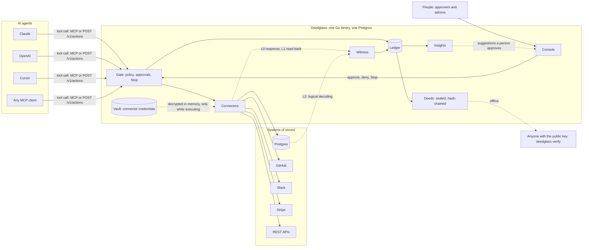
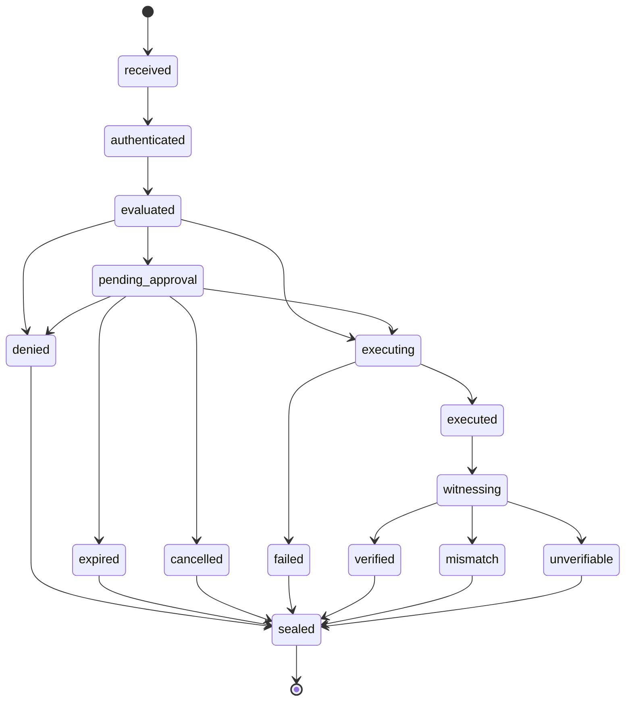

# Architecture

Version 1, written in S01 (2026-10-01). It describes the design the contract fixes, not what is built today; `docs/REPO_MAP.md` has the status of each package. Sources: `~/txv/ops/plan/prompts-v7/00_CONTRACT.md` and `~/txv/ops/plan/85_ALLOY_MASTER_PLAN_V7.md` §3.

Deedglass sits between your AI agents and the tools they use. The Gate decides what each agent may do and runs it under control. The Witness checks the result against the system of record. Every action ends as a sealed deed that anyone with the public key can check offline.

## The picture

One request, in words:

1. An agent sends a tool call with its API key, directly or through the MCP gateway.
2. The Gate authenticates the agent and evaluates policy: `allow`, `deny` or `require_approval`. Stop is checked first.
3. If approval is needed, a person approves or denies it in the Console, Slack or email.
4. The connector executes with credentials the agent never sees.
5. The Witness compares what the agent reported with what the target shows (L0, L1) or with what Postgres committed (L2), and gives a verdict.
6. The Ledger records every step, and the final state is sealed as a deed in the org's deed chain.

## Package map

Full list with status and owners: `docs/REPO_MAP.md`.

| Layer | Packages |
|---|---|
| Surfaces | `cmd/deedglass` (CLI), `httpx` (API), `mcp` (MCP stdio and Streamable HTTP), `console` (embedded web app), `pkg/deedglass` |
| Decide | `identity` (agents, keys, signed intents), `policy` and `sqlguard`, `approve` |
| Act | `gate` (pipeline and state machine), `connector/*`, `vault`, `connector/egress` |
| Check and record | `witness`, `decoder`, `deed`, `deed/archive`, `ledger` |
| Around the core | `notify`, `mailer`, `learn` (Insights) |
| Foundation | `store`, `config`, `ids`, `buildinfo` |

Layering rules, checked by `internal/archtest`:

- `ids` and `buildinfo` import only the standard library. `config` adds only the YAML library.
- `deed`, `policy`, `sqlguard` and `witness` are pure: none of them imports `net/http`, `database/sql`, `github.com/jackc/*`, `store` or `httpx`.
- Nothing in `internal/` imports `cmd/…`.

## The action lifecycle

This is contract §5, with exactly its edges. `internal/gate/state.go` holds the pure edge table, and a database trigger mirrors it.

- Every transition writes `actions.state`, a timestamp and an `action_events` row in one short transaction, before the next side effect.
- Execution never runs inside a database transaction.
- **Honest unknowns.** When Deedglass cannot know whether a tool ran (a timeout, a crash, a lost connection), the action goes `executing → executed` with `execution.status = unknown`, then `witnessing → unverifiable`. `failed` means the tool certainly did not apply. There is no other edge for this, and crash recovery never invents one.
- A later verdict never changes a sealed deed. It produces an amendment deed (`kind: amendment`, `amends: deed_…`).

Verdict precedence (contract §6): any violation gives MISMATCH; otherwise any gap gives UNVERIFIABLE; otherwise at least one clean pass gives VERIFIED. No checks gives UNVERIFIABLE.

## What each part does not do

**Gate**
- It does not give agents connector credentials. In gateway mode they stay in the vault and exist in plaintext only in memory, during execution.
- It does not run unknown tools. They are denied.
- It does not guess. An outcome it cannot know becomes UNVERIFIABLE, never VERIFIED or `failed`.

**Policy**
- It does not touch the network or the database while it evaluates, and it uses no model to decide. The same input gives the same decision.
- It does not make a well-formed, in-policy action from a hijacked agent safe. Policies narrow that risk; they do not close it.

**Approvals and Stop**
- A requester cannot approve their own action, and the first decision wins.
- Stop blocks new actions. It does not reverse actions that already ran.

**Connectors**
- They have no test or live mode in v1. `dg_test_` and `dg_live_` keys are recorded on each action but not enforced.
- They reach the outside world only through `connector/egress`, which refuses private and metadata addresses in prod.

**Witness**
- L2 (Witnessed) covers Postgres only in v1. Other connectors reach L0 or L1.
- It does not turn an evidence gap into MISMATCH, or anything short of a clean pass into VERIFIED.
- It does not see effects outside the Postgres WAL, and DDL can be blocked beforehand but not witnessed or undone.
- L1 shows what the target reports, not whether the action was a good idea.

**Deeds and the Ledger**
- Deeds carry digests, never payloads. To match a deed to a request, you need the original request.
- A sealed deed is never modified. History is append-only, and `ledger check` reports the first break with its seq and reason.
- Seal keys are one set per deployment in v1. Per-org seal keys are v2.
- The optional COSE_Sign1 encoding is a signed statement from your Deedglass instance. It is not an RFC 9942 transparency-log entry.

**Console**
- It holds no data of its own. It reads and acts through the same API as the CLI.

**Insights**
- It never activates enforce mode by itself. Every suggestion becomes a policy change only after a person approves it.
- An optional model may phrase a suggestion. It does not decide anything.

## What this page does not do

It does not specify formats or APIs. The deed format lands in S04–S05, the API conventions in S03, and the Witness in S19–S21. It does not describe the V0 transfer design; see `docs/v0/`.
