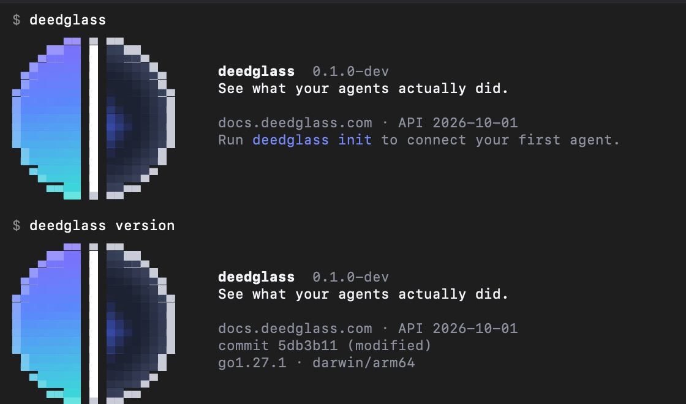
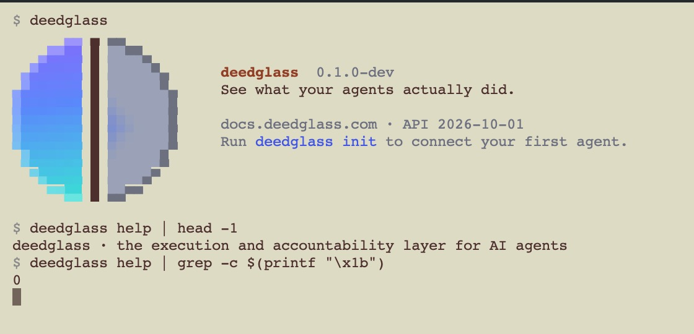

# The deedglass CLI

`deedglass` is one binary: the server (`deedglass serve`, from S03), the operator tools and the
client. This page covers how it behaves. `deedglass help` is always the source for what this build
can do.

## Principles

- **Calm and exact.** Short sentences, sentence case, no exclamation marks, no emoji.
- **Every error ends with a next step.**
- **Honest about what exists.** Every command in the contract is listed. A command that isn't built
  yet says so and exits 2; it never pretends to work.
- **Scriptable.** `--json` on every command, stable exit codes, colour only on a terminal.

## Global flags

Accepted anywhere before `--`, in any order:

| Flag | What it does |
|---|---|
| `--json` | One JSON object on stdout. Errors go to stderr in the API error shape. |
| `--server <url>` | The Deedglass server for client commands (or `DEEDGLASS_SERVER`). |
| `--api-key <key>` | The API key for client commands (or `DEEDGLASS_API_KEY`). Prefer the variable: flags show up in shell history. |
| `--org <id>` | The org, for people who belong to several. |
| `--no-color` | No colour, even on a terminal. |
| `-v`, `-vv` | More detail. |
| `-h`, `--help` | Help for the command it follows. |

## Exit codes

| Code | Meaning |
|---|---|
| 0 | OK |
| 1 | Failure, or invalid input or config |
| 2 | Usage error, unknown command, not built yet, or cannot determine |
| 3 | Not authenticated |

## Output and style

- **Symbols:** `✓` verified or valid (teal), `✕` mismatch, denied or error (red), `◐` pending
  (violet), `○` unverifiable or a notice (amber), `·` separators, `—` not set. Colour only repeats
  what the symbol and text already say.
- **Colour** only when stdout is a terminal, `NO_COLOR` is unset, `TERM` isn't `dumb`, and
  `--no-color` isn't given. It uses the 16 ANSI colours, so it follows your terminal theme.
- **Secrets** never print. `config print` shows `••••••••` for every secret and only the password
  of the database URL is hidden.

## JSON mode

With `--json`, a command writes one JSON object to stdout, with an `object` field, like the API.
Errors go to stderr in the API's error shape:

```json
{"error":{"type":"invalid_request_error","code":"not_built","message":"deedglass deeds export isn't in this build yet. Run deedglass help to see what this build can do.","doc_url":"https://docs.deedglass.com/errors/not_built"}}
```

CLI error codes so far: `unknown_command`, `usage_error`, `not_built`, `config_invalid` (with a
`problems` list), and `failed`; `deedglass verify` adds `input_unreadable`, `input_too_large`,
`keys_unreadable`, `keys_invalid`, `keys_unreachable` and `keys_conflict`. Its own answer is not an
error: `--json` prints the `verification_report` on stdout whatever the result.

## Setup: `init`, `doctor`, `scan` and `help --json` (S32)

- `deedglass init [--yes] [--client …] [--listen …] [--pg-port …] [--no-smoke] [--stop] [--json]` sets
  up a local Deedglass in Docker and runs three smoke actions; run it again and it says `Nothing to
  change.` [INIT_AND_DOCTOR.md](INIT_AND_DOCTOR.md) has every step.
- `deedglass doctor [--only db.*] [--json]`: sixteen read-only checks, each with a fix. Exit 1 on a
  problem, 3 when the server refused the API key.
- `deedglass scan [--dir .] [--postgres-dsn-env VAR] [--format md,html,json,sarif] [--score]
  [--badge] [--share] [--ci] [--fail-under A|B|C|D] [--json]`: what your agent setup can change,
  graded A to F, read-only and local. Exit 1 also means below `--fail-under`. [SCAN.md](SCAN.md).
- `deedglass help --json` prints the whole tree as one `command_tree` object: `groups` (the nine
  of contract §10) of `commands`, each with `path`, `summary`, `usage`, `built` and `flags` (`name`,
  `type`, `default`, `usage`, and `values` for closed lists such as `scan --format`), plus
  `global_flags` and `exit_codes`. S33 renders the CLI reference from it and S35 generates the shell
  completions from it; a golden locks the schema.
- Every built command passes the `--json` audit (exactly one JSON value; an `object` field; nothing
  on stdout when it fails; the error on stderr in the API envelope) and the error-copy audit
  (sentence case, a next step, no banned word): `go test ./cmd/deedglass -run 'Audit'`.

## Banner and quiet mode



The Deedglass mark, drawn in the terminal: the Split Orb in half-block pixels, a calm welcome and
one next step. It appears in exactly three places, and only on an interactive terminal:

| Where | What |
|---|---|
| `deedglass` (no command) | the banner, then `Run deedglass init to connect your first agent.` |
| `deedglass version`, `deedglass --version` | the banner, with commit, build date and platform as its last lines |
| `deedglass help` | the inline mark `◖│◗ deedglass` as the header line |

`init` and `doctor` will use the same mark from S32 (`internal/cli/mark`: `Banner`, `Inline`,
`Sealed`). Every other command stays quiet.

**It never shows** (bare `deedglass` prints the plain help instead, and `version` its plain line):

| Switch | Effect |
|---|---|
| stdout is not a terminal (a pipe, a file, `/dev/null`) | no banner, no inline mark, no escape codes, even when stderr is a terminal |
| `--json` | unchanged JSON, byte for byte |
| `CI` set (`true`, `1`, …; not `0`/`false`) | no banner |
| `DEEDGLASS_NO_BANNER=1` | no banner and no inline mark |
| `-q` / `--quiet` (bare `deedglass`, `version`) | no banner |

**How it looks:**

| Switch | Effect |
|---|---|
| `COLORTERM=truecolor` or `24bit` | 24-bit colour |
| `TERM=*256color` | the nearest xterm-256 colours (chosen by ΔE in OKLab when the grid is generated) |
| any other colour terminal | the 16 ANSI colours |
| `NO_COLOR` (non-empty) or `--no-color` | a monochrome orb in shades (`▓ │ ░`), no escape codes |
| `TERM=dumb`; the Windows console outside Windows Terminal | ASCII only: `(\|) deedglass` and the text |
| narrower than 60 columns | the inline mark and the text, no orb; under 40, the mark and one line |
| `DEEDGLASS_THEME=light` / `dark` / `auto` | the palette for a light or dark background; `auto` reads `COLORFGBG`, else dark |
| `DEEDGLASS_NO_ANIM=1` | the Sealed moment at the end of `init` (S32) shows only its final frame |

On a light theme the right half turns to light glass and the pane takes your terminal's foreground
colour:



The banner is decoration, never a dependency: if detection fails it falls back to plain output,
and it can never change an exit code. Scripts and CI never see it.

Notes: Terminal.app renders 24-bit colour but doesn't set `COLORTERM`, so it gets the 256-colour
orb unless you export `COLORTERM=truecolor`. The terminal isn't asked for its background colour
(OSC 11) in this build; set `DEEDGLASS_THEME=light` on a light terminal that doesn't set
`COLORFGBG`.

## Examples

```
$ deedglass polcy lint
✕ Unknown command "polcy". Did you mean "policy"?
  Run deedglass help to see every command.

$ deedglass verify deeds.jsonl --keys https://api.deedglass.com/.well-known/deedglass/keys.json
✓ 1,204 deeds · chain intact · 2 seal keys · 2026-10-01 → 2026-10-02

$ deedglass deeds export
deedglass deeds export isn't in this build yet.
Run deedglass help to see what this build can do.

$ deedglass executor serve
✕ "executor serve" was a V0 command. Its successor is deedglass serve (S03).
  See docs/NAMING.md for every renamed command.
```

## Commands

`soon (Snn)` means the command is in the contract but not in this build; Snn is the session that
builds it. Hidden commands work but aren't in `deedglass help`.

<!-- commands:begin (generated from cmd/deedglass/registry.go; go test ./cmd/deedglass -run TestDocsTree -update) -->
| Command | Group | What it does | Status |
|---|---|---|---|
| `deedglass init [--yes] [--dir .] [--client claude-code|claude-desktop|cursor|vscode|windsurf|sdk-python|sdk-typescript|none] [--listen 127.0.0.1:8080] [--pg-port 55432] [--no-open] [--no-smoke] [--stop] [--json]` | Setup | Set up Deedglass in this directory | built |
| `deedglass doctor [--only <ids>] [--json]` | Setup | Check config, database and keys | built |
| `deedglass scan [--dir .] [--postgres-dsn-env VAR] [--format md,html,json,sarif] [--score] [--badge] [--share] [--ci] [--fail-under A|B|C|D] [--json]` | Setup | Show what your agent setup can change | built |
| `deedglass serve [--migrate]` | Setup | Run the API, the Gate and the Console | built |
| `deedglass migrate up [--database-url <url>] [--dry-run] [--json]` | Setup | Apply database migrations | built |
| `deedglass migrate status [--database-url <url>] [--json]` | Setup | Show applied and pending migrations | built |
| `deedglass migrate verify [--database-url <url>] [--json]` | Setup | Check applied migrations against this build | built |
| `deedglass config print [--json]` | Setup | Show the effective config, secrets hidden | built |
| `deedglass version [--json] [--check]` | Setup | Show the client and server versions | built |
| `deedglass keys gen [--dir <dir>] [--json]` | Setup | Generate a seal key | built |
| `deedglass keys rotate [--overlap 5m] [--dir <dir>] [--json]` | Setup | Rotate the active seal key | built |
| `deedglass keys list [--server <url>] [--json]` | Setup | List seal keys | built |
| `deedglass vault status [--json]` | Setup | Show the credential vault's keys | built |
| `deedglass vault rotate [--json]` | Setup | Re-encrypt credentials with a new key | built |
| `deedglass help [<command>] [--json]` | Setup | Show help for deedglass or one command | built, hidden |
| `deedglass completion zsh` | Setup | Print zsh completion | soon (S35) |
| `deedglass completion bash` | Setup | Print bash completion | soon (S35) |
| `deedglass completion fish` | Setup | Print fish completion | soon (S35) |
| `deedglass agent create <name> [--description …] [--label env=prod]... [--calls-per-minute n] [--calls-per-day n] [--spend-per-day minor --currency usd] [--owner usr_…] [--json]` | Agents | Register an agent | built |
| `deedglass agent list [--status active|suspended|stopped] [--label env:prod] [--json]` | Agents | List agents | built |
| `deedglass agent show <name|agt_…> [--json]` | Agents | Show one agent | built |
| `deedglass agent suspend <name|agt_…> [--reason …] [--json]` | Agents | Suspend an agent | built |
| `deedglass agent resume <name|agt_…> [--reason …] [--json]` | Agents | Resume a suspended agent | built |
| `deedglass agent stop <name|agt_…> [--reason …] [--json]` | Agents | Stop an agent now | built |
| `deedglass agent start <name|agt_…> --reason "why it's safe now" [--json]` | Agents | Start a stopped agent | built |
| `deedglass agent keys create <name|agt_…> [--name "prod runner"] [--mode live|test] [--scope …]... [--json]` | Agents | Create an API key for an agent | built |
| `deedglass agent keys list <name|agt_…> [--json]` | Agents | List an agent's API keys | built |
| `deedglass agent keys roll <key_…> [--overlap 24h] [--json]` | Agents | Replace an API key, with an overlap | built |
| `deedglass agent keys revoke <key_…> [--reason …] [--json]` | Agents | Revoke an API key | built |
| `deedglass agent intent keygen <name> [--dir .deedglass/intent] [--force] [--json]` | Agents | Generate a signed-intent key pair | built |
| `deedglass agent intent add <name|agt_…> --public-key ed25519:… [--json]` | Agents | Register an intent public key | built |
| `deedglass agent intent list <name|agt_…> [--json]` | Agents | List an agent's intent keys | built |
| `deedglass agent intent remove <name|agt_…> <kid> [--json]` | Agents | Remove an intent key | built |
| `deedglass agent intent mode <name|agt_…> off|optional|required [--json]` | Agents | Require, allow or ignore signed intents | built |
| `deedglass org create --name "Acme" --owner-email priya@acme.com [--slug acme] [--print-link] [--admin-key] [--json]` | Agents | Create an org and its owner | built |
| `deedglass org login-link --email sam@acme.com [--org acme] [--json]` | Agents | Print a one-time sign-in link | built |
| `deedglass org keys create [--org acme] [--name ci] [--mode live|test] [--json]` | Agents | Create an org admin key | built |
| `deedglass org keys list [--org acme] [--json]` | Agents | List org admin keys | built |
| `deedglass org keys revoke <key_…> [--org acme] [--reason …] [--json]` | Agents | Revoke an org admin key | built |
| `deedglass org stop-all [--reason …] [--yes] [--json]` | Agents | Stop every agent in the org | built |
| `deedglass org start-all [--org acme] --reason "why it's safe now" [--json]` | Agents | Start every agent not stopped one by one | built |
| `deedglass policy lint <file|dir|->... [--format text|json|github] [--voice] [--json]` | Policies | Check a policy file | built |
| `deedglass policy fmt [-w] [--check] <file|dir|->... [--json]` | Policies | Format a policy file | built |
| `deedglass policy test <policy.yaml|cases.yaml>... [--cases <file>] | --dir <dir> [--require-coverage] [--voice] [--run <regexp>] [--json]` | Policies | Run a policy's test cases | built |
| `deedglass policy push <policy.yaml> [--notes "…"] [--json]` | Policies | Upload a new policy version | built |
| `deedglass policy activate <name|pol_…> --version <n> --mode enforce|shadow --reason "…" [--yes] [--ack default_allow] | --clear --reason "…" [--json]` | Policies | Activate a policy version | built |
| `deedglass policy evaluate --policy <file> | --server [--policy <name> --version <n>] --tool <name> [--sql …] [--args <json>] [--input <file>] [--agent …] [--label k=v] [--user …] [--time …] [--tz …] [--usage k=v] [--explain] [--json]` | Policies | Evaluate one action against a policy | built |
| `deedglass policy replay <name|pol_…> --version <n> [--from 7d] [--to now] [--baseline recorded|vN] [--wait] [--quiet] [--json]` | Policies | Replay past actions against a version | built |
| `deedglass policy diff <old.yaml> <new.yaml> | <policy> <vA> <vB> [--context 3] [--json]` | Policies | Compare two policy versions | built |
| `deedglass act <tool> [--args '{"k":"v"}'] [--mode gateway|proxy] [--wait 60s] [--idempotency-key K] [--json]` | Actions | Send a test action through the Gate | built |
| `deedglass actions list [--agent agt_…] [--tool stripe.*] [--state …] [--decision …] [--verdict MISMATCH] [--level L2] [--since 1h] [--q text] [--limit 25] [--cursor …] [--json] [--follow] [--connector orders]` | Actions | List actions | built |
| `deedglass actions show <act_…> [--wait] [--diff] [--json]` | Actions | Show one action, its events and its L2 diff | built |
| `deedglass actions cancel <act_…> [--json]` | Actions | Cancel a pending action | built |
| `deedglass approve <apr_…> --as <email> [--reason …] [--json]` | Actions | Approve a pending action | built |
| `deedglass deny <apr_…> --as <email> --reason "…" [--json]` | Actions | Deny a pending action | built |
| `deedglass approvals list [--status pending] [--agent <name>] [--limit 25] [--json]` | Actions | List approvals | built |
| `deedglass approvals show <apr_…> [--json]` | Actions | Show one approval | built |
| `deedglass undo preview <act_…> [--allow-triggers] [--steps N] [--json]` | Actions | Show what an undo would change | built |
| `deedglass undo run <act_…> --plan <sha256:…> --reason "…" [--allow-triggers] [--wait 25s] [--json]` | Actions | Undo an action | built |
| `deedglass webhooks create --url <url> --events approval.requested,approval.decided [--description …] [--json]` | Actions | Add a webhook endpoint | built |
| `deedglass webhooks list [--json]` | Actions | List webhook endpoints | built |
| `deedglass webhooks test <whk_…> [--json]` | Actions | Send a test event | built |
| `deedglass webhooks delete <whk_…> [--json]` | Actions | Remove a webhook endpoint | built |
| `deedglass verify <path|->... [--keys <file|url>] [--pin sha256:…] [--anchor <seq>:sha256:…] [--strict] [--all] [-q]` | Deeds | Check deeds offline | built |
| `deedglass deeds list [--from-seq n] [--to-seq n] [--kind action,admin,amendment] [--action act_…] [--order asc|desc] [--limit 25] [--json]` | Deeds | List deeds | built |
| `deedglass deeds show <deed_…|seq> [--json]` | Deeds | Show one deed | built |
| `deedglass deeds export [--out <file>|-] [--format tar.gz|jsonl] [--from-seq n] [--to-seq n] [--since 1h] [--json]` | Deeds | Export deeds as a bundle | built |
| `deedglass ledger check [--from-seq n] [--to-seq n] [--json]` | Deeds | Check the deed chain | built |
| `deedglass ledger prune [--older-than 90d] [--dry-run] [--yes] [--json]` | Deeds | Remove old payloads; deeds stay | built |
| `deedglass connector create --config <file> [--type rest] [--name orders] [--description …] [--json]` | Connectors | Add a connector | built |
| `deedglass connector list [--json]` | Connectors | List connectors | built |
| `deedglass connector show <name|con_…> [--json]` | Connectors | Show one connector | built |
| `deedglass connector test <name|con_…> [--json]` | Connectors | Test a connector's credentials | built |
| `deedglass connector types [--type stripe] [--json]` | Connectors | List connector types | built |
| `deedglass connector credentials set <name|con_…> --from-env VAR | --stdin | --field KEY=env:VAR|file:PATH|stdin... [--kind bearer] [--json]` | Connectors | Store a connector's credentials | built |
| `deedglass connector credentials remove <name|con_…> [--json]` | Connectors | Delete a connector's credentials | built |
| `deedglass connector postgres init --connector <name> [--admin-dsn-env DEEDGLASS_INIT_DSN] [--config <file>] [--apply] [--confirm <database>] [--rotate-passwords] [--dsn-host host:port] [--no-store] [--json]` | Connectors | Prepare a Postgres database | built |
| `deedglass connector postgres check --connector <name> [--json]  ·  --dsn-env VAR [--witness-dsn-env VAR] [--config <file>] [--probe] [--json]` | Connectors | Check a prepared Postgres database | built |
| `deedglass connector gmail authorize <name> --client-file ./client_secret.json [--readonly] [--no-browser] [--json]` | Connectors | Authorize the Gmail connector | built |
| `deedglass decoder status [--connector <name>] [--recent N] [--json]` | Connectors | Show what the decoder reads from Postgres | built |
| `deedglass decoder drop --connector <name> [--confirm <name>] [--json]` | Connectors | Drop a connector's replication slot | built |
| `deedglass slack manifest --base-url <https://host> [--name Deedglass] [--json]` | Connectors | Print the Slack app manifest | built |
| `deedglass mcp wrap --connector <name> [--connector-type mcp] [--hide-denied=false] [--call-timeout 2m] [--result-mode full|digest] [--log-file <path>] -- <command> [args…]` | MCP | Run an MCP server behind the Gate | built |
| `deedglass mcp serve [--connector native|<name>]` | MCP | Serve the Gate's native MCP tools | built |
| `deedglass mcp snippet --client <claude-desktop|claude-code|cursor|windsurf|vscode> --connector <name> [--connector-type postgres] [--api-key-from-env] -- <command> [args…]  ·  --transport http --client <…> [--connector native|<name>]` | MCP | Print client config for an MCP client | built |
| `deedglass insights stats [--window 7d|30d | --from … --to …] [--by rule|tool|agent|none] [--agent agt_…] [--tool stripe.*] [--compare] [--json]` | Insights | Show decisions, approvals and verdicts by rule | built |
| `deedglass insights shadow [--shadow-version pv_…] [--from …] [--to …] [--json]` | Insights | Show where the shadow policy disagrees | built |
| `deedglass insights anomalies [--status open|acknowledged|resolved|all] [--agent agt_…] [--kind volume_spike] [--days 14] [--limit 50] [--json]` | Insights | List anomalies | built |
| `deedglass insights detect [--org org_…|slug] [--backfill 7d] [--json]` | Insights | Run anomaly detection now | built |
| `deedglass insights settings [--anomaly-facts on|off] [--active-minutes 60] [--stale-minutes 15] [--llm-phrasing on|off] [--llm-cap-cents 200] [--digest owners|admins|off] [--reason "…"] [--json]` | Insights | Show or change Insights settings | built |
| `deedglass insights suggestions list [--status open|accepted|rejected|superseded|all] [--kind loosen|tighten|budget|explicit_rule|advisory] [--limit 25] [--json]` | Insights | List suggestions | built |
| `deedglass insights suggestions show sug_… [--no-diff] [--json]` | Insights | Show one suggestion | built |
| `deedglass insights suggestions accept sug_… [--reason "…"] [--replace-shadow] [--json]` | Insights | Accept a suggestion into shadow | built |
| `deedglass insights suggestions reject sug_… --reason "…" [--json]` | Insights | Reject a suggestion | built |
| `deedglass insights suggestions generate [--json]` | Insights | Generate suggestions now | built |
| `deedglass insights digest --preview [--org org_…|slug] [--html /tmp/digest.html] [--json]` | Insights | Preview the weekly digest | built |
| `deedglass dev seed [--demo [--keys-file <path>] [--approver <email>]] [--json]` | Dev | Load demo data into a dev database | built |
| `deedglass dev fake-action [--n 20] [--seed 42] [--kinds allow,deny,…] [--agents 3] [--batch 1] [--pace 0s] [--org-slug demo] [--quiet] [--json]` | Dev | Seal realistic fake actions (dev only) | built |
| `deedglass dev simulate [--scenario examples/sim/acme.yaml] [--days 7] [--end now|-2d] [--seed 7] [--org org_… | --org-slug acme-sim] [--append] [--pace 0s] [--quiet] [--json]` | Dev | Simulate a week of agent traffic (dev only) | built |
| `deedglass dev agent-script` | Dev | Run a scripted agent | soon (S37) |
| `deedglass dev mail-preview login|invite|approval|approval-foureyes [--out /tmp/login.html] [--json]` | Dev | Preview emails in the browser | built |
| `deedglass dev sign-intent --key <pem> --tool stripe.refund --args '{…}' [--org org_… --agent agt_…] [--obo …] [--session …] [--ttl 60s] [--explain] [--json]` | Dev | Sign an intent with a local key | built |
| `deedglass dev stripe-fixtures [--from-env STRIPE_TEST_KEY] [--connector stripe] [--out examples/demo/.stripe-fixtures.json] [--json]` | Dev | Create Stripe sandbox fixtures | built |
| `deedglass dev id <prefix>` | Dev | Print a fresh id for a prefix | built, hidden |
<!-- commands:end -->

## Seal keys

`deedglass keys gen | rotate | list` manage the keys deeds are sealed with (`docs/SEAL_KEYS.md`).

| Command | Needs | Output | Exit |
|---|---|---|---|
| `keys gen [--dir <dir>]` | nothing (offline) | the key id, the file (0600), its thumbprint, and the `export DEEDGLASS_SEAL_KEY_FILE=…` line | 0; 1 when the file can't be written |
| `keys rotate [--overlap 5m] [--dir <dir>]` | `DEEDGLASS_DATABASE_URL` | the new active key, when each old key retires, and what to restart | 0; 1 when the database refuses (the new file is removed); 2 for an overlap outside 1s to 168h |
| `keys list` | `DEEDGLASS_DATABASE_URL` | every key, newest first, with status, activation, retirement and thumbprint | 0; 1 when the database is unreachable |
| `keys list --server <url>` | nothing | the server's public `keys.json`, checked like a verifier does | 0; 1 when unreachable or a key is unsafe |

`--json` prints the `seal_key_set` (list), a `seal_key_rotation` (rotate) or a `seal_key_file`
summary without the seed (gen). Thumbprints show as `sha256:3f9a…c21e` for people and in full in
JSON.

## Verify

`deedglass verify` checks deeds offline (S05; the auditor's guide is `docs/VERIFYING_DEEDS.md`). No
database, no account, no telemetry; the network only for a `--keys` URL.

```
deedglass verify <path|->... [flags]
```

| Input | Detected by | Handling |
|---|---|---|
| `-` | the argument | stdin: a bundle by its gzip magic bytes, else one deed or JSONL |
| `bundle.tar.gz` | gzip magic bytes, not the name | export bundle v1 (`docs/BUNDLE_FORMAT.md`), streamed, nothing written to disk |
| `deeds.jsonl` | the `.jsonl` name, or several lines of compact deeds | one envelope per line, checked as one chain; a blank line is `malformed` |
| `deed.json` | one top-level value | one deed, checked on its own (its seal, and the genesis link at seq 1); pretty-printed is fine |
| a directory | `stat` | every `*.json` / `*.jsonl` in it (no recursion, no symlinks, at most 100,000 files), sorted by org and seq, one chain per org |
| `deed.cose` | the `.cose` name and CBOR tag 18 | the optional COSE_Sign1 encoding, checked on its own |

Several `.jsonl` or bundle inputs are one chain, in the order given: the second must start where
the first ended. Loose `.json` deeds are checked one by one, and the headline says
`chain not checked`.

| Flag | What it does |
|---|---|
| `--keys <file\|https URL>` | The seal key set (repeatable; merged by key id, and the same id with different content refuses everything). Keys you choose are **pinned**. |
| `--pin sha256:…` | Accept only keys with this thumbprint (repeatable); works on any key set, the bundle's included. |
| `--org <org_…>` | The org every deed must belong to (the global flag). |
| `--anchor <seq>:sha256:…` | The `body_hash` of the deed just before the first one given (a partial export). |
| `--strict` | Require canonical bytes (`non_canonical`) and pinned keys (exit 2 without them). |
| `--all` | List every failure (at most 100) instead of stopping at the first. |
| `--max-bytes <n>` | The largest `deeds.jsonl` a bundle may hold (default 8 GiB). |
| `-q`, `--quiet` | Print nothing; the exit code is the answer. |
| `--json`, `-v`, `--no-color` | The global flags: the full report, details, no colour. |

Keys, highest trust first: `--keys` (pinned), `--pin` (pinned), the bundle's own `keys.json` (not
pinned: integrity, not authenticity, and the output says so), none (`keys_missing`, exit 2).

| Situation | Headline | Exit |
|---|---|---|
| Every check passes, keys pinned | `✓ … chain intact …` | 0 |
| Every check passes, bundle keys only | `✓ …` then `○ Seal keys came from the bundle itself …` | 0 (2 with `--strict`) |
| Any deed, chain or bundle failure | `✕ …` with the deed, the reason and the next step | 1 |
| A deed names a key that is not in the given key set | `✕ … not in the key set.` (`seal_key_unknown`) | 1 |
| No key set at all | `○ Cannot check deed 1: no seal keys were given.` | 2 |
| A newer deed format | `○ Deed 1 uses deed format v2. …` | 2 |
| A `--keys` URL unreachable, too large or redirected elsewhere | `○ Could not fetch seal keys from <host> (…)` | 2 |
| A usage error or an unreadable file | `✕ …` and what to do | 2 |

Every string that came from a deed or a file is shown safely on a terminal: control characters,
`ESC` and bidi overrides print as `\u001b`-style escapes, so a deed cannot recolour a line or fake a
`✓`. `--json` keeps the exact strings.

`--json` prints a `verification_report`:

| Field | Meaning |
|---|---|
| `result` | `valid`, `invalid` or `cannot_determine` |
| `deeds`, `intact` | deeds read (stops at the first failure without `--all`), deeds that passed every check |
| `org`, `first_seq`, `last_seq`, `from`, `to` | what the intact deeds cover |
| `chain` | `{status: intact\|broken\|not_checked, anchor: {kind: genesis\|deed\|none, seq, body_hash}}` |
| `seal_keys` | each key used: `{id, thumbprint, deeds, first_seq, last_seq, source}` |
| `keys_pinned` | whether the keys came from you (`--keys`, `--pin`) |
| `kinds`, `verdicts_recorded` | counts by deed kind, and by the Witness verdict written in each deed (`verify` does not re-run the Witness) |
| `bundle` | `{manifest: ok\|mismatch, manifest_seal: ok\|missing\|invalid, sealed_by, files, input}` or null |
| `failures` | `{code, seq, deed, input, line, field, expected, computed, message, next}`; `expected`/`computed` are the hashes for `body_hash_mismatch` |
| `warnings` | `{code, message, next}`: `keys_not_pinned`, `manifest_unsealed`, `test_keys` |
| `duration_ms`, `verifier` | how long it took, and which build checked |

Performance (S05 §3.9; `make bench-verify`, raw numbers in `bench/results/`): 100,000 deeds in
2.4 s wall with 71 MB peak RSS as `.jsonl`, 2.4 s as a bundle, one deed in under 10 ms, on an Apple
M1 (8 cores), 2026-10-01.

## Actions, deeds and the Ledger

These run in direct database mode (`DEEDGLASS_DATABASE_URL`, the runtime role); API mode
(`--server`, `--api-key`) arrives with S09's keys. With one org in the database they use it;
with several, `--org <id or slug>` is required (the error lists them). Text output is for people
(relative times, short ids); `--json` prints exactly the API's objects (RFC 3339 times, full ids).
Full reference: [LEDGER.md](LEDGER.md), [RETENTION.md](RETENTION.md).

| Command | Does | Exit |
|---|---|---|
| `actions list [--agent] [--tool stripe.*] [--state] [--decision] [--verdict] [--level] [--on-behalf-of] [--since 1h] [--q text] [--limit 25] [--cursor]` | newest first; the footer says `5 of 1,204` and prints the next page's command | 0; 2 for a bad filter |
| `actions show <act_…> [--wait]` | the decision, execution, witness (with the diff sentence), the witness `history` when an amendment deed exists (S21), deeds and the event path; `--wait` (S13) re-reads it until it is sealed or waiting for a person (an action already waiting waits for its next change), at most 25 s | 0; 1 when not found |
| `actions show <act_…> --diff [--json]` | S21: the claim, then L2's expected and observed lines, the changed rows (expected first) and the "Witnessed by Postgres" footer ([witness/DIFFS.md](witness/DIFFS.md)); `--json` prints the `witness_detail` | 0; 1 when not found or not witnessed yet |
| `deeds list [--from-seq] [--to-seq] [--kind] [--action] [--order asc|desc]` | deeds by seq | 0 |
| `deeds show <deed_…|seq>` | a summary; `--json` prints the stored bytes verbatim | 0; 1 when not found |
| `deeds export [--out <file>|-] [--format tar.gz|jsonl] [--from-seq] [--to-seq] [--since 1h]` | a sealed export bundle (or `.jsonl`), written to a temporary file and renamed at the end; `--out -` writes to stdout for `deedglass verify -`, with the summary on stderr; `--since` keeps the deeds issued in that window (S13) | 0; 1 for an empty range (nothing is written) |
| `ledger check [--from-seq] [--to-seq]` | the chain check, with the head to keep elsewhere | 0 intact; 1 broken; 2 incomplete |
| `ledger prune [--older-than 90d] [--dry-run] [--yes]` | removes payloads of old sealed actions and seals a `ledger.pruned` deed | 0; 1 not confirmed or another prune running; 2 without `--yes` off a terminal |
| `dev fake-action [--n 20] [--seed 42] [--kinds …] [--agents 3] [--batch 1] [--pace 0s] [--org-slug demo] [--quiet]` | realistic actions through the real deed path (below) | 0; 1 outside `DEEDGLASS_ENV=dev` |

```
$ deedglass actions list --limit 5
TIME     AGENT         TOOL                    DECISION   WITNESS             LATENCY
2m ago   support-bot   postgres.execute        allow      ✕ L2 · MISMATCH     41 ms
3m ago   support-bot   stripe.create_refund    approval   ◐ pending           —
3m ago   billing-bot   stripe.create_refund    deny       ✕ denied            —
4m ago   ops-bot       github.create_issue     allow      ✓ L1 · VERIFIED     212 ms
5m ago   ops-bot       postgres.query          allow      ✓ L2 · VERIFIED     8 ms
5 of 1,204 · next page: deedglass actions list --cursor eyJpZCI6…
```

Chips follow the brand (§12): `✓ L2 · VERIFIED` teal, `✕ L2 · MISMATCH` bold red, `✕ denied`
plain red, `◐ pending` violet, `○ L1 · UNVERIFIABLE` amber; allowed and executed stay neutral on
purpose. Colour only repeats what the symbol and words already say.

### `dev fake-action`

Dev only: it refuses unless `DEEDGLASS_ENV=dev`, before it reads any config or opens the database,
and prints the database it writes to. It finds or creates the demo org (`--org-slug demo`, or an
existing org with `--org`) and `--agents` demo agents, then walks every action through legal edges
only (`ledger.Transition`) and seals it (`ledger.SealAction`), so the events fire and every deed is
real.

- **Deterministic:** `--seed` (PCG) fixes the tools, arguments, latencies and verdicts; ids and
  times are real.
- **Mix** (`--kinds` restricts it): 60% allowed and VERIFIED (L0 40%, L1 25%, L2 35%), 12% denied
  (`block-destructive-sql`, `refund-limit`, `budget`), 6% L2 MISMATCH on `postgres.execute`, 8%
  UNVERIFIABLE (`timeout`), 6% failed (`upstream_error`, `timeout`), 5% left waiting for approval
  (not sealed), 3% sealed UNVERIFIABLE then amended to VERIFIED in its own amendment deed.
- **Tools** are the canonical connector names: `postgres.query`, `postgres.execute`,
  `stripe.create_refund`, `github.create_issue`, `github.merge_pr`, `slack.post_message`,
  `gmail.create_draft`, `notion.create_page`, `orders.get`.
- `--pace 200ms` spaces actions for live demos. `--batch 500` walks actions in parallel
  transactions and seals them in order, 500 per transaction (bulk seeding).
- Nothing calls a real tool. `executing_at` is set back by the simulated latency so deeds show a
  realistic `latency_ms`; every other time is the database clock.

## The Gate: `act` and `actions cancel` (S13)

Both talk to the server's API (`--server`, `DEEDGLASS_SERVER`, `DEEDGLASS_BASE_URL`, then
`http://127.0.0.1:8080`) with an **agent's** API key (`--api-key` or `DEEDGLASS_API_KEY`; create one
with `deedglass agent keys create <agent>`). `act` is a dev helper: it sends one action through the
Gate exactly as an SDK would, follows it until it is sealed (or `--wait` passes), and prints it.
Full reference: [GATE.md](GATE.md).

| Command | Does | Exit |
|---|---|---|
| `act <tool> [--args '{…}'] [--mode gateway|proxy] [--wait 60s] [--idempotency-key K]` | `POST /v1/actions`, then `GET /v1/actions/{id}?wait=` while it is still processing | 0 executed (VERIFIED or UNVERIFIABLE) or authorized (proxy); 1 denied, failed, MISMATCH, expired or cancelled; 2 pending approval or still processing; 3 no key |
| `actions cancel <act_…>` | `POST /v1/actions/{id}/cancel`: a pending action becomes cancelled and is sealed | 0; 1 when it can't be cancelled (already executing, or done) |

```
$ deedglass act fake.echo --args '{"message":"hello"}'
✓ executed · fake.echo · 4 ms
  action   act_01j9zq3m8x2k7w4c5v6b7n8p9r
  witness  L0 · VERIFIED · the tool reported success
  deed     deed_01j9zq3m… · seq 128 · sealed

$ deedglass act fake.write --args '{"rows":301,"table":"orders"}'
✕ denied · fake.write
  Blocked by policy "no-bulk-writes": writes over 100 rows need a person, not an agent.
  action   act_01j9zq4…
  deed     deed_01j9zq4… · seq 129 · sealed
  Next: change the rule in Console › Policies, or ask an admin to run it by hand.

$ deedglass act fake.write --args '{"rows":1,"table":"approvals"}'
◐ pending approval · fake.write
  Waiting for approval under policy "writes-need-approval": Writes wait for a human. Expires 10:12 IST.
  approval apr_01j9zq5…
  Next: approve it in Console › Approvals, then run: deedglass actions show act_01j9zq5… --wait

$ deedglass act fake.slow --args '{"_fake":{"latency_ms":45000}}'
○ executed · fake.slow · 30.0 s
  UNVERIFIABLE · The tool did not answer within 30.0 s. It may have run.
  deed     deed_01j9zq6… · seq 131 · sealed
  Next: check the target system by hand, or raise gate.execute_timeout.
```

L0 always says its method in words ("the tool reported success"), so it never reads like an
independent check. `--json` prints the action object (for a refusal, the sealed action from
`error.action`) with the same exit codes. The output is pinned in `testdata/gate/cli/` (TTY colour
and plain), regenerated with `go test -tags integration ./cmd/deedglass -run TestGateLive -update`
on a throwaway cluster.

## Connectors and the vault (S16)

The connector commands talk to the server with an org admin key (`DEEDGLASS_API_KEY`), like the
agent commands ([CONNECTORS.md](CONNECTORS.md)):

```text
$ deedglass connector create --config examples/connectors/orders.yaml
✓ Connector created · orders · con_01j9zq7c4m8x2v6t0r3n5k1h7d
  2 tools · orders.get (read) · orders.update_status (write)
  ○ No credentials yet. Next: deedglass connector credentials set orders --from-env ORDERS_TOKEN

$ deedglass connector credentials set orders --from-env ORDERS_TOKEN
✓ Credentials stored · orders · bearer · …9f2c · encrypted with kek:3f9a1c2b7d8e
  Agents never see this value. Deedglass adds it only when the Gate runs a call.

$ deedglass connector test metadata-probe
✕ metadata-probe · destination blocked · 12 ms
  ✕ destination   metadata.attack.test → 169.254.169.254 · cloud metadata
    Deedglass never connects to cloud metadata addresses, even in dev. Point base_url at the service's public address.
    https://docs.deedglass.com/errors/destination_blocked
```

- `connector create --config <file>` takes a YAML or JSON file holding `type`, `name` and `config`
  (or a bare config with `--type` and `--name`).
- `connector list`, `connector show <name|con_…>` and `connector types` read; `connector test`
  exits 1 when a check fails.
- `connector credentials set <name>` takes the value only from `--from-env VAR`, `--stdin` or
  `--field KEY=env:VAR|file:PATH|stdin` (repeatable, for basic auth and `fields`). There is no
  value flag: flag values land in shell history and `ps`. An empty variable answers `ORDERS_TOKEN
  is empty or unset. Export it in this shell and run the command again. Deedglass never reads
  secrets from flags.` `--kind` defaults to the config's `auth.kind`.
- `connector credentials remove <name>` crypto-shreds the credential.

`deedglass vault status` and `deedglass vault rotate` run on the server host, like `migrate`: they
read `DEEDGLASS_DATABASE_URL` and `DEEDGLASS_VAULT_KEY` (and the seal key, to seal `vault.rotated`)
and print key ids and counts only ([VAULT.md](VAULT.md)):

```text
$ deedglass vault rotate
◐ Rewrapping data keys · 42 of 42
✓ All 42 credentials use kek:3f9a1c2b7d8e. You can remove kek:77c0e1a9b442 from DEEDGLASS_VAULT_KEY.
```

Every command takes `--json`.

## Postgres: `connector postgres init` and `connector postgres check` (S17)

`init` prepares a customer database for the Postgres connector; `check` reports whether it is ready
for L2 ([POSTGRES.md](POSTGRES.md)). The admin DSN comes only from the environment
(`DEEDGLASS_INIT_DSN`, or the variable `--admin-dsn-env` names), is read once, and is never stored or
printed.

```text
$ deedglass connector postgres init --connector postgres
Deedglass · Postgres setup plan · acme on 127.0.0.1:55434 · PostgreSQL 18.6 · local
  + role deedglass_owner · NOLOGIN
  + role deedglass_agent · password generated at apply
  + role deedglass_witness · REPLICATION · password generated at apply
  + schema deedglass · ledger · begin_action (sha256:2f3f…7bd4)
  + grants · read public (5 tables) · write public.orders, public.refunds
  + replica identity full · 3 watched tables · brief lock on each
  + publication deedglass_pub · 4 tables
7 changes · SQL for review: .deedglass/plans/postgres-20261001T2125Z.sql
Next: deedglass connector postgres init --connector postgres --apply
```

- `--apply` runs the plan in one transaction: right away for a local host or a config with
  `throwaway: true`, otherwise only with `--confirm <database>` (on a terminal it asks; without one
  it refuses).
- New login roles get generated passwords, sent to Postgres as SCRAM verifiers; `--rotate-passwords`
  replaces both. The roles are cluster-wide, so rotating them changes the passwords of every
  connector whose database is on the same cluster ([shared roles](POSTGRES.md#shared-roles-on-one-cluster)). The DSNs go to the vault, or with `--no-store` to `.deedglass/pg-<connector>.env`
  (mode 0600). `--dsn-host host:port` stores the address the server uses when it differs from the
  admin DSN's.
- `--config <file>` plans offline from a connector file, without the server.
- A second run on an unchanged database prints `Nothing to change.`

`check --connector <name>` runs on the server with the stored DSNs; `check --dsn-env VAR
[--witness-dsn-env VAR] [--config <file>] [--probe]` runs the same checks from this machine, and
`--probe` also runs `begin_action` in a transaction it rolls back. It exits 1 when any line fails:

```text
$ deedglass connector postgres check --connector postgres
PostgreSQL 18.6 · acme · orders-db · self-hosted
✓ wal_level          logical
✓ begin_action       security definer · search_path pinned · body sha256:2f3f…7bd4
✓ agent role         least privilege · 2 writable tables · no ledger access
○ slot               not created yet · the witness creates deedglass_01m3wnr88j9d4gbs3fxm0ypb66 on first start
Ready for L2 · 14 passed · 3 notes · 0 failed
```

## The decoder: `decoder status` and `decoder drop` (S20)

Both talk to the server with an admin key (or a session's role: viewers can read, admins drop).

- `deedglass decoder status` prints one line per witnessed connector: `✓ healthy` with the lag and
  the last commit, `○ degraded` with why and a next step, `✕ halted` with what was lost and how to
  recover, `◐ connecting`, `waiting` or `pending`. It exits 1 when any decoder is halted, so a
  monitor can run it.
- `--connector <name>` shows one decoder in detail: the slot, the server version, lag and
  checkpoint, the watched tables, the frame counters per class and, with `--recent N` (0 to 50), the
  newest frames with their action and row counts. `--json` prints the decoder object of
  `GET /v1/connectors/{id}/decoder` (a list without `--connector`).
- `deedglass decoder drop --connector <name>` drops the connector's replication slot after you type
  the connector's name (`--confirm <name>` in scripts; without a terminal it refuses). It seals
  `decoder.slot_dropped`; the next sync creates a new slot and reconcile records the actions in the
  gap as missing. Goldens: `cmd/deedglass/testdata/decoder/`.

## MCP: `mcp wrap` and `mcp snippet` (S14)

`deedglass mcp wrap --connector <name> -- <command> [args…]` runs an MCP server behind the Gate
for an MCP client: every `tools/call` goes to `POST /v1/actions` in proxy mode first and runs only
when it is authorized ([MCP.md](MCP.md)). Its stdout belongs to the client and carries JSON-RPC and
nothing else; its own lines go to stderr and `~/.deedglass/logs/mcp-<connector>.log`. It takes an
agent's key (`DEEDGLASS_API_KEY` or `--api-key`) and the server (`DEEDGLASS_SERVER` or
`--server`); http is refused for anything but a loopback address. `--fail-open` works only with
`DEEDGLASS_ENV=dev` and otherwise exits 2:

```text
$ DEEDGLASS_ENV=prod deedglass mcp wrap --connector scratch --fail-open -- npx -y @modelcontextprotocol/server-filesystem /tmp/deedglass-demo
✕ --fail-open is for local development only.
  Set DEEDGLASS_ENV=dev to use it.
```

`deedglass mcp snippet --client <claude-desktop|claude-code|cursor|windsurf|vscode> --connector <name> -- <command> [args…]`
prints the client's config with absolute paths and `PATH` ([MCP_CLIENTS.md](MCP_CLIENTS.md));
`--connector-type` is copied into the wrap command, and `--api-key-from-env` puts
`DEEDGLASS_API_KEY` in place of the placeholder. `deedglass help mcp wrap` lists every flag.

### `mcp serve`, `mcp snippet --transport http` (S15)

`deedglass mcp serve [--connector native|<name>]` bridges a stdio MCP client (Claude Desktop) to the
Gate's HTTP endpoints: every line from stdin is one POST to `/mcp/native` (or `/mcp/<name>`) with
the agent's key (`DEEDGLASS_API_KEY`) and the MCP headers; every answer is one line on stdout. It
runs no tools and holds no credentials but the key; stdin EOF exits 0. With the server down, a tool
call answers `Deedglass could not be reached at http://127.0.0.1:8080, so this was not run. Start
it with "deedglass serve", then try again.`

`deedglass mcp snippet --transport http --client <client> [--connector native|<name>]` prints config
for the HTTP endpoints instead of a wrapped server: `claude mcp add --transport http …` for Claude
Code, `url` + `headers` for Cursor, `type: http` with a password prompt for VS Code, `serverUrl`
for Windsurf, and the `mcp serve` bridge for Claude Desktop ([MCP_CLIENTS.md](MCP_CLIENTS.md)).

### `actions list --follow` (S15)

`deedglass actions list --follow [--connector orders] [--agent agt_…]` prints one line per action
created after it started, when it waits for a person and when it is sealed. It polls the Ledger
once a second in direct database mode (S24 moves it to the event stream); Ctrl-C exits 0.

```text
$ deedglass actions list --follow --connector orders
Following actions · org acme-demo · connector orders · Ctrl-C to stop
10:14:03  ✓ orders.execute_sql   allowed   41 ms    L0 · VERIFIED        act_01j9zw3k…
10:14:21  ✕ orders.execute_sql   denied    block-destructive-sql         deed_01j9zw4m…
10:14:37  ✕ orders.execute_sql   denied    no-deletes-on-orders          deed_01j9zw5p…
10:14:52  ◐ orders.execute_sql   waiting   orders-writes-need-approval   apr_01j9zw6q…
```

`--connector X` is `--tool 'X.*'`; it doesn't take `--json` or `--cursor`.
(`testdata/cli/actions-follow.txt` pins the format.)

### `dev seed --demo` (S15)

`deedglass dev seed --demo [--keys-file examples/demo/.demo-keys]` loads the Acme demo org
(`acme-demo`, owner `founder@example.test`), agents `claude-desktop`, `claude-code` and `cursor`
with one `dg_test_` key each (shown once: written to the keys file, mode 0600), and the
`acme-demo` policy enforced with its activation deed. Running it again changes nothing; an agent
missing from the keys file gets a new key. `make demo-up` runs it ([examples/demo](../examples/demo/README.md)).

## People: `org create`, `org login-link`, `dev mail-preview`

`org create` and `org login-link` are operator commands: they use the database directly
(`DEEDGLASS_DATABASE_URL`), like `migrate`, and seal admin deeds with the seal key.

```
$ deedglass org create --name "Acme" --owner-email priya@acme.com
✓ Org created · Acme · org_01k6h7kp6msmzrhdzwtcr3jnkp
✓ Owner · priya@acme.com · usr_01k6c9kb2zcjsyn7b8g2k1vqvp
✓ Deed sealed · org.created · deed_01k6vrddq2atgb2023qvhhct3g

  Sign-in link for priya@acme.com (works once, expires in 15 minutes):
  http://127.0.0.1:8080/auth/confirm#t=OEVkbr-q18qimgaDkbcE5mnZqQ2a1zGG7_TgYq8PKFc

  Next: open the link, then register your first agent with `deedglass agent create`.

$ deedglass org create --name "Acme" --owner-email priya@acme
✕ "priya@acme" isn't a complete email address. Use the form name@company.com.      (exit 2)

$ deedglass org login-link --email sam@acme.com
✓ Sign-in link issued · sam@acme.com · Acme
✓ Deed sealed · login_link.issued · deed_01k6…
  https://app.deedglass.com/auth/confirm#t=…
  Anyone with this link can sign in as sam@acme.com for 15 minutes. Send it privately.
```

- `org create` writes the org, the owner, the membership and the `org.created` deed in one
  transaction. `--slug` defaults to one made from the name. In prod it emails the owner (or prints
  the link with `--print-link`); in dev it always prints the link.
- `org login-link` uses `--org` (an id or a slug), else the person's most recently used org. A
  pending invitee gets an invite link (7 days).
- `dev mail-preview login|invite [--out file.html]` renders the email with sample data and writes the
  HTML and a `.txt` next to it.
- `--json` prints the objects (the link included for `login-link`, and for `org create` when printed).

## Signed intents: `agent intent` and `dev sign-intent`

The spec is [INTENTS.md](INTENTS.md). `keygen` and `dev sign-intent` run locally, on the machine
that runs the agent: the private key never leaves it. `add`, `list`, `remove` and `mode` call the
API with an org admin key (`--api-key` or `DEEDGLASS_API_KEY`, and `--server`), like the other
`agent` commands. Every command takes `--json`.

| Command | Flags | Does | Exit |
|---|---|---|---|
| `agent intent keygen <name>` | `--dir .deedglass/intent` (created 0700), `--force` (replace an existing file) | writes `<dir>/<name>.pem` (PKCS#8 PEM, mode 0600, never through a symlink) and prints the public key and kid | 0; 1 when the file exists or can't be written |
| `agent intent add <name\|agt_…>` | `--public-key ed25519:…` (required) | registers the key; seals `agent.intent_key_added` | 0; 1 when the server refuses (422 unsafe key, 409 a third or duplicate key); 2 without `--public-key` |
| `agent intent list <name\|agt_…>` | | the agent's mode and keys: kid, public key, when added and by whom | 0 |
| `agent intent remove <name\|agt_…> <kid>` | | removes the key; seals `agent.intent_key_removed` | 0; 1 for an unknown kid, or the last key of a `required` agent |
| `agent intent mode <name\|agt_…> off\|optional\|required` | | changes the mode; seals `agent.intent_mode_changed` (nothing when unchanged) | 0; 1 for `required` with no keys; 2 for an unknown mode |
| `dev sign-intent` | `--key <pem>`, `--tool`, `--args` (required); `--org`, `--agent`; `--obo`, `--session`; `--ttl 60s` (at most 5m); `--explain`; `--now <RFC 3339>` and `--nonce <32 hex>` (tests and vectors only) | signs one intent and prints the `Deedglass-Intent` header | 0; 1 when the key can't be read or the arguments can't be signed; 2 for a usage error |

```
$ deedglass agent intent keygen support-bot
✓ Intent key created · support-bot · kid 21fe31dfa154a261626bf854046fd227
  Private key  .deedglass/intent/support-bot.pem (mode 0600). Keep it with the agent; it never goes to Deedglass.
  Public key   ed25519:11qYAYKxCrfVS_7TyWQHOg7hcvPapiMlrwIaaPcHURo
  Next: deedglass agent intent add support-bot --public-key ed25519:11qYAYKxCrfVS_7TyWQHOg7hcvPapiMlrwIaaPcHURo

$ deedglass agent intent add support-bot --public-key ed25519:11qYAYKxCrfVS_7TyWQHOg7hcvPapiMlrwIaaPcHURo
✓ Intent key registered · support-bot · kid 21fe…d227 · deed_01k6… sealed
  support-bot doesn't check signed intents yet. Check them when sent, or require them:
  deedglass agent intent mode support-bot optional|required

$ deedglass agent intent mode support-bot required
✓ support-bot now requires a signed intent on every call · deed_01k6… sealed
  Calls without a valid Deedglass-Intent header are refused with intent_required.
  MCP clients can't sign intents yet, so support-bot can act only through the SDKs or the REST API.

$ deedglass agent intent list support-bot
support-bot · intent mode required
KID                                PUBLIC KEY                                            ADDED    BY
21fe31dfa154a261626bf854046fd227   ed25519:11qYAYKxCrfVS_7TyWQHOg7hcvPapiMlrwIaaPcHURo   2h ago   usr_01k6c9kb2zcjsyn7b8g2k1vqvp

$ deedglass agent intent add support-bot --public-key ed25519:AQAAAAAAAAAAAAAAAAAAAAAAAAAAAAAAAAAAAAAAAAA
✕ That public key is a small-order point, so a single signature would verify for every message. Generate a fresh key with deedglass agent intent keygen support-bot.      (exit 1)
```

`add` says what happens next for the agent's current mode: in `off` (above), that the agent
doesn't check signed intents yet; in `optional`, that intents stay optional until you require them
(`deedglass agent intent mode support-bot required`); in `required`, that calls signed with the new
key are accepted now. `remove` ends with `Every Deedglass instance refuses intents signed with it
within 2 seconds.`

**`dev sign-intent`.** Without `--explain` it prints only the header, so `H=$(…)` works.
`--explain` prints every value in full, one per line:

```
$ deedglass dev sign-intent --key testdata/intents/keys/test1.pem \
    --org org_01k6h7kp6msmzrhdzwtcr3jnkp --agent agt_01k633rrmh3bcz2p39gg4vp46q \
    --tool stripe.refund --args '{"charge":"ch_3QxZ8f2L","amount":1200}' --obo usr_ext_4821 --session conv_9f2c \
    --now 2026-10-03T09:30:00Z --nonce 05c18be68a24c056cd6c7c8910dc0729 --explain
args          {"amount":1200,"charge":"ch_3QxZ8f2L"}
args_digest   sha256:f7411a7cf4706333c9ba80c85aab7d8b92363ad3077a288dadc26bef42d89d36
intent        {"agent":"agt_01k633rrmh3bcz2p39gg4vp46q","args_digest":"sha256:f741…","exp":1791019860000,…,"v":"deedglass.intent/1"}   393 bytes
intent_hash   sha256:87c73e450a53f0269e33f7adb8430a6f89714606f9aae38bc732536fef7e3089
signed bytes  "deedglass/intent/v1\n" + intent_hash
kid           21fe31dfa154a261626bf854046fd227
header        eyJhZ2VudCI6ImFndF8wMWs2MzNycm1oM2JjejJwMzlnZzR2cDQ2cSIs…ifQ.TQAgBevx6iwlDM2Z7px4mrRiCjdbrAX3GCacB_gMAQbvPagJqCsJUWYz7xS7VuQqyV2rOK71uyRHvym2nqjJCA
✓ Valid for 60 s · nonce 05c1…0729 · works once
```

(The `intent` and `header` lines are shortened here; the command prints them whole. This is the
cross-check vector: the header ends in `.TQAgBevx…nqjJCA`.)

- **The org and agent** come from `--org` and `--agent`. Without them, `dev sign-intent` calls
  `whoami` when an API key is set (`--api-key` or `DEEDGLASS_API_KEY`) and that key is the agent's
  own; an org admin key is refused, because intents are signed for one agent. With neither, it
  exits 2: `deedglass dev sign-intent needs --org and --agent, or the agent's API key.`
- **`--now` and `--nonce`** fix the time and the nonce, for tests and the golden vectors. Never use
  `--nonce` for real calls: a nonce works once.
- **`--json`** prints `{"object":"signed_intent","header","intent_hash","intent","args_digest","nonce","kid","expires_at"}`.

## Policies: `policy lint`, `policy fmt`, `policy evaluate`, `policy test`, `policy push` and `policy activate`

The policy language is specified in [POLICY_LANGUAGE.md](POLICY_LANGUAGE.md), and every diagnostic
code has a section in [POLICY_ERRORS.md](POLICY_ERRORS.md). Both commands work offline: no config,
database or server.

### `deedglass policy lint <file|dir|->... [--format text|json|github] [--voice] [--json]`

Compiles each policy and reports every problem in one pass, with the file, line and column, the
source line with carets, and a hint.

- **Inputs.** Files; directories, searched recursively for `*.yaml` and `*.yml` (test files named
  `*.cases.yaml` are skipped); and `-` for stdin (shown as `stdin`).
- **`--format text`** (the default). One file gives the full report; several files, or a
  directory, give one line per file and a summary.
- **`--format json`**, or `--json`: one `policy_lint_result` object per file (an array for several):
  `{object, file, valid, name, version_hash, rules, budgets, errors[], warnings[]}`. S12's
  `POST /v1/policies/lint` returns the same object.
- **`--format github`**: one GitHub Actions workflow command per diagnostic,
  `::error file=…,line=…,col=…::<code>: <message> <hint>` (warnings use `::warning`).
- **`--voice`** adds the `reason_style` warning: reasons should start with a capital, end with a
  period, have no exclamation mark and use none of the banned words. It is off by default, because
  your reasons use your own domain words.
- **Exit codes:** 0 when every file is valid (warnings allowed), 1 when any file has errors, 2 for a
  usage error or a file that can't be read.

```
$ deedglass policy lint policies/postgres-safe.yaml
✓ postgres-safe · 4 rules · 2 budgets · sha256:c666…2c9b

$ deedglass policy lint refunds.yaml
✕ refunds.yaml:9:5 · unknown_key
  Unknown key "desicion" in rule "cap-refunds".

    8 │   - id: cap-refunds
    9 │     desicion: deny
      │     ^^^^^^^^
  hint: Did you mean "decision"?

✕ refunds.yaml:14:26 · cel_type
  args.amount <= "5000" compares a number with a string.

   14 │     when: args.amount <= "5000"
      │                          ^^^^^^
  hint: Compare numbers with numbers: args.amount <= 5000 (minor units, so 5000 is $50.00).

✕ refunds.yaml:21:11 · yaml_tag
  !sql.multi is read by YAML as a tag, not as CEL.

   21 │     when: !sql.multi
      │           ^^^^^^^^^^
  hint: Quote the expression: when: '!sql.multi'

○ refunds.yaml:29:5 · rule_unreachable
  Rule "allow-small" can never match: rule "allow-all-stripe" (line 23) matches everything it does and has no when.

   29 │   - id: allow-small
      │     ^^^^^^^^^^^^^^^
  hint: Move rule "allow-small" above rule "allow-all-stripe", or narrow rule "allow-all-stripe".

✕ 3 errors · ○ 1 warning · refunds.yaml was not accepted

$ deedglass policy lint policies/
✓ policies/postgres-safe.yaml · 4 rules · 2 budgets
✕ policies/refunds.yaml · 3 errors · 1 warning
✕ 1 of 2 files has errors · run deedglass policy lint policies/refunds.yaml for details
```

The demo file is `cmd/deedglass/testdata/policy/refunds.yaml`; its exact output is pinned in
`cmd/deedglass/testdata/policy/lint_demo.golden`.

### `deedglass policy fmt [-w] [--check] <file|dir|->... [--json]`

Rewrites a valid policy into one layout and keeps every comment: canonical key order, two-space
indentation, flow style for `match`, `approval` and short lists when they fit in 100 columns,
lowercase currencies, and a folded block for a `when` over 80 characters
([POLICY_LANGUAGE.md](POLICY_LANGUAGE.md) section 11). The result always has the same
`version_hash` as the input; `fmt` checks that before it writes.

- With one file and no flag, it prints the formatted policy. Several files need `-w` or `--check`.
- **`-w`** writes each file that changes, in place (through a temporary file; the mode is kept).
- **`--check`** writes nothing and lists the files that would change.
- A file with errors is never formatted: `fmt` doesn't change meaning, and it can't check a file
  that doesn't compile. Run `policy lint` on it.
- **Exit codes:** 0 when everything is (or now is) formatted, 1 when `--check` finds a file to
  change or a file has errors, 2 for a usage error.

```
$ deedglass policy fmt --check policies/
○ policies/refunds.yaml would change · run deedglass policy fmt -w policies/refunds.yaml
✕ 1 of 2 files needs formatting
```

### `deedglass policy evaluate`

```
deedglass policy evaluate --policy <file> --tool <name> [--sql …] [--args <json>] [--input <file>]
    [--agent …] [--label k=v] [--user …] [--time …] [--tz …] [--usage k=v] [--explain] [--json]
```

Evaluates one action against a local policy file and prints the decision, the message the agent
would see and, with `--explain`, the trace. It works offline: no config, database or server. The
evaluation is the same `policy.Evaluate` the Gate runs ([POLICY_LANGUAGE.md](POLICY_LANGUAGE.md)
section 6).

| Flag | Sets |
|---|---|
| `--policy <file>` | the policy (required; `-` for stdin) |
| `--input <file>` | a whole input as JSON ([POLICY_LANGUAGE.md](POLICY_LANGUAGE.md) section 6.2); the other flags apply over it |
| `--tool <name>` | `tool.name` (required, unless the input file has one). When the prefix before the first dot is a known connector type (`postgres`, `rest`, `mcp`, `mcp_http`, `sdk`, `github`, `slack`, `stripe`, `gmail`, `notion`, `fake`), it also sets `tool.connector_type`, so `postgres.*` tools get SQL facts |
| `--args '<json>'` | `args`, a JSON object |
| `--sql "<sql>"` | `args.sql` |
| `--agent <name or agt_…>` | the agent's name, or its id when it starts with `agt_` |
| `--label k=v` | an agent label (repeatable) |
| `--user <ref>` | `user.ref` (on behalf of) |
| `--time <RFC 3339>` | the decision time (default: now) |
| `--tz <IANA zone>` | the org's time zone (default: UTC) |
| `--usage k=v` | a usage counter (repeatable): `calls_minute`, `calls_hour`, `calls_today`, `spend_today` (minor units), `currency`, or a budget id. A per-agent call budget with no value of its own takes the standard counter for its window ([BUDGETS.md](BUDGETS.md) section 10) |
| `--explain` | print the trace |
| `--json` | print the decision as a `policy_decision` object (it always includes the trace) |

**Exit codes:** 0 when an evaluation ran, whatever the decision; 1 when the policy doesn't compile
(the lint report is printed); 2 for a usage error.

```
$ deedglass policy evaluate --policy examples/policies/postgres-safe.yaml \
    --tool postgres.execute --sql "/* tidy up */ DrOp TABLE public.orders" --explain
✕ deny · block-destructive-sql · 41 µs
  Blocked by policy "block-destructive-sql": DROP and TRUNCATE are never allowed for agents.

  sql     drop · ddl · 1 statement · public.orders
  stop    ✓ agent active · org running
  budget  agent-rate ✓ 0 of 60 this minute · agent-daily ✓ 0 of 5,000 today
  rules   block-unclassified-sql   no match   when → false
          one-statement-only       no match   when → false
          block-destructive-sql    match      when → true      line 45
          … 9 more rules not evaluated
  policy  postgres-safe · sha256:2c4c…04fd · sqlguard 1
```

Deny is `✕` in red, require approval `◐` in violet, and allow `✓` in the neutral colour (teal is
kept for VERIFIED). The exact outputs are pinned in `cmd/deedglass/testdata/policy/evaluate_*.golden`.

### `deedglass policy test <policy.yaml|cases.yaml>... [--cases <file>] | --dir <dir>` (S12)

Runs a policy's cases like unit tests, against the same evaluator the server uses, with rule
coverage. Without `--cases` it pairs `<name>.cases.yaml` next to `<name>.yaml`; a cases file given
directly names its policy with `policy:`. `--dir` tests every policy in a directory, and each one
needs a cases file. The cases format, `expect` keys and coverage rules are in
[POLICIES_GUIDE.md](POLICIES_GUIDE.md) section 3.

- `--require-coverage` fails when a rule decides no case.
- `--voice` also fails on `reason_style` warnings (the starter policies run with it).
- `--run <regexp>` runs only the matching cases (coverage isn't judged then).
- `--json` prints one `policy_test_run` with each policy's `policy_test_result` (the same object
  `POST /v1/policies/test` returns).
- Exit 0 when every case passes, 1 on any failure (or an uncovered rule with
  `--require-coverage`), 2 on a usage error.

```
$ deedglass policy test --dir examples/policies --require-coverage --voice
✓ claude-agent-local         15 cases · 7 of 7 rules
✓ default-deny               13 cases · default and 1 budget covered
✓ github-read-mostly         23 cases · 11 of 11 rules
✓ gmail-drafts-only          18 cases · 4 of 4 rules
✓ notion-pages               7 cases · 3 of 3 rules
✓ postgres-safe              29 cases · 12 of 12 rules
✓ sdk-demo                   8 cases · 5 of 5 rules
✓ slack-post-with-approval   16 cases · 5 of 5 rules
✓ stripe-refunds             27 cases · 12 of 12 rules
✓ 156 cases passed · 9 policies · every rule covered · 0.0 s

$ deedglass policy test cmd/deedglass/testdata/policytest/fail.cases.yaml
✕ a comment does not hide DROP · fail.cases.yaml:7
    expected  deny · block-destructive-sql
    got       allow · allow-reads
    verify: expected L2, got L0
✕ postgres-safe   3 cases · 1 failed · 2 of 12 rules
```

A cases-file problem is shown like a lint error, with the line and a did-you-mean
(`Unknown key "rul" in expect.` · `hint: Did you mean "rule"?`). `make policy-test` (part of
`make ci`) runs the first command above. Goldens: `cmd/deedglass/testdata/policytest/test_*`.

### `deedglass policy push <policy.yaml> [--notes "…"]` (S12)

Lints the file locally first (nothing is sent when it doesn't compile), then saves it on the server
as a new policy (v1) or as the next version of the policy with that `name`. Content identical to an
existing version saves nothing. It uses an org admin key (`--api-key` or `DEEDGLASS_API_KEY`) at
`--server`, `DEEDGLASS_SERVER`, `DEEDGLASS_BASE_URL` or `http://127.0.0.1:8080`.

```
$ deedglass policy push examples/policies/postgres-safe.yaml --notes "Orders DB, first cut"
✓ postgres-safe v1 saved · pv_01jb8m3c0d2f4g6h8j0k2m4n6p · sha256:2c4c…04fd · 12 rules · 2 budgets
  Next: deedglass policy test examples/policies/postgres-safe.yaml

$ deedglass policy push examples/policies/postgres-safe.yaml
○ postgres-safe v1 already has this content · nothing saved
```

### `deedglass policy activate <name|pol_…> --version <n> --mode enforce|shadow --reason "…"` (S12)

Activates a version and seals the change as a deed. `--mode shadow` runs it next to the enforced
policy and only records what it would have decided; `--mode enforce` makes it decide every action.
Enforcing asks you to type the policy name on a terminal; scripts pass `--yes`. `--ack
default_allow` acknowledges a policy whose default allows. `--clear` (with `--version` and
`--reason`) switches the shadow off. The reason (3 to 280 characters) is required and goes into
the deed. Promoting the shadow version to enforce seals two deeds and clears the shadow.

```
$ deedglass policy activate postgres-safe --version 1 --mode shadow --reason "Watch it for a day before enforcing"
◐ postgres-safe v1 is now the shadow policy · deed_01m3w10snw3gjnnt2df6p10e15 sealed
  It decides every action next to default-deny v1, and only records what it would have done.

$ deedglass policy activate postgres-safe --version 1 --mode enforce --reason "Guard the orders database before the pilot"
  From now on, every agent action in acme is decided by postgres-safe v1 (replacing default-deny v1).
  The change is sealed as a deed.
  Type the policy name to confirm: postgres-safe
✓ postgres-safe v1 enforced · deed_01m3w10sqhvpsa0z4chabr9zd5 sealed · shadow cleared
```

Deed ids are printed in full so you can check one offline:
`deedglass deeds show <deed> --json > deed.json && deedglass verify deed.json --keys <server>/.well-known/deedglass/keys.json`.

### `deedglass policy evaluate --server …` (S12)

With `--server` (bare, or with a URL), `policy evaluate` sends the same flags to
`POST /v1/policies/evaluate`: the org's active policies by default (exactly what the Gate would
evaluate, including `policy_unavailable` when a version failed its load checks), a stored version
with `--policy <name|pol_…> --version <n>`, or a local file's source with `--policy <file>`.
`--agent agt_…` reads that agent's name, labels, status and budgets from the server. Usage counters
are zero unless you pass `--usage`; nothing is reserved.

```
$ deedglass policy evaluate --server --tool postgres.execute --sql "DELETE FROM public.orders" --explain
✕ deny · block-unbounded-writes · 69 µs
  Blocked by policy "block-unbounded-writes": UPDATE and DELETE need a WHERE clause that names the rows to change.
  …
  policy  postgres-safe v1 · sha256:2c4c…04fd · sqlguard 1
```

## Insights: `policy replay`, `insights …` and `dev simulate` (S27)

Insights reads what the Gate recorded and reports it, numbers first ([INSIGHTS.md](INSIGHTS.md)).
`policy replay` and the `insights stats`, `shadow`, `anomalies` and `settings` commands call the
server with an org admin key (`--api-key` or `DEEDGLASS_API_KEY`, at `--server` or
`DEEDGLASS_SERVER`). `insights detect` and `dev simulate` are operator commands that use the
database in `DEEDGLASS_DATABASE_URL` directly. Every one takes `--json`. Anomalies print amber
(`info` plain), never red.

### `deedglass policy replay <name|pol_…> --version <n> [--from 7d] [--to now] [--baseline recorded|vN] [--wait] [--quiet] [--json]`

Re-decides the recorded actions of a window under a stored version, and counts what would change
([REPLAY.md](REPLAY.md)). `--from` is days (`7d`, 1 to 90) or a duration (`48h`) back from `--to`,
or an RFC 3339 time; `--to` is `now` or an RFC 3339 time. `--baseline v2` compares with version 2
re-evaluated instead of the recorded decisions. Without `--wait` it prints the queued replay's id;
with it, it polls until the replay ends.

```
$ deedglass policy replay acme-sim --version 3 --from 7d --wait
◐ Replaying acme-sim v3 against 5,612 actions (2026-10-02 to 2026-10-09) · baseline: recorded decisions
  ████████████████████████████████ 100% · 0.6 s
✓ 415 decisions would change · 4 by a different rule · 5,193 unchanged · 0 unknown
  require_approval → allow     411   allow-order-updates · humans approved 398, expired 5, denied 0, pending 8
  allow → deny                   4   refund-limit-strict
  result sha256:9c1e…40ab · same inputs and version always give this digest
  next       deedglass policy activate acme-sim --version 3 --mode shadow --reason "…"
```

Exit 0 when the replay succeeded or was queued; 1 when the server refused it (`replay_too_large`,
`replay_window_invalid`, `not_found`, `rate_limited`) or it failed (`replay_failed`) or was
cancelled (`replay_cancelled`); 2 for a usage error; 3 when not authenticated.

### `deedglass insights stats [--window 7d|30d | --from … --to …] [--by rule|tool|agent|none] [--agent agt_…] [--tool stripe.*] [--compare] [--json]`

`GET /v1/insights/stats`: decisions, approvals and their waits, verdicts, latency and budget use,
by rule unless `--by` says otherwise. Every definition is in [INSIGHTS.md](INSIGHTS.md#stats).

```
$ deedglass insights stats --window 7d
Insights · 2026-10-02 18:35 to 2026-10-09 18:35 IST · 7 days · 5,612 actions
  decisions  allow 4,890 · deny 311 · require_approval 411 · deny rate 5.5%
  approvals  411 requested · 398 approved (100% of decided) · 5 expired · median wait 19 min · p95 1 h 54 min
  verdicts   4,990 VERIFIED · 3 MISMATCH · 188 UNVERIFIABLE · 431 not witnessed
  latency    p50 41 ms · p95 180 ms
  by rule
    RULE                   ACTIONS  DENY  APPROVED    MEDIAN WAIT  VERIFIED  MISMATCH  UNVERIFIABLE
    allow-gmail-drafts     1,540    0     —           —            1,410     0         72
    allow-db-reads         1,312    0     —           —            1,250     0         34
    approve-order-updates  411      0     398 (100%)  19 min       392       0         6
    @default               96       96    —           —            0         0         0
  budget     refunds-per-day (org) · max 95.1% · 3 days over 80%
```

The numbers are illustrative. An empty window prints `○ No actions between … Send one: deedglass
act fake.echo --args '{"x":1}'`.

### `deedglass insights shadow [--shadow-version pv_…] [--from …] [--to …] [--json]`

`GET /v1/insights/shadow`: where the shadow policy disagrees with the enforced one, by transition
and rule ([INSIGHTS.md](INSIGHTS.md#shadow-disagreements)). The default is the live shadow.

```
$ deedglass insights shadow
Shadow acme-sim v2 would have sent 41 actions to approval and denied 5 that v1 allowed (refund-approval-over-30: 41, slack-allowlist: 5).
  agreement  98.6% of 3,207 actions · 46 disagree
  allow → require_approval  41   refund-approval-over-30 41
  allow → deny  5   slack-allowlist 5
```

### `deedglass insights anomalies [--status open|acknowledged|resolved|all] [--agent agt_…] [--kind volume_spike] [--days 14] [--limit 50] [--json]`

`GET /v1/insights/anomalies`: the review inbox, the latest finding first. By default open and
acknowledged episodes with a finding in the last 14 days, at most 50 (1 to 100). The last line says
whether this org's policies see anomaly facts.

```
$ deedglass insights anomalies
5 anomalies · none active now · last 14 days
  high  mismatch_spike  ops-agent     3 MISMATCH verdicts, 11:00 to 12:00 IST · usually 0                  52h ago  anm_01jbx3k2…
  warn  new_tool        ops-agent     first github.merge_pr (write), 15:00 to 16:00 IST                    48h ago  anm_01jbx4d4…
  warn  volume_spike    growth-agent  212 calls, 14:00 to 15:00 IST · 9.4× its usual 22.6                  26h ago  anm_01jbx5p7…
  info  off_hours       growth-agent  12 calls, 02:00 to 03:00 IST · usually none at this hour             38h ago  anm_01jbx5h9…
  warn  user_ref_burst  support-bot   25 new on-behalf-of users, 16:00 to 17:00 IST · usually 0.1 an hour  1h ago   anm_01jbx6w3…
  Policies don't read anomalies in this org. Turn it on: deedglass insights settings --anomaly-facts on --reason "…"
```

An episode that isn't open shows its status after the title (`(acknowledged)`); agents with under
72 hours of history get their own line ("support-bot has 41 hours of history. Volume and hours
checks start after 72 hours."). Acknowledge and resolve are API routes and Console actions; resolving
needs a reason and seals a deed.

### `deedglass insights detect [--org org_…|slug] [--backfill 7d] [--json]`

Runs anomaly detection now, the pass `serve` runs every 5 minutes: for one org, or for every org
with actions in the last 2 hours or with anomaly facts on. It reads the database directly.
`--backfill 7d` (1 hour to 30 days, like `48h`) walks the range one org-local hour at a time, each
judged as if it were now, so simulated history gets its anomalies at the right times; it runs only
with `DEEDGLASS_ENV=dev`. A backfill is idempotent: a window already in an episode is skipped.

```
$ DEEDGLASS_ENV=dev deedglass insights detect --backfill 7d --org acme-sim
✓ Detection ran over 168 hours, hour by hour for 1 org · 5 anomalies opened · 3 extended · 9 findings
  next       deedglass insights anomalies
```

Exit 0 on success; 1 for `--backfill` outside dev (`dev_only`), an org that doesn't exist
(`not_found`), a backfill while another pass holds the org's lock, or another failure; 2 for a
usage error, a `--backfill` outside 1 hour to 30 days, or a database it can't reach
(`database_unreachable`).

### `deedglass insights settings [--anomaly-facts on|off] [--active-minutes 60] [--stale-minutes 15] [--reason "…"] [--json]`

Without flags, shows the org's Insights settings (`GET /v1/insights/settings`). With any of them,
changes them (`PATCH`): `--anomaly-facts on` lets this org's policies read `anomaly.*`,
`--active-minutes` (5 to 1,440) is how long an anomaly stays active after its last finding, and
`--stale-minutes` (10 to 240) how old detection may be before the facts fail closed. A change needs
`--reason` (3 to 280 characters) and seals an `insights.settings_changed` deed.

```
$ deedglass insights settings --anomaly-facts on --reason "Require approval while an agent spikes"
  anomaly facts  on · active 60 min after a finding · stale after 15 min
✓ Settings changed · deed deed_01jbr3k2… sealed
```

The `stats`, `shadow`, `anomalies` and `settings` commands exit 0 on success, 1 when the server
refuses or can't be reached, 2 for a usage error (like `--anomaly-facts maybe`) and 3 when not
authenticated.

### `deedglass dev simulate [--scenario …] [--days 7] [--end now|-2d] [--seed 7] [--org org_… | --org-slug acme-sim] [--append] [--pace 0s] [--quiet] [--json]`

Pushes seeded, simulated traffic through the real Gate into a fresh simulated org. Dev only: it
refuses unless `DEEDGLASS_ENV=dev`, before it opens anything. The scenario format, the incidents,
the honesty rules and the append rules are in [SIMULATOR.md](SIMULATOR.md).

```
$ deedglass dev simulate --days 7 --seed 7
◐ Simulating 7 days for a new org (acme-sim) · seed 7 · database 127.0.0.1:55432
  org        acme-sim (org_01jbq2…) · 2026-10-02 19:00 to 2026-10-09 19:00 IST
  agents     support-bot · ops-agent · growth-agent · nightly-etl
  policies   acme-sim v1 enforced · acme-sim v2 in shadow from day 3
✓ 5,612 actions through the Gate · 5,598 deeds sealed · chain intact
  …
  next       deedglass insights detect --backfill 7d --org acme-sim   ·   deedglass insights stats --window 7d
```

```
$ deedglass dev simulate
✕ dev simulate only runs with DEEDGLASS_ENV=dev. It writes a simulated org into this database.
  next  Use a throwaway database: make dev, then DEEDGLASS_ENV=dev deedglass dev simulate
```

Exit 0 when the run finished with the chain intact; 1 outside dev (`dev_only`), for `--append`
into an org that isn't simulated (`not_simulated`) or would overlap (`simulation_overlap`), an org
that doesn't exist (`not_found`), or a chain that didn't check out; 2 for a usage error or an
invalid scenario (`scenario_invalid`, with the file and line).

## Suggestions: `insights suggestions`, `insights digest` and `policy diff` (S28)

Insights proposes policy changes from 14 days of traffic, each with its evidence, a diff and a
replay; a person accepts one into shadow or rejects it ([SUGGESTIONS.md](SUGGESTIONS.md)). The
`insights suggestions` commands call the server with an org admin key (`--api-key` or
`DEEDGLASS_API_KEY`). `insights digest --preview` reads the database directly and never sends.
Every command takes `--json`.

### `deedglass insights suggestions generate [--json]`

`POST /v1/suggestions/generate`: runs a pass now (the server also runs one daily after 03:00
org-local). It prints what it created, with how many recorded decisions each would change, what it
dropped and why, and what was already open.

```
$ deedglass insights suggestions generate
◐ Read 14 days of acme-sim traffic (5,890 actions) against acme-sim v1
✓ 3 suggestions
  loosen   approve-order-updates  Allow updates to public.orders without approval                  411 would change
  tighten  allow-db-writes        Send updates to public.inventory to approval after 3 mismatches  180 would change
  budget   refunds-per-day        Raise refunds-per-day from $4,000.00 to $5,000.00                0 would change
  next      deedglass insights suggestions show sug_01k6z…
```

Titles over 72 characters are cut with `…` in this table. A dropped proposal gets a line like
`· dropped loosen.approval_rate on refund-approval: its replay would allow 2 actions a person denied`;
a second run prints `✓ 0 suggestions` and `· 3 already open, unchanged`. An advisory shows
`advice` instead of a count.

### `deedglass insights suggestions list [--status open|accepted|rejected|superseded|all] [--kind …] [--limit 25] [--json]`

`GET /v1/suggestions`: one line per suggestion (id, status, kind, target rule, title), by impact.
The default is open ones (and any being accepted). With none: "No suggestions yet. Deedglass
suggests a change once a rule has at least 30 decisions in the last 14 days."

### `deedglass insights suggestions show sug_… [--no-diff] [--json]`

One suggestion: the kind and target, the title and rationale (with "Worded by …" when Claude
worded it), the policy version it was written for, the window, the approvals, the pattern, the
evidence digest, the replay and its transitions with what people did, the risk note, any compile
warnings, and the policy change as a diff (added lines marked `+`, removed lines dim and marked
`−`; never red). An open suggestion ends with the accept and reject commands.

### `deedglass insights suggestions accept sug_… [--reason "…"] [--replace-shadow] [--json]`

`POST /v1/suggestions/{id}/accept`: creates the version and runs it in shadow. `--reason` is
optional (at most 280 characters) and is sealed in the deed. When another version is already in
shadow, the server answers `shadow_slot_taken` unless you pass `--replace-shadow`.

```
$ deedglass insights suggestions accept sug_01k6z… --reason "Ops approves these every time" --replace-shadow
◐ acme-sim v3 created from sug_01k6z… · running in shadow (replaced v2)
✓ 2 deeds sealed · policy.activated (shadow) · suggestion.accepted
  Nothing is enforced yet. Watch it: deedglass insights shadow · promote: deedglass policy activate acme-sim --version 3 --mode enforce
```

### `deedglass insights suggestions reject sug_… --reason "…" [--json]`

`POST /v1/suggestions/{id}/reject`: the reason is required (3 to 280 characters) and sealed in the
`suggestion.rejected` deed.

```
$ deedglass insights suggestions reject sug_01k6z… --reason "We review order updates by hand this quarter"
✓ Rejected sug_01k6z… · deed deed_01k6z… sealed
  Deedglass won't suggest this again for 30 days unless the numbers double.
```

The suggestion commands exit 0 on success, 1 when the server refuses (`suggestion_stale`,
`shadow_slot_taken`, `suggestion_decided`, `conflict`, `not_found`) or can't be reached, 2 for a
usage error and 3 when not authenticated.

### `deedglass insights digest --preview [--org org_…|slug] [--html /tmp/digest.html] [--json]`

Renders this week's digest so far for one org (default: the most recently active one) without
sending it: the subject, how many people would get it, and the text part; `--html` also writes the
HTML part to a file. `--preview` is required: the command never sends. The digest itself is in
[EMAIL.md](EMAIL.md#the-weekly-insights-digest).

```
$ deedglass insights digest --preview --org acme-sim --html /tmp/digest.html
Subject: Acme (simulated) · week 41 · 5,612 agent actions, 2 suggestions to review
To: 1 recipient (not sent: preview)
…
✓ HTML written to /tmp/digest.html
```

When the org's digest is off it says so and points to Console › Insights › Settings.

### `deedglass policy diff <old.yaml> <new.yaml> | <policy> <vA> <vB> [--context 3] [--json]`

The same line diff suggestions use (Myers, unified hunks), between two files, or between two
stored versions of a policy (read with an org admin key). `--context` is 0 to 20 lines.

```
$ deedglass policy diff acme-sim 1 3
acme-sim v1 → acme-sim v3  +8 lines, −0
@@ lines 52 to 65 @@
      match: { tool: stripe.create_refund }
      decision: allow

+   # Accepted from Deedglass Insights suggestion sug_01k6z… · evidence sha256:7a1c…e9d0
+   - id: allow-order-updates
…
```

No changes prints `✓ No changes between …`. Exit 0 on success, 1 when a file can't be read or the
server refuses, 2 for a usage error.

## What it doesn't do (yet)

- The Ledger commands use the database directly; `--server`/`--api-key` (API mode) come with S09.
  `actions list --follow` waits for S24's event stream.

- The banner doesn't ask the terminal for its background colour (OSC 11); light terminals need
  `COLORFGBG` or `DEEDGLASS_THEME=light`. No image-protocol (iTerm2, Kitty) rendering yet.

- No shell completion until S32 (`deedglass completion zsh|bash|fish`).
- `policy diff` is a line diff, not a semantic one: reformatting a file shows as changed lines even
  when `version_hash` is the same. `policy replay` replays stored versions only; replaying an unsaved
  file comes later. There is no language server; the Console
  editor (S26) shows the same diagnostics inline.
- There are no CLI commands to acknowledge or resolve an anomaly; use the API or the Console.
- `insights settings` sets `llm_phrasing` (`--llm-phrasing on|off`), `llm_monthly_cap_cents`
  (`--llm-cap-cents`) and `digest.recipients` (`--digest owners|admins|off`) with a reason, like the
  anomaly settings.
- `insights digest` only previews; the weekly send runs inside `serve`.
- `policy push` and `policy activate` use an org admin key; there is no CLI sign-in with a Console
  session.
- Intent keys live in PEM files. `keygen` and `dev sign-intent` don't use an OS keychain, a KMS or
  an HSM; protect `.deedglass/intent/` like any other secret on the agent's machine.
- `keys revoke` isn't built (planned; `docs/SEAL_KEYS.md`).
- `deedglass verify` does not re-run the Witness, fetch keys anywhere you did not name, or cache
  them (a key cache with `--offline` is planned). Bundles in the browser verifier are not built yet.
