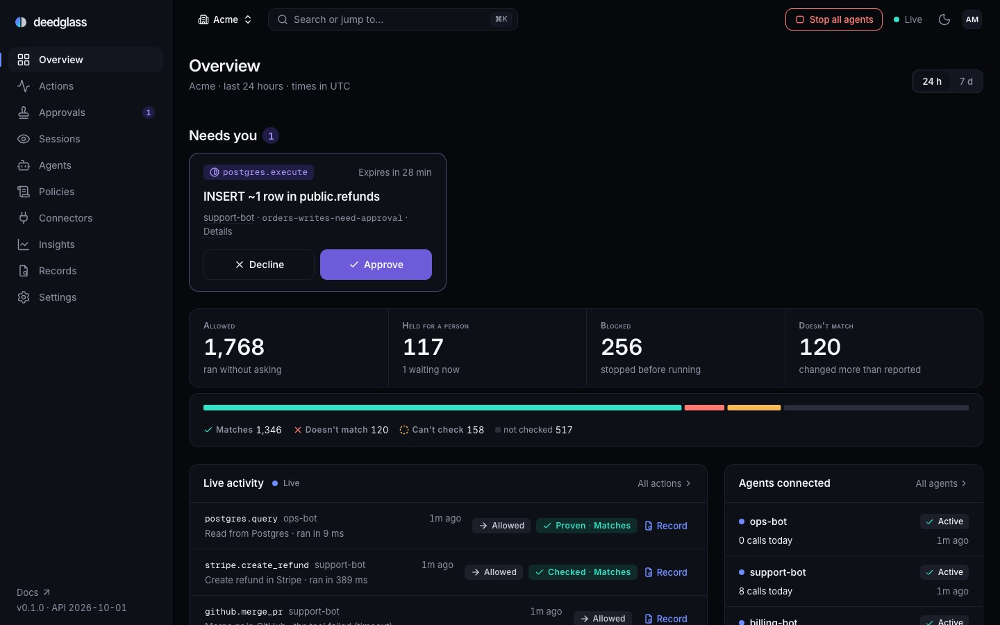
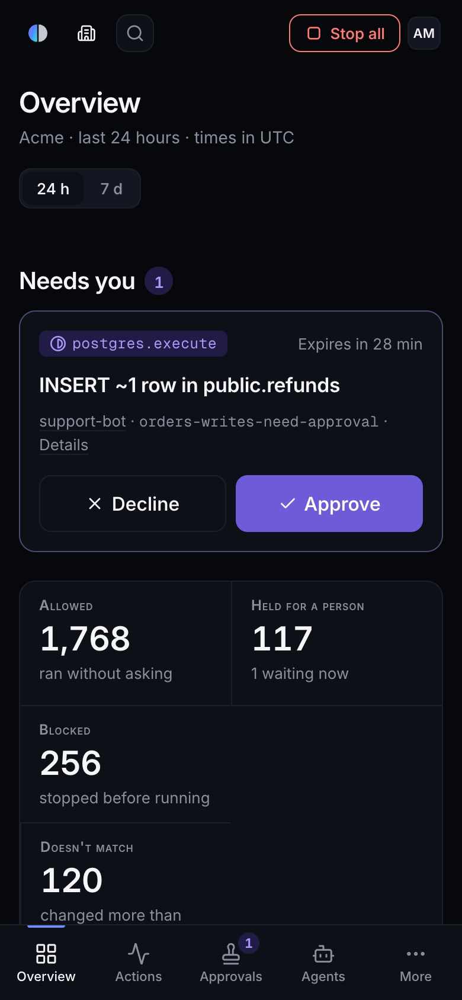
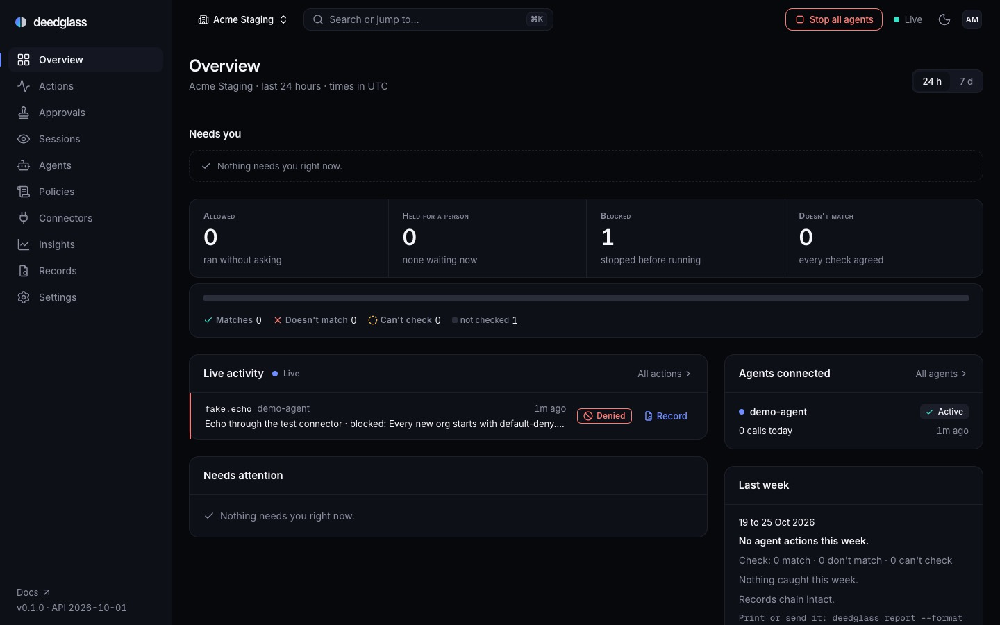
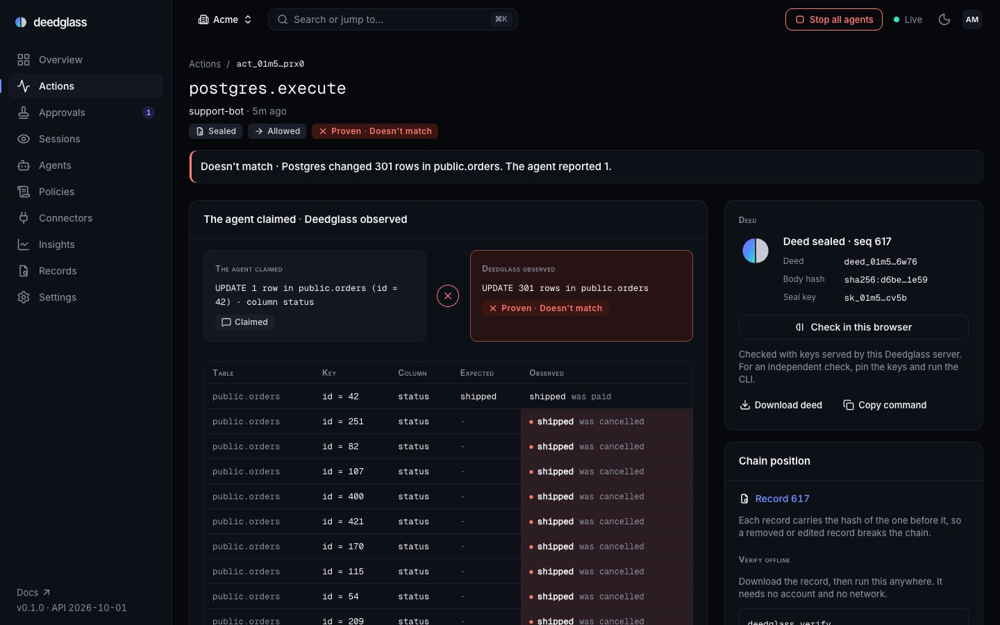

# The Console

The Console is Deedglass's web app at `/app` (`app.deedglass.com` in the cloud beta). It is a static
build embedded in the `deedglass` binary and served by `deedglass serve` from the same origin as the
API, so there is nothing else to deploy and no cross-origin request anywhere.

## Architecture

- **Source:** `web/` (Astro 7, static output, base `/app`, vanilla TypeScript; ADR-020, ADR-053).
  `make web-build` writes `internal/console/dist`, which `//go:embed` puts in the binary.
- **Data:** pages contain no data. Every value arrives through `web/src/lib/api.ts` (session cookie,
  `Deedglass-Version`, CSRF and an Idempotency-Key on every change, 15 s timeout, no redirects) and
  the live stream `web/src/lib/stream.ts` (one `EventSource` per tab on [`GET /v1/events`](EVENTS.md)).
- **Rendering:** `web/src/lib/dom.ts` builds DOM from data with text nodes only. Agent-controlled
  strings (tool names, reasons, labels, org names) are attacker input; nothing is parsed as HTML.
- **Server:** `internal/console` serves the pages and assets (ADR-054); the event hub, hydration and
  `GET /v1/events` live there too.

## Routes and the sign-in redirect

| URL | Page |
|---|---|
| `/app` | Overview |
| `/app/actions`, `/approvals`, `/agents`, `/policies`, `/connectors`, `/insights`, `/deeds`, `/settings` | the screen |
| `/app/<screen>/<id>` (actions `act_`, approvals `apr_`, agents `agt_`, policies `pol_`, connectors `con_`, deeds `deed_`) | the detail page; the id's prefix must match |
| `/app/settings/<section>` | Settings, on that section |
| `/app/_kit` | the component kit, dev builds only (404 in prod) |
| anything else | the Console 404, which never echoes the path |

Without a valid session every page answers `302 /login?next=<path and query>`. `next` must look like
`/app…` with no `//`, `\` or `..`; anything else is dropped. After signing in with the 6-digit code the
sign-in page returns to `next`. A link opened from the email in a new tab lands on `/app` (the return
path lives in the tab that asked for it).

## Security headers and why

```
Content-Security-Policy: default-src 'none'; script-src 'self'; style-src 'self'; img-src 'self' data:;
  font-src 'self'; connect-src 'self'; manifest-src 'self'; form-action 'self'; frame-ancestors 'none';
  base-uri 'none'; object-src 'none'; require-trusted-types-for 'script'; trusted-types 'none'
Cross-Origin-Opener-Policy: same-origin
Permissions-Policy: camera=(), microphone=(), geolocation=(), payment=(), usb=()
```

- No inline script or style anywhere (the build fails if one appears: `web/scripts/check-dist.mjs`).
- Trusted Types `'none'` makes every HTML-string sink throw in Chromium, which enforces the
  text-only rule at run time; the HTML-sink grep enforces it at build time.
- `frame-ancestors 'none'` and COOP stop clickjacking and cross-window access.
- Pages are `Cache-Control: no-cache` with an ETag; hashed assets are cached for a year.
- Browser storage holds UI preferences only: the theme (`localStorage`) and the palette's recent pages
  (`sessionStorage`, per org, cleared on sign-out). Never a key or a token.

## The dev loop

- `make web-build && make build-only && make dev` (or `deedglass serve`) is exactly what ships. At start
  `deedglass serve` prints `✓ Console on <base URL>/app` under the listening line.
- `make web-dev` runs `astro dev` on `:4321` and proxies `/v1`, `/login`, `/auth` and `/.well-known`
  to `:8080`; start the server with `DEEDGLASS_BASE_URL=http://localhost:4321` so sign-in links agree.
- `make web-test` (in `make ci`): typecheck and Vitest. `make web-e2e`: Playwright in the installed
  Chrome against a throwaway PostgreSQL 18 and a real server (`scripts/web_e2e.sh`). `make
  web-lighthouse`: accessibility and best practices ≥ 95 on `/app`, `/app/_kit` and `/login`.
- `scripts/web_e2e.sh serve` keeps that stack up (Acme with an owner, an admin and a viewer) for
  manual looks; `deedglass org login-link --email owner@acme.example --org acme` from `.tmp/web-e2e`.
  Since S25 it seeds real data first (`WEB_E2E_SEED=0` skips it): 600 fake actions, then the L2 hero
  on a second throwaway cluster (the Acme Store orders database on `:55469`; the egress door
  refuses Deedglass's own cluster): the postgres connector and its decoder, the `acme-demo` policy,
  support-bot ships order 42 (L2 VERIFIED), the legacy trigger goes on, and it ships 42 again (L2
  MISMATCH, 301 rows). The ids land in `.tmp/web-e2e/fixtures.json` for Playwright.
- `make web-dev` with `DEEDGLASS_DEV_PROXY=http://127.0.0.1:18241` proxies to that throwaway stack
  instead of `:8080` (reads work; changes need the Console and the server on one origin).

## The screens (S25)

Every screen has a loading state (a skeleton in the final geometry; after 8 s, `Still loading. The
server is slow to answer.`), an empty state that teaches, a filtered-empty state, an error state (the
server's message, the request id, Retry), a viewer state (controls visible, changes disabled with
the reason), the Console 404 (the same for a missing id and another org's id) and the offline
banner (content stays; the Overview says `Last updated 14:02`). Dark and light, down to 360 px.

### Overview (`/app`): the live view

Since console-v1 the Overview answers one question first: what are my agents doing, and does
anything need me?



- **Needs you** (top): every pending approval as a card, with the tool, the effect line (`INSERT ~1
  row in public.refunds`), the agent, the rule and when it expires. **Approve** (the brand violet)
  and **Decline** are 44 px or taller and sit side by side, 48 px on a phone. Each one opens the
  DecisionSheet (S26), so a decline still needs a reason and every decision carries the context
  digest and one Idempotency-Key. Four-eyes rules show `0 of 2 signed` with dots. After you sign,
  the card says `You approved. Waiting for the next person.` and its buttons go away. Viewers see
  the cards with the buttons disabled and the reason. The first 3 cards show, then `N more in
  Approvals`. `approval.*` events reload the inbox, so a new request appears without a reload.
- **Today:** Allowed, Held for a person, Blocked and Doesn't match for the window in the toggle
  (`24 h` or `7 d`, in the URL as `?window=7d`). The counts come from
  [`GET /v1/overview`](OVERVIEW_METRICS.md) (`decisions.allowed`, `decisions.held`,
  `blocked.total`, `verification.mismatch`), and each tile links to the feed, filtered. The
  verification bar under the tiles keeps its labels and counts in text.
- **Live activity:** the last 20 actions, then each new one the moment Postgres commits it. A row
  shows the tool and the agent, a plain summary (`Create refund in Stripe · blocked: Refunds over
  $100 need a person.`), the rule decision, the read-back result (Matches, Doesn't match, Can't
  check, at its level) and a **Record** link to the sealed deed. A row updates in place as the action
  moves through decided, executed, witnessed and sealed. Summaries come from the tool name and the
  policy's reason, never from the request, so they are safe in Health mode. Screen readers hear at
  most one arrival every 5 s.
- **Streaming, then polling:** the page uses the one SSE stream ([`GET /v1/events`](EVENTS.md)). While
  the stream isn't live (a proxy that strips SSE, a reconnect), it polls `GET /v1/actions` and the
  pending approvals every 5 s and says `Live updates are off. Checking every 5 seconds.`. Counters
  also move live between refetches, and the page refetches the Overview 3 s after activity and every
  60 s to correct drift.
- **Needs attention:** the server's attention items. Repeats fold into one line (`Doesn't match ·
  postgres.execute · support-bot · 8 times`).
- **Agents connected:** the 8 most recently active agents, with a live dot when an agent acted in
  the last 5 minutes, its status and its calls today against `calls_per_day`.
- **Last week** and **Chain**, as before.



### Empty state: one next step

An org with no actions yet gets one card and one command:



`deedglass init --smoke` sends three test actions through the stack that `deedglass init` set up: a
read, a blocked `DROP TABLE` and an `UPDATE` checked at Proven. The page listens on the stream (and
polls every 5 s while the stream isn't live). When the first action arrives it becomes the live view
without a reload. **Connecting your own agent instead?** opens the earlier flow: create the demo
agent and its key (shown once), the MCP client config with the key filled in, and the wait for its
first action. The key fills the snippet on this page only, is never stored, and a reload shows the
placeholder again.

### Health mode

When the org's PHI mode is on (`settings.phi_mode`, [PHI_MODE.md](PHI_MODE.md)), the Overview and
the action page show `Health mode is on. The Console shows field names, not values.` The DiffTable
keeps tables, keys and column names and shows every value as `•••`. The request and the result stay
hidden, and their digests stay in the record. The Live activity summaries never held values.

### Actions (`/app/actions`)

- **Filters** live in the URL with the API's names, so a shared link is a readable query: `agent`,
  `tool` (exact, or a glob with `*`), `decision`, `verdict`, `level`, `state`, `on_behalf_of`,
  `time` (`1h`, `24h`, `7d`) or `from`/`to`, and `q` (2 to 64 characters, server-side).
- **Live:** new actions that match the filters go to the top; existing rows update in place. While
  paused or scrolled away from the top, they wait behind `12 new actions · Show`. **Live updates
  pause while searching by text** (the server owns `q`). The DOM keeps at most 500 rows and writes
  once per animation frame; the live region announces new actions at most once every 5 s.
- **Keys:** `p` pause, `j`/`k` move, `Enter` opens the selected row, `/` search, `f` more filters,
  `Esc` clears the selection. `g` sequences still navigate (`g p` is Approvals, not pause).
- **Under 640 px** each row is a card: the tool and the verdict, then agent, decision and time.

### Action detail (`/app/actions/{id}`)



- **Claimed beside observed** (first, above everything else on a phone): what the agent claimed
  (the statement's footprint, `UPDATE 1 row in public.orders (id = 42) · column status`, or `The
  tool reported success.`) beside what Deedglass observed (`UPDATE 301 rows in public.orders`, or
  the read-back), with the verdict chip. Under them is the DiffTable with its diff rows.
- **The policy that decided:** the decision, the policy, the rule, the reason and the mode, second.
- **Chain position** (beside the deed panel): `Record 617`, linking to the deed, and
  **Verify offline**: the exact `deedglass verify deed_….json --keys <origin>/.well-known/deedglass/keys.json`
  command, readable and with a Copy button. Download the deed, then run it anywhere.
- **The sentence:** the API's `witness.summary`, verbatim, after a prefix (`MISMATCH · `,
  `Witnessed by Postgres · `, `Confirmed by a read-back · `); denials use the Gate's message.
- **Witness:** level, method, verdict, every check (✓ pass, ✕ violation, ○ gap, i note) and the
  **DiffTable**: expected against observed, changed cells tinted at 12 % with `●` and the words
  "unexpected change", sensitive values `•••` with `masked`. The Witness keeps the first
  `witness.diff_rows` changed rows (20 by default), so the table shows `Showing 20 of 301 rows`;
  raise the setting on the connector to keep more. `Download diff (JSON)` saves the L2 evidence.
- **Timeline** (every lifecycle event, ms, deltas), **Decision** (policy, rule, reason, mode, the
  shadow when it differs), **Request and result** (rendered only when opened; pruned payloads say
  when and that the deed still verifies), **Amendments**.
- **Deed panel:** `Check in this browser` reads the deed's exact bytes and this server's keys and
  runs S05's verifier (`✓ Seal valid · key sk_…`, or the verifier's sentence, or `○` when the browser
  has no Ed25519). **The check uses the keys this server serves**; for an independent check, pin the
  keys and run the CLI (`Copy command`). `Download deed` saves the exact bytes.
- **Approval** (S22) and **Undo** (S23, its strings verbatim): `Preview undo` (admins) opens the
  plan as a DiffTable (`Now` · `After undo`), the twelve checks, the policy line and the reason;
  `Request undo` is never red: asking isn't destructive until a person countersigns.

### Deeds (`/app/deeds`, `/app/deeds/{id}`)

- The chain card, then every deed newest first (`kind` filter in the URL), with seq, kind, a
  one-line summary, issued, the id and the body hash.
- **Export:** a date range in the org's time zone downloads the bundle and prints the
  `deedglass verify` command to check it offline.
- **A deed:** contract §7's sections (who, action, policy, approval, execution, witness, cost, admin,
  chain with a link to the previous deed), the raw JCS exactly as sealed (a formatted view only on
  request, labelled), the deed panel, and ← → by seq.

### Agents (`/app/agents`, `/app/agents/{id}`)

- The list reads `GET /v1/agents?expand[]=usage`: status, labels, calls today against the daily
  budget (amber from 80 %, red at the limit, always with the numbers), spend today, last action and
  active keys. `Create agent` (admins) validates the name live with S08's rule.
- **Tabs** (in the URL as `?tab=`): Overview (calls today, blocked and the verdict mix over the last
  24 hours, and the last 20 actions), Keys (create, shown once; roll with an overlap; revoke),
  Budgets (`PATCH`, a deed per change), Security (intent mode and intent keys, S09) and Danger zone
  (suspend or resume; stop with the typed confirmation; start with a reason). Status changes arrive
  live through `agent.*` events.

## The screens (S26)

S26 makes the Console operable: approving, editing and enforcing policies, adding connectors, and
running the org, all without the CLI. The API still decides every rule; the Console hides or
disables what a role can't do and says why.

### Approvals (`/app/approvals`, `/app/approvals/{id}`)

- **Designed at 360 px first.** Under 1024 px the inbox and an approval are separate screens; from
  1024 px they sit side by side (a 400 px list and the detail). Selecting an approval changes the
  URL, so a reload or a shared link opens the same one. `?tab=history` shows decided approvals,
  filtered by status and agent.
- **The card:** the tool and the countdown, the one-line effect (Stripe `$120.00 to cus_Q3…`,
  Postgres `UPDATE ~1 row in public.orders`, GitHub `merge PR #212 in acme/api`, otherwise the side
  effect and the tool), the agent and who it acts for, the rule and `1 of 2` when two people must
  countersign. The effect comes from the server's context snapshot, never from the agent's text.
- **The detail, in order:** the effect, the rule and its reason, the SQL with its kind, tables,
  WHERE clause and `≈ 1 row (EXPLAIN estimate)`, the arguments exactly as the agent sent them (in a
  bordered region labelled `Arguments (from the agent)`), the agent's last 10 actions with their
  verdicts, the decisions so far, and the expiry: `Expires at 09:50 (in 9 min). If nobody decides,
  it is denied automatically.`
- **Deciding:** Approve and Deny open a sheet (a bottom sheet on a phone, a dialog from 640 px);
  nothing is sent without it. Approve takes an optional reason, Deny needs 3 to 280 characters.
  Both send the reason and the `context_digest` of what you reviewed, with one Idempotency-Key per
  sheet, so a double tap sends once. ⌘ Enter or Ctrl Enter submits. If the context changed, the
  sheet shows `What you reviewed is out of date. Reload the approval and review it again.` and
  sends nothing else.
- **Keyboard (desktop):** `↑`/`↓` (or `j`/`k`) move, `A` opens Approve, `D` opens Deny. Neither
  submits by itself.
- **Four-eyes, self and races:** `1 of 2 countersigned · Priya Raman`; after your countersign the
  buttons give way to `You countersigned at 09:41. Waiting for one more approver.`; an action that
  runs on your behalf shows `You asked for this action, so someone else must approve it. You can
  still deny it.` and Deny only (S22 lets you deny it); a decision by someone else turns the card
  read-only in place (`Priya Raman approved this 20 seconds ago.`), and a 409 from a race shows the
  server's sentence. Nothing is lost silently.
- **Follow-through:** after an approve the card stays and follows its action:
  `Countersigned by you · running…`, `◐ Running`, then `Executed · L2 · VERIFIED · deed sealed`
  with the Mirror's Sealed moment once and a link to the action. After 10 s it leaves Pending.
- **Offline:** the buttons are disabled with `You're offline. Decisions need a connection so they
  can be sealed.` Decisions are never queued.
- The emailed approval page (S22) links back with `Open in Console` in every state.

### Policies (`/app/policies`, `/app/policies/{id}`)

- **The list:** name, status (`Enforced`, `Shadow` in a violet outline, `Inactive`), the active and
  latest versions, the rules count and who changed it when. `New policy` opens the six starters
  from `examples/policies` (bundled at build time, loaded on demand) or `Blank`; the new policy is
  v1 and nothing is enforced until you choose to.
- **A policy** (`?tab=editor|dry-run|tests|versions|replay&v=3&line=55`): the header shows the
  version you opened (`v4 · sha256:3f9a…c21e`, the author, notes) and the actions `Save as v5`
  (when the buffer differs), `Run in shadow` and `Enforce`.
- **Editor:** see `docs/POLICY_EDITOR.md`. Lint runs 400 ms after you stop typing; diagnostics
  show in the gutter, as underlines and in the list below with `Apply fix` and the docs link. A
  viewer gets the editor read-only: `Viewers can read policies. Editing needs the Admin role.`
  Leaving with unsaved changes asks `Discard changes to acme-demo?`. Saving identical content
  answers `No changes: this is already v4.` (comments don't change a version's hash).
- **Dry run:** a tool (suggested from your connectors), SQL for `postgres.*`, JSON arguments
  (strict: a syntax error names its line, a repeated key is refused), an agent, on behalf of, a
  time; evaluated against the unsaved draft, the enforced version, or the version you opened. The
  result is the decision, the Gate's message, the rule with its line (click to reveal it in the
  editor), the trace step by step, the SQL facts and the evaluation time.
- **Tests:** paste a cases file or choose one (read in the browser, up to 1 MiB, sent only to this
  server's `POST /v1/policies/test` with the buffer). `24 cases passed · every rule covered`, or
  what failed and which rules have no case.
- **Versions:** every version with its status, hash, author and notes; tick two to compare them
  (a line diff with neutral highlights: a policy diff isn't a verdict). The latest two are
  compared on open.
- **Shadow and enforce:** `Run acme-demo v4 in shadow?` needs a reason. `Enforce acme-demo v3?`
  shows the exact version and hash, needs the policy's name typed and a reason, and, for a
  version whose default is allow, a ticked `I understand this policy allows every action no rule
  matches.` The toast reads `acme-demo v3 enforced · deed sealed` with `View deed`. Rolling back is
  `Enforce v2 again` on an older row. While a shadow runs, the header says
  `Shadow disagreed on 3 of 212 actions in the last 24 h · View`, which opens the feed filtered to
  `shadow_differs=true`.
- **Replay:** the form posts to S27's `POST /v1/policies/{id}/versions/{v}/replay` and follows the
  job. Until S27 lands, the server answers 404 and the tab says
  `Replay isn't available on this server yet. Use Dry run to test a single action.`

### Connectors (`/app/connectors`, `/app/connectors/new`, `/app/connectors/{id}`)

- **The list:** name, type (an icon and its title), the levels it reaches, health (`Passing`,
  `Warnings`, `Failing`, `Not tested`), the credential (`Set · bearer · …9f2c · updated 2h ago` or
  `Not set`) and the tool count.
- **Adding one** is three steps, each its own URL: the type (cards from `GET /v1/connector-types`),
  the configuration (a form drawn from the type's `config_schema`: text, URLs, numbers with their
  range, switches, selects, checkboxes for enum lists, chips for string lists, fieldsets for nested
  objects, and JSON where the schema goes beyond that), then the credential, followed by a test.
  Server errors land under the field their `param` names, word for word.
- **Credentials are write-only here too:** the fields are never pre-filled, a `Show` toggle resets
  when you leave the field, and the values are cleared from the page as soon as the save answers,
  success or not. `Remove` warns that agents will get `connector_unavailable`.
- **Test:** each check as ✓ (quiet), ○ or ✕ with its detail, the fix and `Copy SQL`, which copies
  the SQL behind the header `-- Review before running. Run as a superuser on <db>.` Nothing runs
  from the Console. The button rests 6 s after a run (the server allows 10 a minute).
- **Postgres:** the test is the readiness report (`Ready for Proven checks · 14 passed · 3 notes · 0 failed`,
  or `Not ready for Proven checks · 1 item to fix`), with the provider's note when it applies and the CLI
  equivalent. The Witness card reads the decoder S20 already records (`GET …/decoder`):
  `Witness · healthy · 12 MB behind · last commit 4s ago`; lagging adds
  `L2 verdicts will arrive late.`, an invalidated slot gives the recovery steps. It never connects
  to your database when the page loads.
- **Tools:** name, side effect (`destructive` is the one red), idempotency, levels, and a link that
  dry-runs the tool against the enforced policy.
- **Editing** the configuration sends `expected_config_hash`; if it changed meanwhile:
  `This connector changed since you opened it. Reload to see the latest.`

### Settings (`/app/settings/{section}`)

A side menu on desktop, a list on a phone; each section has its own URL (`/app/settings/org` still
opens General).

| Section | What it does | Who |
|---|---|---|
| General | org name, slug, time zone (searchable), payload retention in days. `After 90 days, request and result bodies are removed. Deeds hold digests only, so they keep verifying.` | read: everyone · edit: admin · retention: owner |
| Members | name, email, role, status, joined; invite (an email and a role), resend an invite, change a role (owner), remove (typed email), leave. The last owner can't be removed or demoted (S07's message) | invite: admin · roles: owner |
| API keys | org admin keys: create (shown once), roll, revoke (typed name) | admin, signed in |
| Approvals | email links (Decide or Review only), email detail (Summary or Full), self-countersign (Deny or Allow, which needs the org slug typed) | read: admin · edit: owner |
| Webhooks | endpoints, events, status; add (the `whsec_…` secret shown once), send a test, recent deliveries, delete (typed host) | admin |
| Seal keys | the server's public keys, read-only. `Whoever runs this Deedglass server rotates seal keys with deedglass keys rotate. Old keys stay listed so older deeds keep verifying.` | everyone |
| Notifications | who receives approval emails, the org's email defaults, and where Slack approvals live (the Slack connector, S29) | admin |
| Danger zone | Stop all agents, Start all agents (owner), export every deed | admin · owner |

Seal keys have no rotate button because they belong to the server, not the org. Retention prunes
payloads, never deeds.

### Roles in the Console

| Control | Viewer | Admin | Owner |
|---|---|---|---|
| Approve or deny | only if a rule names them | when the rule's approvers include them | same as Admin |
| Policy edit, save, shadow, enforce | read-only editor; dry run and tests allowed | yes | yes |
| Connector create, edit, credentials, test | read and test results only | yes | yes |
| Members invite / role change | no / no | viewers and admins / no | yes / yes |
| Org keys, webhooks | no | yes | yes |
| Retention | no | no | yes |
| Approval settings | no | read | yes |
| Stop all / Start all | no / no | yes / no | yes / yes |

`web/e2e/roles.spec.ts` checks every row twice: the UI state, and the API answering the page's own
call with the documented status.

## The screen (S28)

### Insights (`/app/insights`)

One scroll with four sections; each reads the Insights API (docs/INSIGHTS.md, docs/SUGGESTIONS.md):

- **Suggestions.** One card per open suggestion, by impact: the kind and target rule, the title and rationale,
  the evidence numbers, the replay's transitions with the decision chips (Allowed neutral, Denied a red outline,
  approval violet), the risk note, and the policy change collapsed as `Policy change +N lines` (a mono diff:
  added lines on an accent tint, removed lines neutral; never red). `Accept and run in shadow` opens a sheet
  (an optional reason; a required checkbox when another version runs in shadow, which sends `replace_shadow`);
  `Reject` asks for a reason. Generate runs a pass now (admins).
- **Shadow.** The live shadow's report and `Promote`, which reuses S26's typed activation sheet (type the policy
  name, give a reason); under 100 decided actions or 24 hours a neutral notice says so.
- **Anomalies.** Open episodes, newest first; Acknowledge and Resolve (a reason, sealed as a deed).
- **Trends.** Inline SVG charts of the verification mix, denials and approval wait per day for 30 days, each
  with a "Show as table" fallback.

At 1280 px and wider a right rail shows the settings (anomaly facts, phrasing, digest recipients) and how
Insights works; admins change them in a sheet with a reason. Viewers see everything and none of the buttons.
Live events (`suggestion.created`, `anomaly.detected`, `policy.activated`, `deed.sealed`) refresh the affected
section and announce new suggestions politely. Keyboard: `j`/`k` move between cards, `Enter` opens or closes
the diff, `a` accept, `r` reject, `?` lists the keys.

A simulated org (`dev simulate`) shows a neutral banner under the top bar on every screen.

## Adding a screen

1. The page in `web/src/pages/` (and `<screen>/detail.astro` if it has ids), on `AppShell`.
2. Every string in `web/src/lib/copy.ts`, or for a larger screen in its own `web/src/lib/copy-<area>.ts`
   (S26), which `test/checks.test.ts` walks too, so a page bundles only its own strings.
3. The four states: loading (a skeleton in the final shape), empty (one teaching sentence, one
   action), error (the server's message, the request id, Retry) and no permission.
4. Live updates through `stream().on(...)`, and a refetch on `onResync`.
5. Tests: Vitest for any pure logic, a Playwright case, the axe pass, a screenshot, Lighthouse.
6. Tokens only: if a component needs a value that doesn't exist, add it to `DESIGN.md` and
   `web/tokens/tokens.json` first (`TestTokensMatchDesignMD` keeps them in step).

## Browser support

Current Chrome, Edge, Firefox and Safari (the last two versions). The Popover API and anchor
positioning are Baseline but not needed: menus and tooltips are positioned in JavaScript. `<dialog
closedby>` isn't in stable Safari, so sheets implement their own light dismiss.

## What it doesn't do

- No offline mode: without the network the Console says so and reconnects when it can.
- No mobile app; the Console works down to 360 px wide.
- No third-party analytics, fonts, scripts or CDNs, ever.
- No collaborative editing of policies: the last save wins, versions never change, and the diff
  shows what changed between them.
- No Slack approvals in the Console until S29; Slack approvals will be set on the Slack connector.
- Replay needs S27's job API; until then the tab says so. Replay can only re-decide actions whose
  stored inputs haven't been pruned; those count as unknown.
- Approvals aren't queued offline, and the Console has no push notifications (a PWA with Web Push
  would need an ADR; v2).
- The editor has no syntax colouring (plain text over a diagnostics mirror) and no completion.
- Deleting an org isn't in the Console (no route yet; the v0.2 backlog in `docs/LIMITATIONS.md`).
- Members have no last-active time, and invites have no separate resend route: Resend posts the
  invite again, which S07 allows for an invited member.
- The browser seal check trusts the keys this server serves; it is a convenience, not an
  independent check.
- The REST action detail carries the request and result (S13); the Console renders them only when
  you open them, but it doesn't avoid loading them.
- The Overview's counters move live between refetches and can drift for up to 60 s.
- The feed shows the newest 500 rows in the page; older ones are a click on `Load older actions`.
