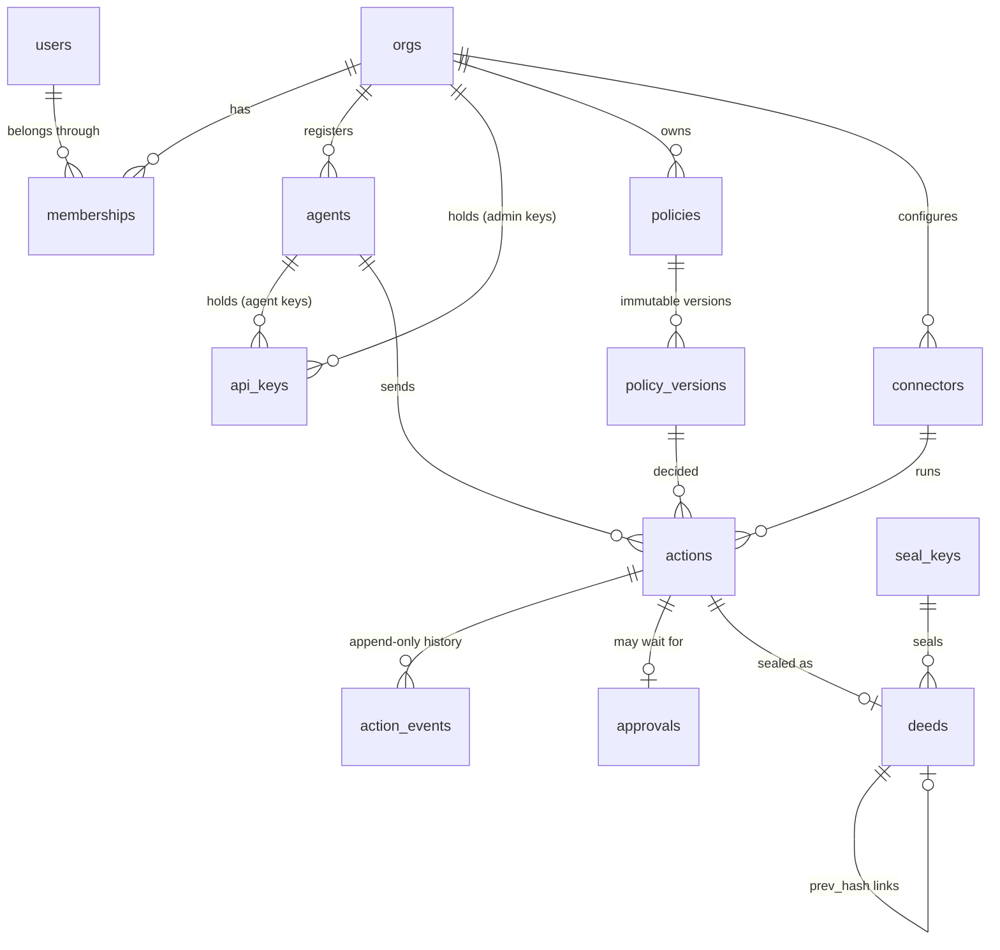

# The data model

Deedglass keeps its own state in one Postgres database, the **control plane**, in schema `deedglass`. This page is the map: what each table holds, what the database itself enforces, and what it doesn't. The schema is created by the migrations in `internal/store/migrations/` (see `docs/MIGRATIONS.md`); roles and setup are in `docs/DATABASE_SETUP.md`.

Contract §4 is the source. Version 0009, PostgreSQL 16, 17 and 18.

## The core



## Tables

32 tables: 30 from contract §4, plus `idempotency_keys` and `schema_migrations`.

| Table | What it holds | Written by |
|---|---|---|
| `orgs` | An org: the company account. Its pinned API version, time zone, retention, and "Stop all agents" state. | S07, S08 |
| `users` | A person, once, across orgs. Email and display name only. | S07 |
| `memberships` | A user's role in one org: owner, admin or viewer. | S07 |
| `sessions` | Console sign-in sessions. Hashes of the cookie and CSRF secrets, never the secrets. `org_id` is the active org. | S07 |
| `login_tokens` | Magic-link and invite tokens, hashed. No email column. | S07 |
| `agents` | Registered agents: name, status (active, suspended, stopped), labels, budgets, intent mode and intent keys. | S08, S09 |
| `api_keys` | API keys: a globally unique 8-character prefix plus a hash of the secret. Admin keys have no agent and exactly the `admin` scope. | S08 |
| `intent_nonces` | Replay memory for signed intents. | S09 |
| `policies` | Named policies. | S12 |
| `policy_versions` | One immutable version of a policy: its YAML and compiled hash. **Append-only.** | S12 |
| `policy_activations` | Which version is active in enforce or shadow mode. At most one of each per org. | S12 |
| `usage_counters` | Calls and spend per agent or org, per minute, hour and day. | S11 |
| `connectors` | Configured tools. | S16 |
| `credentials` | A connector's credentials, envelope-encrypted. Field names and a short hint are the only clear text. | S16 |
| `actions` | One tool call through the Gate, with its state, decision, result digest and witness verdict. | S13 |
| `action_events` | Every state change of every action. **Append-only.** | S13 |
| `approvals` | A request for a human decision on one action. | S22 |
| `approval_tokens` | One-time approve or deny links, hashed. | S22 |
| `idempotency_keys` | Stored responses for `Idempotency-Key`, kept 24 hours. | S03 |
| `seal_keys` | The instance's public seal keys. | S04 |
| `deeds` | Sealed deeds, one hash-linked chain per org. **Append-only.** | S04 |
| `admin_events` | Administrative changes in an org. **Append-only.** | S07+ |
| `witness_jobs` | Work queued for the Witness and the approval workers. | S13, S19–S22 |
| `decoded_txs` | Transactions read from a watched database's change stream. | S20 |
| `decoder_slots` | One logical replication slot per Postgres connector. | S20 |
| `suggestions` | Insights suggestions a person accepts or rejects. | S28 |
| `anomalies` | Insights anomalies. | S27 |
| `replay_jobs` | Replays of past actions against a policy version. | S27 |
| `webhooks` | Webhook endpoints, with the signing secret encrypted. | S22 |
| `webhook_deliveries` | Each delivery attempt. | S22 |
| `waitlist` | Waitlist entries. | S36 |
| `schema_migrations` | Which migrations ran, with their checksums. | the runner |

## Global tables, and why

Every table has `org_id` except these five.

| Table | Why it is global | Row-level security |
|---|---|---|
| `orgs` | The org is the boundary itself. | Yes: `org_self` shows only the current org. |
| `users` | One person can be in several orgs (the org switcher). Access comes only from memberships. | Yes: a user is visible only when they are a member of the current org. Inserting a user needs system scope. |
| `seal_keys` | One set of seal keys signs every org's deeds (per-org keys are v2). They are public keys. | No. |
| `waitlist` | People join before they have an org. | Yes: anyone may insert; only system scope reads. |
| `schema_migrations` | It describes the schema, not an org. | No. The runtime role can only read it. |

`login_tokens` is **not** global: each token signs into one org.

## Orgs and isolation

Every org-scoped statement runs inside `store.OrgTx(org)`, which sets the **transaction-local** setting `deedglass.org_id`. Each org table has this policy, written inline:

```sql
CREATE POLICY org_isolation ON deedglass.agents FOR ALL TO deedglass_app
  USING      (org_id = (SELECT NULLIF(pg_catalog.current_setting('deedglass.org_id', true), '')))
  WITH CHECK (org_id = (SELECT NULLIF(pg_catalog.current_setting('deedglass.org_id', true), '')));
```

- The `(SELECT …)` makes Postgres evaluate the setting once per query (an `InitPlan`), not once per row. `EXPLAIN` shows it; a test asserts it.
- **Fail closed.** With no org set, the policy compares with NULL: reads return no rows, and writes fail with `42501`.
- The setting is always set with `set_config(…, true)`, so it ends with the transaction. A pooled connection never carries an org into the next transaction. A test greps the code for the session-wide form, and another checks a one-connection pool.
- `store.SystemTx(reason)` sets `deedglass.scope = 'system'`. Only the 15 tables with a `system_scope` policy then show every org's rows; the rest show none. The reasons are named (`org_create`, `maintenance`, `health`), every call is logged at debug level, and a test lists every call site.

**Tables with `system_scope`:** `orgs`, `users`, `memberships`, `sessions`, `agents`, `api_keys`, `usage_counters`, `approvals`, `approval_tokens`, `idempotency_keys`, `decoded_txs`, `decoder_slots`, `replay_jobs`, `webhook_deliveries`, `waitlist`. This list does not grow after S02; a test pins it.

### The rule for cross-org reads (S07 onward)

Lookups that happen before the org is known (a session cookie, a login token, an email, an API-key prefix) and workers that claim jobs across orgs don't use `SystemTx`. They call narrow `SECURITY DEFINER` functions:

| Prefix | Use | Sessions |
|---|---|---|
| `preauth_*` | Find the one row a credential points to, before the org is known | S07–S09, S22 |
| `claim_*` | Claim due jobs across orgs, with `FOR UPDATE SKIP LOCKED` | S13, S20, S22 |
| `maint_*` | Pruning and other maintenance | S06, S09 |

Each one is owned by `deedglass_migrator`, pins `search_path = pg_catalog, pg_temp`, returns the minimum columns, and is granted only to `deedglass_app`. `SystemTx` stays for org creation, health checks and tests.

## What the database enforces, and what it doesn't

### Enforced by Postgres

| Invariant | How | Error |
|---|---|---|
| One org can't read or write another org's rows | RLS on every org table, keyed on `deedglass.org_id` | no rows; `42501` on write |
| A row can't point into another org | Every foreign key between org tables includes `org_id` | `23503` |
| The runtime role can't rewrite history | No UPDATE, DELETE or TRUNCATE grant on `deeds`, `action_events`, `admin_events`, `policy_versions` | `42501` |
| Nobody edits history through SQL, the owner included | Row and statement triggers on those four tables | `DG001` |
| The runtime role can't turn the guards off | It owns nothing: no ALTER, no DISABLE TRIGGER, no DISABLE RLS, no CREATE in the schema | `42501` |
| Fixed columns stay fixed | Column-level UPDATE grants: an action's agent, key, tool and request digest; an agent's name; an API key's secret hash, prefix and scopes | `42501` |
| The deed chain links | A BEFORE INSERT trigger checks `prev_hash`: the genesis value for seq 1, the previous `body_hash` after that | `DG002`, `DG003` |
| No forks, no gaps | `UNIQUE (org_id, seq)`, `UNIQUE (org_id, prev_hash)`, and the predecessor check | `23505`, `DG002` |
| A deed's hash matches its bytes | `CHECK (body_hash = 'sha256:' || encode(sha256(body_jcs), 'hex'))` | `23514` |
| The action lifecycle | A trigger that mirrors `internal/gate/state.go`: 22 edges; a new action starts in `received` | `DG004` |
| A state carries its timestamp | One CHECK per state, for example `state <> 'sealed' OR sealed_at IS NOT NULL` | `23514` |
| An org keeps an active owner | A deferred constraint trigger, checked at commit | `DG005` |
| Ids have the right shape | One domain per id prefix, the same regex as `ids.Pattern` | `23514` |
| Digests, currencies, money | Domains `digest` and `currency`; integer minor units; amount and currency both or neither | `23514` |
| Admin keys are admin, agent keys aren't | A CHECK on `api_keys` | `23514` |
| One active enforce and one active shadow version | A partial unique index on `policy_activations` | `23505` |

### Custom SQLSTATEs

| Code | Meaning |
|---|---|
| `DG001` | The table is append-only. |
| `DG002` | The deed has no predecessor. |
| `DG003` | The deed's `prev_hash` doesn't link. |
| `DG004` | The action can't make that state change. |
| `DG005` | The org's last active owner can't be removed. |
| `DG006` | Reserved for S22's approval-vote guard. |

`DG101`–`DG103` are reserved for the customer-side guards (S17), so one code never means two things.

### Not enforced by the database

- **A superuser or the schema owner can still change anything.** They can disable triggers, turn off RLS, or rewrite rows. Postgres can't stop its own superuser. Offline deed verification (S05) detects a rewritten or broken chain; it doesn't prevent one.
- **RLS stops a forgotten filter, not an attacker.** Anyone who can run SQL as `deedglass_app` can set `deedglass.org_id` or `deedglass.scope` themselves. SQL injection and a compromised server are handled elsewhere: parameterized SQL only, no user SQL ever runs on the control plane, the two-role split, and offline verification.
- **Seals aren't checked.** The database checks the shape of a seal and the hash chain, not the Ed25519 signature. S04 seals; S05 verifies.
- **Time isn't checked.** `issued_at` comes from the database clock under S04's chain lock; the schema doesn't check that it never decreases along `seq`.
- **Business rules above the schema.** Reserved agent names, scope choices for agent keys, budgets and policy semantics are enforced in Go.

## Retention

Payloads are prunable; digests and deeds stay.

| What | Kept |
|---|---|
| `actions.request`, `actions.result`, `actions.witness_detail` | Until the org's retention (90 days by default, `orgs.retention_days`). S06 sets them to NULL and records `payload_pruned_at`. |
| Digests (`request_digest`, `result_digest`, `witness_detail_digest`) | Always. |
| `deeds`, `action_events`, `admin_events`, `policy_versions` | Always (append-only). |
| `idempotency_keys` | 24 hours (S03's pruning job). |
| `intent_nonces`, `login_tokens`, `sessions` | Until they expire (S07, S09). |

## Personal data

Email addresses live only in `users` and `waitlist`. Tokens and API keys are stored as hashes. Payloads are prunable. Event payloads (SSE and webhooks) carry ids, never emails.
