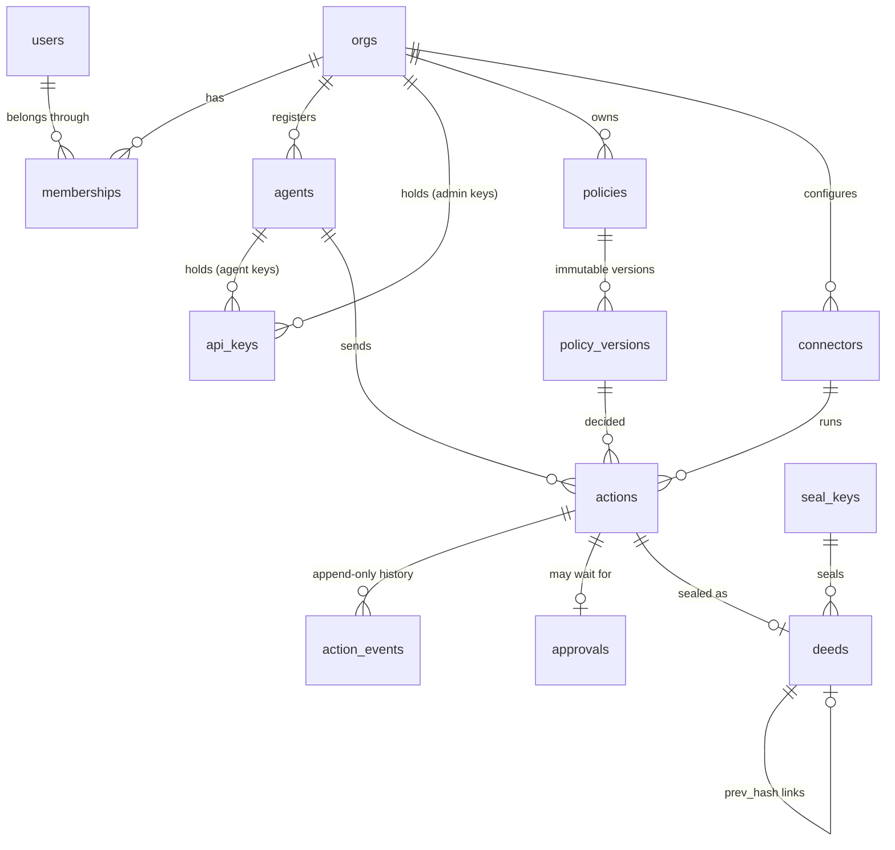

# The data model

Deedglass keeps its own state in one Postgres database, the **control plane**, in schema `deedglass`. This page is the map: what each table holds, what the database itself enforces, and what it doesn't. The schema is created by the migrations in `internal/store/migrations/` (see `docs/MIGRATIONS.md`); roles and setup are in `docs/DATABASE_SETUP.md`.

Contract §4 is the source. Version 0009, PostgreSQL 16, 17 and 18.

## The core



## Tables

32 tables: 30 from contract §4, plus `idempotency_keys` and `schema_migrations`.

| Table | What it holds | Written by |
|---|---|---|
| `orgs` | An org: the company account. Its pinned API version, time zone, retention, and "Stop all agents" state. | S07, S08 |
| `users` | A person, once, across orgs. Email and display name only. | S07 |
| `memberships` | A user's role in one org: owner, admin or viewer. | S07 |
| `sessions` | Console sign-in sessions. Hashes of the cookie and CSRF secrets, never the secrets. `org_id` is the active org. | S07 |
| `login_tokens` | Magic-link and invite tokens, hashed. No email column. | S07 |
| `agents` | Registered agents: name, status (active, suspended, stopped), labels, budgets, intent mode and intent keys. | S08, S09 |
| `api_keys` | API keys: a globally unique 8-character prefix plus a hash of the secret. Admin keys have no agent and exactly the `admin` scope. | S08 |
| `intent_nonces` | Replay memory for signed intents. | S09 |
| `policies` | Named policies. | S12 |
| `policy_versions` | One immutable version of a policy: its YAML and compiled hash. **Append-only.** | S12 |
| `policy_activations` | Which version is active in enforce or shadow mode. At most one of each per org. | S12 |
| `usage_counters` | Calls and spend per agent or org, per minute, hour and day: `(org_id, scope, counter, window_kind, window_start, value)`. `scope` is an agent id or `org`; `counter` is `calls`, `spend:<currency>` or `budget:<budget id>`; `window_kind` is `minute`, `hour` or `day` (UTC floors; day is the org's local midnight, stored as UTC). S11 uses migration 0003's table unchanged (no new migration; `TestUsageCountersShape` pins it). `Usage.Prune` deletes old windows through `SystemTx(maintenance)` ([BUDGETS.md](BUDGETS.md)). | S11 |
| `connectors` | Configured tools. | S16 |
| `credentials` | A connector's credentials, envelope-encrypted. Field names and a short hint are the only clear text. | S16 |
| `actions` | One tool call through the Gate, with its state, decision, result digest and witness verdict. | S13 |
| `action_events` | Every state change of every action. **Append-only.** | S13 |
| `approvals` | A request for a human decision on one action. | S22 |
| `approval_tokens` | One-time approve or deny links, hashed. | S22 |
| `idempotency_keys` | Stored responses for `Idempotency-Key`, kept 24 hours. | S03 |
| `seal_keys` | The instance's public seal keys. | S04 |
| `deeds` | Sealed deeds, one hash-linked chain per org. **Append-only.** | S04 |
| `admin_events` | Administrative changes in an org. **Append-only.** | S07+ |
| `witness_jobs` | Work queued for the Witness and the approval workers. | S13, S19 to S22 |
| `decoded_txs` | Transactions read from a watched database's change stream. | S20 |
| `decoder_slots` | One logical replication slot per Postgres connector. | S20 |
| `suggestions` | Insights suggestions a person accepts or rejects. | S28 |
| `anomalies` | Insights anomalies. | S27 |
| `replay_jobs` | Replays of past actions against a policy version. | S27 |
| `webhooks` | Webhook endpoints, with the signing secret encrypted. | S22 |
| `webhook_deliveries` | Each delivery attempt. | S22 |
| `waitlist` | Waitlist entries. | S36 |
| `schema_migrations` | Which migrations ran, with their checksums. | the runner |

## Global tables, and why

Every table has `org_id` except these five.

| Table | Why it is global | Row-level security |
|---|---|---|
| `orgs` | The org is the boundary itself. | Yes: `org_self` shows only the current org. |
| `users` | One person can be in several orgs (the org switcher). Access comes only from memberships; a user row grants nothing. | Yes: a user is visible only when they are a member of the current org. An org may insert a new person in the `invited` state only (`insert_invited`, S07: inviting someone new); everything else needs system scope. |
| `seal_keys` | One set of seal keys signs every org's deeds (per-org keys are v2). They are public keys. | No. |
| `waitlist` | People join before they have an org. | Yes: anyone may insert; only system scope reads. |
| `schema_migrations` | It describes the schema, not an org. | No. The runtime role can only read it. |

`login_tokens` is **not** global: each token signs into one org.

## Orgs and isolation

Every org-scoped statement runs inside `store.OrgTx(org)`, which sets the **transaction-local** setting `deedglass.org_id`. Each org table has this policy, written inline:

```sql
CREATE POLICY org_isolation ON deedglass.agents FOR ALL TO deedglass_app
  USING      (org_id = (SELECT NULLIF(pg_catalog.current_setting('deedglass.org_id', true), '')))
  WITH CHECK (org_id = (SELECT NULLIF(pg_catalog.current_setting('deedglass.org_id', true), '')));
```

- The `(SELECT …)` makes Postgres evaluate the setting once per query (an `InitPlan`), not once per row. `EXPLAIN` shows it; a test asserts it.
- **Fail closed.** With no org set, the policy compares with NULL: reads return no rows, and writes fail with `42501`.
- The setting is always set with `set_config(…, true)`, so it ends with the transaction. A pooled connection never carries an org into the next transaction. A test greps the code for the session-wide form, and another checks a one-connection pool.
- `store.SystemTx(reason)` sets `deedglass.scope = 'system'`. Only the 15 tables with a `system_scope` policy then show every org's rows; the rest show none. The reasons are named (`org_create`, `maintenance`, `health`), every call is logged at debug level, and a test lists every call site.

**Tables with `system_scope`:** `orgs`, `users`, `memberships`, `sessions`, `agents`, `api_keys`, `usage_counters`, `approvals`, `approval_tokens`, `idempotency_keys`, `decoded_txs`, `decoder_slots`, `replay_jobs`, `webhook_deliveries`, `waitlist`. This list does not grow after S02; a test pins it.

### The rule for cross-org reads (S07 onward)

Lookups that happen before the org is known (a session cookie, a login token, an email, an API-key prefix) and workers that claim jobs across orgs don't use `SystemTx`. They call narrow `SECURITY DEFINER` functions:

| Prefix | Use | Sessions |
|---|---|---|
| `preauth_*` | Find the one row a credential points to, before the org is known | S07 to S09, S22 |
| `claim_*` | Claim due jobs across orgs, with `FOR UPDATE SKIP LOCKED` | S13, S20, S22 |
| `maint_*` | Pruning and other maintenance | S06, S09 |

Each one is owned by `deedglass_migrator`, pins `search_path = pg_catalog, pg_temp`, returns the minimum columns, and is granted only to `deedglass_app`. `SystemTx` stays for org creation, health checks and tests.

## What the database enforces, and what it doesn't

### Enforced by Postgres

| Invariant | How | Error |
|---|---|---|
| One org can't read or write another org's rows | RLS on every org table, keyed on `deedglass.org_id` | no rows; `42501` on write |
| A row can't point into another org | Every foreign key between org tables includes `org_id` | `23503` |
| The runtime role can't rewrite history | No UPDATE, DELETE or TRUNCATE grant on `deeds`, `action_events`, `admin_events`, `policy_versions` | `42501` |
| Nobody edits history through SQL, the owner included | Row and statement triggers on those four tables | `DG001` |
| The runtime role can't turn the guards off | It owns nothing: no ALTER, no DISABLE TRIGGER, no DISABLE RLS, no CREATE in the schema | `42501` |
| Fixed columns stay fixed | Column-level UPDATE grants: an action's agent, key, tool and request digest; an agent's name; an API key's secret hash, prefix and scopes | `42501` |
| The deed chain links | A BEFORE INSERT trigger checks `prev_hash`: the genesis value for seq 1, the previous `body_hash` after that | `DG002`, `DG003` |
| No forks, no gaps | `UNIQUE (org_id, seq)`, `UNIQUE (org_id, prev_hash)`, and the predecessor check | `23505`, `DG002` |
| A deed's hash matches its bytes | `CHECK (body_hash = 'sha256:' || encode(sha256(body_jcs), 'hex'))` | `23514` |
| The action lifecycle | A trigger that mirrors `internal/gate/state.go`: 22 edges; a new action starts in `received` | `DG004` |
| A state carries its timestamp | One CHECK per state, for example `state <> 'sealed' OR sealed_at IS NOT NULL` | `23514` |
| An org keeps an active owner | A deferred constraint trigger, checked at commit | `DG005` |
| Ids have the right shape | One domain per id prefix, the same regex as `ids.Pattern` | `23514` |
| Digests, currencies, money | Domains `digest` and `currency`; integer minor units; amount and currency both or neither | `23514` |
| Admin keys are admin, agent keys aren't | A CHECK on `api_keys` | `23514` |
| One active enforce and one active shadow version | A partial unique index on `policy_activations` | `23505` |

### Custom SQLSTATEs

| Code | Meaning |
|---|---|
| `DG001` | The table is append-only. |
| `DG002` | The deed has no predecessor. |
| `DG003` | The deed's `prev_hash` doesn't link. |
| `DG004` | The action can't make that state change. |
| `DG005` | The org's last active owner can't be removed. |
| `DG006` | Reserved for S22's approval-vote guard. |

`DG101` to `DG103` are reserved for the customer-side guards (S17), so one code never means two things.

### Not enforced by the database

- **A superuser or the schema owner can still change anything.** They can disable triggers, turn off RLS, or rewrite rows. Postgres can't stop its own superuser. Offline deed verification (S05) detects a rewritten or broken chain; it doesn't prevent one.
- **RLS stops a forgotten filter, not an attacker.** Anyone who can run SQL as `deedglass_app` can set `deedglass.org_id` or `deedglass.scope` themselves. SQL injection and a compromised server are handled elsewhere: parameterized SQL only, no user SQL ever runs on the control plane, the two-role split, and offline verification.
- **Seals aren't checked.** The database checks the shape of a seal and the hash chain, not the Ed25519 signature. S04 seals; S05 verifies.
- **Time isn't checked.** `issued_at` comes from the database clock under S04's chain lock; the schema doesn't check that it never decreases along `seq`.
- **Business rules above the schema.** Reserved agent names, scope choices for agent keys, budgets and policy semantics are enforced in Go.

## Retention

Payloads are prunable; digests and deeds stay ([RETENTION.md](RETENTION.md), `deedglass ledger prune`).

| What | Kept |
|---|---|
| `actions.request`, `actions.result`, `actions.witness_detail` | Until the org's retention (90 days by default, `orgs.retention_days`). S06 sets them to NULL and records `payload_pruned_at`. |
| Digests (`request_digest`, `result_digest`, `witness_detail_digest`) | Always. |
| `deeds`, `action_events`, `admin_events`, `policy_versions` | Always (append-only). |
| `idempotency_keys` | 24 hours (S03's pruning job). |
| `intent_nonces`, `login_tokens`, `sessions` | Until they expire (S07, S09). |

## Ledger additions (0010, S06)

`0010_ledger.sql` adds only what S06 needed beyond 0005/0006:

| Object | What | Why |
|---|---|---|
| `actions.execution_status` | `succeeded`, `failed`, `unknown`, or NULL until the tool ran | the deed's `execution.status` (contract §6); `executing_at` is when execution started, `executed_at`/`failed_at` when it finished |
| `actions_verdict_time` | `(org_id, witness_verdict, created_at DESC, id DESC)` | `GET /v1/actions?verdict=` |
| `actions_tool_prefix` | `(org_id, tool text_pattern_ops)` | prefix globs (`tool=stripe.*`) |
| `actions_org_open` | `(org_id, state) WHERE state <> 'sealed'` | the open actions of one org |
| `action_events_data_size` | `CHECK (pg_column_size(data) <= 2048)` | event data is short codes and digests, never payloads |
| `action_events_action` | `(org_id, action_id, seq)` | an action's events in order |
| `admin_events_reason_len` | `CHECK (char_length(reason) <= 280)` | the deed's `admin.reason` limit |
| `admin_events_data_size` | `CHECK (pg_column_size(data) <= 16384)` | only its digest enters the deed |
| `deeds_org_kind_seq` | `(org_id, kind, seq)` | `GET /v1/deeds?kind=` |

`(org_id, created_at DESC, id DESC)` and `(org_id, agent_id, created_at DESC, id DESC)` on
`actions`, and `UNIQUE (action_id, seq)` on `action_events`, already existed (0005).

## Identity additions (0011, 0012, S07)

0002 already had S07's tables and column names; 0011 and 0012 add only the real gaps.

| Object | What | Why |
|---|---|---|
| `login_tokens_user_time` | `(user_id, created_at DESC)` | voiding a user's older tokens; the hourly per-user cap |
| `sessions_user_live` | `(user_id) WHERE revoked_at IS NULL` | logout everywhere; ending a removed member's sessions |
| policy `insert_invited` on `users` | `FOR INSERT … WITH CHECK (status = 'invited' AND last_login_at IS NULL AND email_verified_at IS NULL)` | an org invites someone new; the row grants nothing and stays invisible until a membership links it |

**Users are global, and access is never derived from the user row.** What a person may do is read
on every request from their membership in the session's org (role and status), so a role change or a
removal applies to their very next request.

The five cross-org functions (0012). Each is `SECURITY DEFINER`, owned by `deedglass_migrator`
(whose tables have no `FORCE ROW LEVEL SECURITY`), pins `search_path = pg_catalog, pg_temp`, takes a
hash or an id (never a pattern) and is executable by `deedglass_app` only. `store.PreAuth` is the only
Go caller; `TestPreAuthNamesStayInStore` fails if the names appear anywhere else.

| Function | Returns | Used by |
|---|---|---|
| `preauth_session(token_hash)` | session id, org, user, CSRF hash, `last_seen_at`, both expiries, `revoked_at` | the session middleware |
| `preauth_login_token(token_hash)` | token id, org, user, membership, purpose, `expires_at`, `used_at`, `voided_at` | preview and callback |
| `preauth_user_by_email(email)` | user id and status; per non-removed membership: org id, name and status, role, status, `last_used_at`, `joined_at`; tokens created in the last hour | the sign-in worker, codes, invites, logout everywhere, the org list in `GET /v1/me` |
| `preauth_code_token(user_id)` | the newest unused, unvoided, unexpired login token with a code | code sign-in |
| `maint_prune_identity(limit)` | rows deleted | the prune job in `serve`, every 10 minutes |

Writes (using a token, opening a session) always follow in a normal org-scoped transaction.

## Agents and keys additions (0013, S08)

0002 already had `agents`, `api_keys` and the `orgs` stop columns with S08's names, `CHECK`s and
grants: agent names have no `UPDATE` grant, so they can't change, and admin keys carry exactly
`{admin}`. `0013_identity_agents.sql` adds only the real gaps:

| Object | What | Why |
|---|---|---|
| `api_keys_agent_live` | `(org_id, agent_id) WHERE revoked_at IS NULL` | an agent's active keys: the 10-key limit and the key list |
| `admin_events.actor_type` | gains `api_key` (now `user`, `agent`, `api_key`, `system`) | an org admin key is the actor of what it changes |
| `deedglass.preauth_api_key(p_prefix)` | see below | the one lookup that happens before the org is known |

`preauth_api_key` follows 0012's pattern: `SECURITY DEFINER`, `search_path = pg_catalog, pg_temp`,
`EXECUTE` for `deedglass_app` only, and `store.PreAuth` is its only Go caller. It takes the
8-character public prefix, never the secret, and returns in one round trip:

| Returns | From |
|---|---|
| `id`, `org_id`, `agent_id`, `mode`, `secret_hash`, `scopes`, `expires_at`, `revoked_at` | the key |
| `agent_name`, `agent_status` | its agent (null for an org admin key) |
| `agent_intent_mode`, `agent_intent_keys` | its agent's signed-intent settings (added by 0014, S09) |
| `org_name`, `org_status`, `org_stopped_at`, `org_api_version` | its org |

The caller compares `sha256(pepper ‖ secret)` with `secret_hash` in constant time. The hash is
never logged or returned to a client.

### The `deedglass_identity` channel

Every change to who may act sends a `NOTIFY` on `deedglass_identity` inside its own transaction,
so Postgres delivers it only if the change commits, and a failed `NOTIFY` rolls the change back
([STOP.md](STOP.md)). Payloads are JSON, at most 200 bytes, and carry ids and states only, never
secrets, names or reasons:

```json
{"v":1,"t":"agent","org":"org_…","id":"agt_…","s":"stopped"}
{"v":1,"t":"key","org":"org_…","id":"key_…","p":"jJbEEMWk","s":"revoked"}
{"v":1,"t":"org","org":"org_…","id":"org_…","s":"stopped"}
{"v":1,"t":"ping","from":"<instance>","n":42}
```

`t` is `agent`, `key`, `org`, `member` or `ping`. `p` is a key's public prefix (the cache's key);
`s` is the new state (`active`, `suspended`, `stopped`, `rolled`, `revoked`). Each instance sends a
`ping` every 500 ms to check that its own listener is alive. `store.NotifyIdentity` is the one door
to the channel.

## Signed intents additions (0014, S09)

0002 already had `agents.intent_mode` (`off`, `optional`, `required`, default `off`),
`agents.intent_keys` (a JSON array of at most 2) and `deedglass.intent_nonces` (primary key
`(agent_id, nonce)`, RLS on `org_id`, the `expires_at` index) with S09's names.
`0014_identity_intents.sql` adds only the real gaps:

| Object | What | Why |
|---|---|---|
| `deedglass.intent_keys_valid(jsonb)` and `agents_intent_keys_shape` | a `CHECK` that `intent_keys` is an array of at most 2 objects, each with exactly `kid` (`^[0-9a-f]{32}$`), `public_key` (`^ed25519:[A-Za-z0-9_-]{43}$`), `created_at` and `created_by` as strings, and no kid twice | a row edited outside the API can't hold a malformed key. The curve checks (small order, canonical encoding) stay in Go, which parses every stored key again on read |
| `deedglass.maint_prune_intent_nonces(p_limit)` | `SECURITY DEFINER`, `search_path = pg_catalog, pg_temp`, `EXECUTE` for `deedglass_app` only; deletes up to `p_limit` (at most 100,000) nonces whose `expires_at` is more than 2 minutes in the past, oldest first, and returns how many | `serve` runs it every minute in batches of 10,000. An intent is accepted until `exp + 60 s`, so a pruned nonce's intent is always refused as expired first ([INTENTS.md](INTENTS.md) §9) |
| `deedglass.preauth_api_key(p_prefix)` | dropped and created again in the same transaction, returning everything it did plus `agent_intent_mode` and `agent_intent_keys` | the principal cache carries the agent's mode and keys, so the intent check costs no extra round trip |

`intent_nonces` rows hold the agent, the nonce, the `intent_hash` and the intent's `exp`, never the
intent or its arguments. Consuming a nonce is one `INSERT … ON CONFLICT (agent_id, nonce) DO
NOTHING` in an org-scoped transaction: of any number of concurrent uses, exactly one inserts.

## Personal data

Sessions and sign-in tokens keep the client IP address and User-Agent (at most 512 characters) for
security review. `maint_prune_identity` deletes sign-in tokens 7 days after they expire and sessions
30 days after they expire or are revoked; `serve` runs it every 10 minutes, 5,000 rows at a time.

Email addresses live only in `users` and `waitlist`. Tokens and API keys are stored as hashes
(an API key as its public prefix plus `sha256(pepper ‖ secret)`). Payloads are prunable. On-behalf-of references (`Deedglass-On-Behalf-Of`, `Deedglass-Session`, S09) are stored and, from S13, sealed exactly as the agent sends them; the docs ask for opaque ids, never names or emails, because Deedglass can't tell the difference. Event payloads (SSE and webhooks) carry ids, never emails.
