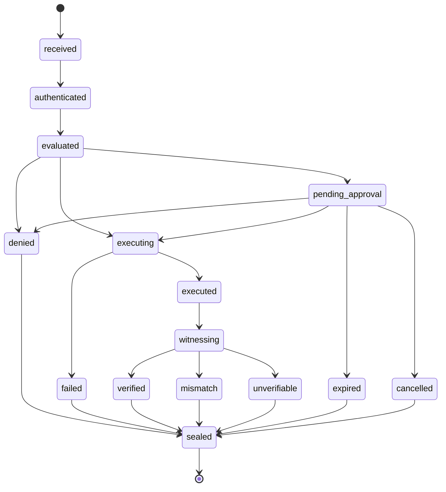
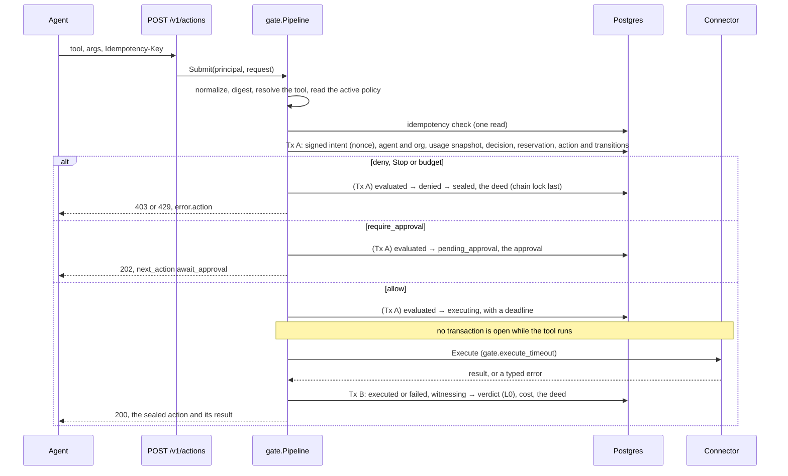

# The Gate

Every agent action passes through the Gate. It is one pipeline (`internal/gate`) that every
surface uses: the REST API today, the MCP stdio wrapper (S14), the Streamable HTTP gateway (S15) and
the SDKs (S31, S32). An action enters with `POST /v1/actions`, and leaves as a sealed deed. On the
way the Gate checks who sent it, asks the policy, waits for a person when a rule says so, runs the
tool under control (or lets the edge run it, in proxy mode), records what the tool reported, and
seals.

## The state machine

The edge table lives in `internal/gate/lifecycle` (contract §5). A database trigger mirrors it, and
a test keeps this diagram equal to the code (`TestGateDoc`).



- **One write path.** Every transition is a compare-and-set on `actions.state` (`UPDATE … WHERE
  id = $1 AND state = $from`), one `action_events` row and one event, written by
  `ledger.Transition` in one statement. The columns an edge records (the decision, the deadline,
  the execution, the verdict) ride in the same `UPDATE` as a `ledger.Patch`, and each edge may
  write only its own columns.
- **An illegal edge fails loudly.** In tests it panics at the call site; in production it returns
  `gate.ErrIllegalTransition` and nothing is written.
- **Honest unknowns.** There is no `executing → unverifiable` edge. When Deedglass can't know
  whether a tool ran (a timeout, a crash, a lost edge, a connector that panicked), the action goes
  `executing → executed` with `execution.status = unknown`, then `witnessing → unverifiable` with
  its reason, then `sealed`. The deed says plainly that the tool may have run. `failed` means the
  tool certainly did not apply the call.

## Gateway and proxy mode

| | Gateway (default) | Proxy |
|---|---|---|
| Who runs the tool | Deedglass, through a connector | The edge (S14's MCP wrapper), which reports back |
| After an allow | `executing`, then the tool runs, then sealed | `executing` with `status: "authorized"` and a deadline |
| The result | the connector's answer | `POST /v1/actions/{id}/result`, by the same agent, once |
| The witness method | `reported` (L0: the tool reported success) | `edge_reported` (L0: the edge reported success) |
| Connector type | from the connector registry | declared by the edge: `connector_type` (default `mcp`; `postgres` turns on the SQL guard for `args.sql`) |

## The status field

`status` is the one field an agent needs; `state` is the exact lifecycle state.

| status | HTTP on `POST /v1/actions` | Meaning |
|---|---|---|
| `executed` | 200 | The tool ran and the action is sealed, whatever the verdict. |
| `processing` | 202 | Still executing or witnessing when `wait` ended. Poll `GET /v1/actions/{id}?wait=25`. |
| `authorized` | 200 | Proxy mode: run the tool at the edge now, then report the result. |
| `pending_approval` | 202 | Waiting for a person. `next_action.poll_url` waits for the decision. |
| `denied` | 403 or 429, `error.action` | A policy, a budget or Stop refused it. Nothing ran. The refusal is sealed. |
| `failed` | 200 | The tool certainly didn't apply the call (it refused it, or it was never sent). |
| `expired` | (later) | No one decided before the approval expired. |
| `cancelled` | (later) | Cancelled while it waited for approval. |

Refusals answer with an error envelope that carries the sealed action (Stripe-style):
`policy_denied` and `policy_unavailable` (403 `policy_error`), `budget_exceeded` (429
`rate_limit_error`, with `Retry-After`), `agent_stopped`, `agent_suspended` and `org_stopped` (403
`permission_error`), and `tool_unknown` (404). The message is S11's decision sentence, verbatim.

## Idempotency

`POST /v1/actions` owns its idempotency (the HTTP middleware stays out of this route):

- A key names one action per agent for 24 hours (a unique index on org, agent and key).
- The same key with the same request answers with the original action and
  `Deedglass-Idempotent-Replayed: true`. The tool runs once.
- While the original is still running, a duplicate waits for it (up to its own `wait`) and answers
  with the same action. One connector call, whatever the client retries.
- The same key with a different request (another tool, other arguments, another on-behalf-of or
  session) is `422 idempotency_conflict`.
- Another agent's key is independent. After 24 hours the key is free again: the sweeper clears it,
  and a request that finds an expired key takes it over.
- The comparison is the request fingerprint: the request digest plus the `Deedglass-On-Behalf-Of`
  and `Deedglass-Session` headers. A signed intent isn't part of it, so a client that signs again for
  a retry still replays.

## Transaction boundaries



- No transaction is open while a tool runs (a test checks the pool at that moment).
- The reservation of S11's usage store happens inside Tx A, in a savepoint: it commits with the
  action or not at all. A reservation another request won first becomes a recorded
  `budget_exceeded`. Reservations go back when an action ends without reaching the upstream
  (denied after approval, expired, cancelled, failed before it was sent).
- The deed chain lock is taken last in whichever transaction seals, so it is held for well under a
  millisecond.
- The decision is pinned: the action records the policy version and its hash, and an activation
  that lands mid-flight doesn't change an action already decided.
- The shadow policy, when one is active, is evaluated on the same input and recorded next to the
  enforced decision (`decision.shadow`), never enforced.
- If only the seal fails (a retired seal key, say), the outcome is recorded anyway and the sweeper
  seals it once the cause is fixed. A result that came back is never lost to a sealing problem.

## Crash recovery and the worker

`deedglass serve` runs a worker on every instance. It wakes on `deedglass_jobs` and polls every 2 s
(±20%). The sweepers run every 5 s:

1. **Crash recovery:** an action still `executing` past its deadline becomes `executed` with status
   `unknown` (error `timeout` in gateway mode, `edge_lost` in proxy mode), then `unverifiable`, then
   sealed. A result that arrives later is refused with `409` ("already sealed as UNVERIFIABLE").
2. **Unsealed:** an action in a final state idle for 30 s is sealed.
3. **Approval expiry:** a pending action past its approval's `expires_at` becomes `expired`, then
   sealed; its reservation goes back.
4. **Idempotency release:** keys of actions older than 24 hours are cleared, 1,000 per pass.

The cross-org reads are two narrow `SECURITY DEFINER` functions that return ids only
(`deedglass.claim_witness_jobs`, `deedglass.claim_stale_actions`) plus
`deedglass.maint_release_action_keys`; every change then runs in an org transaction with
row-level security on. Two instances may race on one action; the compare-and-set lets exactly one
win, so nothing is sealed twice.

Witness jobs (`witness_jobs`) are claimed with `FOR UPDATE SKIP LOCKED`. Today the L0 witness
answers inline, so no job is created; S19's Witness defers to them, with backoff `min(2^attempts s,
5 min) ±20%`, and seals `UNVERIFIABLE` (`witness_gave_up`) after `gate.worker.max_attempts`.

## Long polls

`GET /v1/actions/{id}?wait=0..25` returns when the action is settled (sealed, or waiting for a
person), when its state changes, or when the wait ends. An action that is already pending when the
wait starts waits for its next change, which is how a client waits for a person's decision. For an
agent key, a Stop ends the wait at once with the stop error. Each agent may hold 20 open waits;
the 21st is `rate_limited`. Waits are woken by `deedglass_events` and re-read every second.

## Settings

`deedglass.yaml`, section `gate` (no environment variables; docs/CONFIG.md has the ranges):

```yaml
gate:
  wait_timeout: 10s
  execute_timeout: 30s
  edge_result_timeout: 10m
  max_args_bytes: 262144
  max_result_bytes: 262144
  worker:
    concurrency: 4
    max_attempts: 8
```

## Metrics

`deedglass_gate_actions_total{mode,status}`, `deedglass_gate_overhead_seconds` (buckets 1, 2, 5,
10, 25, 50 and 100 ms), `deedglass_worker_jobs_total{kind,result}`, `deedglass_worker_queue_depth`
(the jobs this instance holds), `deedglass_gate_sweeps_total{sweeper,result}`, and
`deedglass_policy_eval_time_limit_total{mode}`: every evaluation the 50 ms time limit stopped. That
limit fails closed (`policy_unavailable`), so each trip is a refused action, and each one is also
logged at warn level with the org and agent.

## The console system agent (S23)

Every action needs an agent: `actions.agent_id` is required and the deed names one. Some actions are
started by a person, not an agent, and the first is undo ([UNDO.md](UNDO.md)). For those, each org
has a **system agent** named `console` (`agents.kind = 'system'`), described as "Actions a person
starts from the Console or the CLI, such as undo." It is created on first use, with an
`agent.created` admin deed whose actor is Deedglass.

- **Person-initiated.** The principal is the `console` agent with the person attached: the action's
  `on_behalf_of` is the person's `usr_` id (for an org admin key, the person who minted the key).
  Policies can match it with `agent: console`, and S22's self rule keeps the person from
  countersigning their own request.
- **Internal tools are reachable only this way.** A connector can declare internal tools
  (`ToolSpec.Internal`), such as the Postgres connector's `undo`. They are never listed to agents.
  An agent that calls one gets a sealed `tool_unknown`; only the `console` principal resolves them
  (`Registry.ResolveInternal`, wired in as `gate.Options.Internal`), and it resolves nothing else.
- **It holds no keys.** Creating a key for it is `validation_failed`. The undo routes take an
  admin or owner session or an org admin key; agent keys get `insufficient_scope`.
- **Stop all skips it.** You stop your agents, then undo what they wrote. An admin can still stop
  `console` on its own, and a stopped `console` refuses every person-initiated action
  (`agent_stopped`).
- **Reserved names.** No agent can be registered as `console`, `system` or `deedglass`.

## What the Gate doesn't do

- It doesn't undo a tool by itself. A person can undo a Postgres write witnessed at L2 (S23,
  [UNDO.md](UNDO.md)); anything else stays as it ran.
- It doesn't make an edge-reported result independent. In proxy mode the deed says
  `edge_reported`: it records what the edge said. S21's L2 witness checks Postgres on its own.
- It doesn't retry a tool. A timeout is an unknown outcome, never a second call.
- It doesn't witness beyond L0 until S19: today's verdict is what the tool reported.
- It doesn't block a `dg_test_` key. The action records `livemode`, but connectors have no test or
  live mode in v1.
- The fake connector (`fake.echo`, `fake.write`, `fake.fail`, `fake.slow`) exists only when
  `DEEDGLASS_ENV=dev`. Real connectors arrive in S16 and later.
