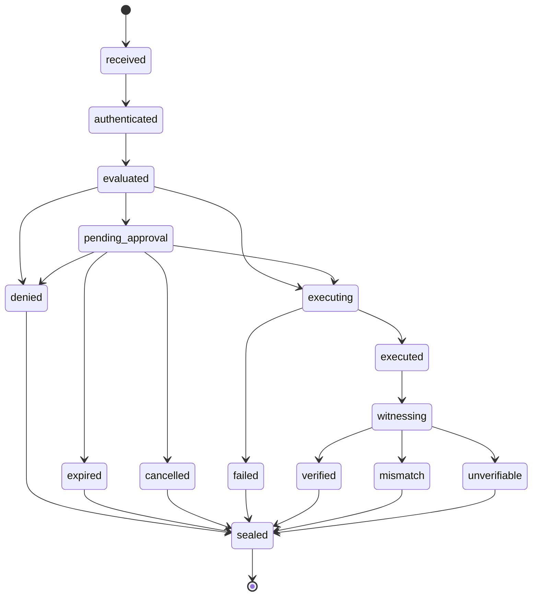

# The Ledger

The Ledger is the searchable history of everything agents did in an org: every action, every state
change, every deed and every admin decision. The Console's Actions and Deeds screens read it, a
security lead searches it after an incident, and an auditor exports it and checks it with
`deedglass verify` without trusting Deedglass.

Code: `internal/ledger` (S06). It has nothing to do with `deedglass.ledger`, the table S17 creates
in a customer's database for L2 witnessing.

## 1. What the Ledger records

| Record | Table | Changes? | Holds |
|---|---|---|---|
| Action | `actions` | its state moves along the lifecycle; payloads can be pruned | who, which tool, the decision, the execution, the verdict, digests, and the payloads (`request`, `result`, `witness_detail`) until retention removes them |
| Action event | `action_events` | append-only | one row per state change (`seq`, `from`, `to`, `at`, `actor`) plus short codes (`reason`, `rule_id`, `error_code`, `level`, `verdict`, `approval_id`, `detail_digest`), at most 2 KiB, never payloads |
| Deed | `deeds` | append-only | the sealed record ([DEED_SPEC.md](DEED_SPEC.md)): digests, never payloads, hash-chained per org |
| Admin event | `admin_events` | append-only | one administrative change (who, what, which object, why, at most 280 characters of reason, a 16 KiB data object), and the admin deed that seals it |

One write path: nothing in Deedglass writes `action_events`, `admin_events` or `deeds` except
`internal/ledger`. A state change, its event, its deed and its event notification commit in one
transaction, or not at all.

## 2. The lifecycle

The edges are contract §5, `internal/gate/state.go`, and a database trigger that mirrors it.



An action is sealed only from one of the seven final states (`gate.State.Sealable`), and only by
`ledger.SealAction`, which seals its deed in the same statement that moves it to `sealed`. When
Deedglass can't know whether a tool ran, the action goes `executing → executed` with
`execution.status = unknown`, then `witnessing → unverifiable`. A later verdict never edits a deed:
it is sealed as an amendment deed.

## 3. Querying actions

`GET /v1/actions` (and `deedglass actions list`) returns the newest first, ordered by
`(created_at, id)` descending.

| Parameter | Meaning | Example |
|---|---|---|
| `agent` | an agent id | `agt_01j9z9b1d3f5h7k9m1p3r5t7v9` |
| `tool` | exact, or a glob with `*` (at most three; `_` and `%` are literal) | `stripe.*`, `*.execute` |
| `state` | a comma list of states | `pending_approval` |
| `decision` | `allow`, `deny`, `require_approval` | `deny` |
| `verdict` | `VERIFIED`, `MISMATCH`, `UNVERIFIABLE` | `MISMATCH,UNVERIFIABLE` |
| `level` | `L0`, `L1`, `L2` | `L2` |
| `on_behalf_of` | the exact reference the agent sent | `u_4821` |
| `created_at[gte]`, `created_at[lt]` | RFC 3339 | `2026-10-02T00:00:00Z` |
| `q` | 2–64 characters to find in the tool name or the error code | `refund` |
| `limit` | 1–100, default 25 | `100` |
| `cursor` | `next_cursor` from the previous page | |

Rules:

- Filters combine with AND. A parameter this list doesn't know is refused (400
  `validation_failed`), so a typo never widens a query.
- The cursor is opaque. It holds the last row's `created_at` and id and a hash of the filters it
  was issued with. Reusing it with different filters is 400 `validation_failed` on `cursor`:
  "This cursor belongs to a different query." Cursors carry no org; row-level security scopes every
  query to yours.
- Rows added while you page appear only on a fresh first page; they never shift later pages.
- An id from another org is 404 `not_found`, exactly like an id that doesn't exist.

```sh
curl -s -H 'Deedglass-Dev-Org: org_01j9z8m2k4p6r8t0v2x4z6b8d0' \
  'http://127.0.0.1:8080/v1/actions?verdict=MISMATCH&limit=2'
deedglass actions list --verdict MISMATCH --limit 2
deedglass actions show act_01j9zt3a5c7e9g1j3m5p7r9t1v
```

`GET /v1/actions/{id}` adds `request`, `result` and `witness.detail` (`null` after pruning), up to
200 `events`, the `deeds` about the action (its deed and any amendments) and `approval` (`null`
until S22).

Until sign-in (S07) and API keys (S08, S09) exist, the only principal is a dev principal: with
`DEEDGLASS_ENV=dev`, from a loopback address, send `Deedglass-Dev-Org: org_…`. It is refused in
prod and from any other address, and S07/S09 delete it.

## 4. Deeds and the chain

Every org has one chain: deed `seq` 1, 2, 3… with no gaps, each deed's `prev_hash` the `body_hash`
of the one before (seq 1 links to the org's genesis value). The database refuses a fork, a gap and
any UPDATE or DELETE. [DEED_SPEC.md](DEED_SPEC.md) has the format.

- `GET /v1/deeds?from_seq=&to_seq=&kind=&action=&order=asc|desc` lists envelopes, oldest first.
- `GET /v1/deeds/{id}` returns the stored canonical bytes verbatim, with `ETag` = the
  `body_hash` and `Cache-Control: private, max-age=31536000, immutable`. With
  `Accept: application/cose` it returns a COSE_Sign1 signed statement (not an RFC 9942
  transparency-service object).
- `deedglass deeds show 812` takes an id or a seq.

## 5. Checking the chain

`GET /v1/ledger/check` and `deedglass ledger check` stream the org's deeds in seq order through
the same verifier `deedglass verify` uses, with the server's own key set: hashes, seals, links and
seq continuity.

```
$ deedglass ledger check
✓ Chain intact · 1,204 deeds · seq 1 → 1,204 · 2 seal keys · 0.31 s
  head       seq 1,204 · sha256:5e0b…a91c · keep this somewhere outside Deedglass
```

- `status` is `intact`, `broken` (with `break`: seq, deed, code, message, next) or `incomplete`
  (the 30 s budget or the 2,000,000-deed limit was reached; `next_from_seq` says where to resume).
  A broken chain is a result, not an error, and it is logged at ERROR.
- A range that doesn't start at 1 is anchored on the stored `body_hash` of the deed before it.
- **Keep the `head` somewhere outside Deedglass** (a ticket, a log, a different system). A check
  inside one database can't see deeds deleted from the end of the chain; comparing today's head
  with one you kept can.

Exit codes: 0 intact, 1 broken, 2 incomplete.

## 6. Exports

`GET /v1/deeds/export` and `deedglass deeds export` write an export bundle v1
([BUNDLE_FORMAT.md](BUNDLE_FORMAT.md)): `README.txt`, `keys.json`, `deeds.jsonl`, `manifest.json`
and `manifest.seal.json`, as a deterministic tar.gz.

- One `REPEATABLE READ READ ONLY` snapshot for the whole export: pass 1 counts the deeds and
  their bytes, pass 2 streams them. Memory stays flat; writers are never blocked.
- Choose deeds by `from_seq`/`to_seq` or by `issued_at[gte]`/`issued_at[lt]`, at most 1,000,000 at
  a time. An empty range is 404 with where the chain ends.
- The same range exported twice gives the same bytes, apart from `created_at` (a test pins it).
- If the client disconnects, the export stops and rolls back; the partial file fails
  `deedglass verify` with `bundle_invalid`.
- `--format jsonl` writes the deeds alone, one stored envelope per line.

```
$ deedglass deeds export --out acme-oct.tar.gz
◐ Exporting deeds 1 → 1,204 for org_01j9z8m2…
✓ 1,204 deeds · 2.7 MB · manifest sealed by sk_01j9zr8k…
  file       acme-oct.tar.gz
  next       deedglass verify acme-oct.tar.gz --keys http://127.0.0.1:8080/.well-known/deedglass/keys.json
```

Pin the issuer's keys when you verify (`--keys <issuer>/.well-known/deedglass/keys.json`): the
bundle's own `keys.json` shows nothing changed since export, not who sealed it.

## 7. Admin deeds

Every administrative change is an admin deed, sealed through `ledger.RecordAdmin` with its
`admin_events` row. The names are a catalogue in `internal/ledger/admin_actions.go`
(`<object>.<past verb>`, matching `^[a-z_]+\.[a-z_]+$`); each session adds its own line, and
`RecordAdmin` refuses a name that isn't there.

| Action | Session |
|---|---|
| `ledger.pruned` | S06 |
| `org.created`, `org.updated`, `member.invited`, `member.joined`, `member.role_changed`, `member.removed`, `login_link.issued` | S07 |
| `agent.created`, `agent.updated`, `agent.suspended`, `agent.resumed`, `agent.stopped`, `agent.started`, `org.stopped_all`, `org.started_all`, `api_key.created`, `api_key.rolled`, `api_key.revoked` | S08 |
| `agent.intent_key_added`, `agent.intent_key_removed`, `agent.intent_mode_changed` | S09 |
| `policy.activated`, `policy.deactivated` | S12 |
| `connector.credentials_updated` | S16 |
| `decoder.slot_created`, `decoder.slot_dropped` | S20 |
| `approval.decided`, `approval.countersigned`, `webhook.created`, `webhook.deleted`, `webhook.disabled` | S22 |
| `anomaly.resolved`, `insights.settings_changed` | S27 |
| `suggestion.accepted`, `suggestion.rejected` | S28 |

Only the digest of the event's data enters the deed; the data stays in `admin_events.data`.

## 8. Events

Every write publishes on the Postgres channel `deedglass_events`, delivered at COMMIT (a rolled-back
seal never announces itself). S24 turns these into SSE, S22 into webhooks.

| Transition into | Event |
|---|---|
| `received` | `action.created` |
| `denied`, `pending_approval`, `executing` (from `evaluated`) | `action.decided` |
| `executed`, `failed` | `action.executed` |
| `verified`, `mismatch`, `unverifiable` | `action.witnessed` |
| `sealed`, every admin deed and every amendment | `deed.sealed` |

One payload shape, every key present (`null` when it doesn't apply), at most 1 KiB, ids and states
only:

```json
{"v":1,"event":"evt_01j9zt3q5v7x9z1b3d5f7h9k1m","type":"deed.sealed","org":"org_01j9z8m2k4p6r8t0v2x4z6b8d0","id":"deed_01j9zt3q5s7v9w1y3a5c7e9g1j","seq":812,"action":"act_01j9zt3a5c7e9g1j3m5p7r9t1v","state":"sealed","deed":"deed_01j9zt3q5s7v9w1y3a5c7e9g1j","at":"2026-10-02T10:14:03.512Z"}
```

Nobody calls `pg_notify('deedglass_events', …)` directly; `ledger.Publish` is the one door.

## 9. When the chain is broken

Deeds are append-only for every Deedglass role, so a broken chain means someone with database
superuser rights (or with the files) changed the database underneath Deedglass. Treat it as an
incident:

1. **Stop writes.** Stop the Deedglass servers, so nothing new is sealed onto a broken chain.
2. **Snapshot the database** as it is now (`pg_dump`, or a volume snapshot), before anything is
   repaired or restored.
3. **Export and verify the ranges around the break** with the issuer's pinned keys:
   `deedglass deeds export --from-seq <break-100> --to-seq <break+100>`, then
   `deedglass verify <file> --keys <issuer>/.well-known/deedglass/keys.json --all`.
4. **Compare with an old export** that covers the same seqs. A deed that verified then and fails
   now was changed after that export; the old copy is what it said.
5. **Write down the head** you have now, and compare it with every head you kept elsewhere.
6. Find out who had superuser or file access, from database and host logs. Deedglass can't tell
   you; the chain only shows that, and where, something changed.

## 10. What the Ledger does not do

- It never deletes or archives deeds, never repairs a chain and never re-seals anything.
- It doesn't search inside payloads (`q` matches the tool name and the error code only).
- It has no cross-org queries; every read is one org's.
- The chain check runs inside the database it checks: it can't see deeds deleted from the end of
  the chain unless you compare the head with one you kept elsewhere.
- Retention is an operator command today (`deedglass ledger prune`); a daily sweep inside `serve`
  is planned.
- Until S07/S09, the HTTP routes accept only the dev principal (loopback, `DEEDGLASS_ENV=dev`).

## Performance

The S06 §3.10 budgets (100,000 actions in one org, local PostgreSQL 18) are a test,
`TestLedgerBudget` (`make bench-ledger`), with raw output in `bench/results/`. They are development
measurements, not public claims; [BENCHMARKS.md](BENCHMARKS.md) explains when numbers become
quotable (S35).
