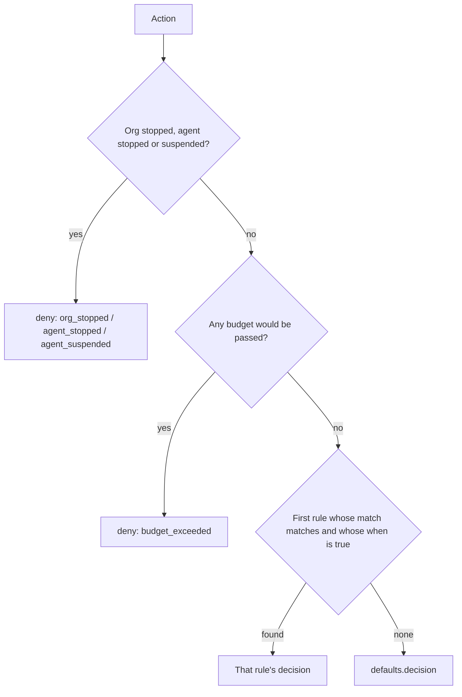

# The Deedglass policy language (`deedglass: policy/v1`)

**Status:** normative for policy/v1 (S10). Owners: S10 (language, compiler, `lint`, `fmt`), S11 (evaluation), S12 (storage and versions).
**Audience:** anyone who writes, reviews or audits a policy, and anyone writing a compatible compiler.

## 1. In ten seconds

```yaml
deedglass: policy/v1
name: refunds
defaults:
  decision: deny
  reason: No rule allows this action. Add a rule in Console › Policies to allow it.
rules:
  - id: block-destructive-sql
    match: { tool: "postgres.*" }
    when: sql.kind in ["drop", "truncate"]
    decision: deny
    reason: DROP and TRUNCATE are never allowed for agents.
  - id: small-refunds
    match: { tool: stripe.create_refund }
    when: args.amount <= minor("50.00 usd")
    decision: allow
  - id: large-refunds-need-approval
    match: { tool: stripe.create_refund }
    decision: require_approval
    reason: Refunds over $50.00 wait for a human. An admin can approve in Console › Approvals.
```

A policy decides, for every action an agent asks for, whether it runs (`allow`), never runs (`deny`) or waits for a person (`require_approval`).
Rules are read top to bottom, and **the first rule that matches decides**; when none matches, the `defaults` decide.
**An error never widens access:** a condition that can't be evaluated never lets an action through.

## 2. Contents

1. In ten seconds
2. Contents
3. The file format
4. Fields
5. Globs, money and durations
6. Evaluation order and the two invariants
7. The CEL environment
8. Limits
9. Normalization and `version_hash`
10. How the language is versioned
11. Formatting (`deedglass policy fmt`)
12. What policies can't do
13. Coming from OPA/Rego, Cedar or Kubernetes CEL
14. Later
15. FAQ
16. Diagnostics at a glance

The diagnostic codes (`unknown_key`, `cel_type`, …) are listed in section 16 and, with examples and fixes, in [POLICY_ERRORS.md](POLICY_ERRORS.md). The CLI is in [CLI.md](CLI.md#policies).

## 3. The file format

A policy is one YAML document in UTF-8 (a byte-order mark and CRLF line endings are accepted). It is a mapping with these top-level keys:

```yaml
# Comments are kept by fmt and ignored by the hash.
deedglass: policy/v1              # format marker; required
name: postgres-safe               # slug, unique per org
description: Reads run freely. Writes wait for a human. Schema changes never run.

defaults:                         # applies when no rule matches
  decision: deny                  # allow | deny | require_approval
  reason: No rule allows this action. Add a rule in Console › Policies to allow it.
  verify: L0                      # minimum witness level for allowed writes (S19 enforces it)
  approval:                       # used by require_approval rules that omit fields
    approvers: [role:admin]
    required: 1
    expires_in: 30m

budgets:                          # checked before rules
  - id: agent-rate
    per: agent                    # agent (default) | org
    window: minute                # minute | hour | day (day = the org's local calendar day)
    max_calls: 60
  - id: refunds-per-day
    match: { tool: stripe.create_refund }
    per: org
    window: day
    max_spend: "500.00 usd"       # money is always a string "<decimal> <currency>"
    measure: args.amount          # CEL giving int minor units; omit it to count the reported cost

rules:                            # first match wins
  - id: block-destructive-sql
    description: DROP and TRUNCATE never run through agents.
    match:                        # every present field must match; a list means "any of"
      tool: "postgres.*"          # glob on the full tool name <connector>.<tool>
      connector_type: postgres
      side_effect: [write, destructive]
      agent: ["support-*"]        # glob on the agent's name, or an exact agt_ id
      labels: { env: prod }       # agent labels; every pair must match exactly
    when: sql.kind in ["drop", "truncate"]   # CEL returning bool; omitted means true
    decision: deny
    reason: DROP and TRUNCATE are never allowed for agents.
    notify: [slack]
  - id: large-refunds-need-approval
    match: { tool: stripe.create_refund }
    when: args.amount > minor("50.00 usd")
    decision: require_approval
    reason: Refunds over $50.00 wait for a human. An admin can approve in Console › Approvals.
    approval: { approvers: [role:admin, "user:priya@example.com"], required: 1, expires_in: 2h }
    verify: L1
```

**Why `deedglass: policy/v1` and not `version: 1`.** Everywhere else in the API, "version" means a stored policy version (`pv_…`, `"version": 3`). The marker names the *format*, the way `openapi: 3.1.0` does, and it lets editors recognise the file. A file with `version: 1` gets `unknown_key`, with the hint to use `deedglass: policy/v1`. `fmt` puts the marker first; the compiler reads it anywhere in the top-level mapping.

**YAML subset.** Policies use plain YAML with these refusals, each checked before anything is expanded:
- no anchors (`&a`), aliases (`*a`) or merge keys (`<<`);
- no tags except the YAML 1.2 core schema (`!!str`, `!!int`, `!!float`, `!!bool`, `!!null`, `!!map`, `!!seq`);
- exactly one document;
- no tab in the indentation;
- no key twice in one mapping.

## 4. Fields

The compiler checks every row. "Slug" means `^[a-z][a-z0-9-]{1,62}$` (ASCII lowercase letters, digits and dashes; 2 to 63 characters; starts with a letter).

### 4.1 Top level

| Field | Type | Rules |
|---|---|---|
| `deedglass` | string | required; exactly `policy/v1` |
| `name` | slug | required; unique per org (S12 enforces uniqueness) |
| `description` | string | optional; at most 1,000 characters |
| `defaults` | mapping | required |
| `budgets` | list | optional; at most 50 |
| `rules` | list | optional; at most 500. A policy with no rules is valid: the default decides everything |

### 4.2 `defaults`

| Field | Type | Rules |
|---|---|---|
| `decision` | enum | required: `allow`, `deny` or `require_approval`. `allow` gives the warning `default_allow` |
| `reason` | string | required unless the decision is `allow`; at most 280 characters (longer is the warning `reason_too_long`) |
| `verify` | enum | `L0` (default), `L1` or `L2` |
| `approval` | mapping | optional; see 4.5. Missing fields default to `approvers: [role:admin]`, `required: 1`, `expires_in: 30m` |
| `notify` | list | optional; `email`, `slack` or `webhook` |

### 4.3 `budgets[]`

| Field | Type | Rules |
|---|---|---|
| `id` | slug | required; unique across budgets **and** rules |
| `description` | string | optional; at most 1,000 characters |
| `match` | mapping | optional; as in 4.4. Omitted means every action |
| `per` | enum | `agent` (default) or `org` |
| `window` | enum | required: `minute`, `hour` or `day` (the org's local calendar day) |
| `max_calls` | int | 1 to 1,000,000,000. Exactly one of `max_calls` and `max_spend` |
| `max_spend` | money | more than zero |
| `measure` | CEL | only with `max_spend`; must type-check to `int` or `dyn`; omitted means the cost the tool reports after it runs |

### 4.4 `rules[]` and `match`

| Field | Type | Rules |
|---|---|---|
| `id` | slug | required; unique across rules and budgets; ASCII only |
| `description` | string | optional; at most 1,000 characters |
| `match` | mapping | optional; omitted means every action |
| `when` | CEL string | optional (omitted means true); at most 4,096 characters; type-checks to `bool` or `dyn`; within the cost limit (section 8) |
| `decision` | enum | required: `allow`, `deny` or `require_approval` |
| `reason` | string | required for `deny` and `require_approval`; at most 280 characters (longer is a warning); no control or bidirectional characters |
| `approval` | mapping | `require_approval` only (elsewhere it is the warning `ignored_field`); merged over `defaults.approval` field by field |
| `notify` | list | `email`, `slack` or `webhook`; for `deny` (an alert) and `require_approval` (the request). On `allow` it is ignored, with a warning |
| `verify` | enum | `L0`, `L1` or `L2`; for `allow` and `require_approval`. Omitted means `defaults.verify`. On `deny` it is ignored, with a warning |

`match` fields. Every field that is present must match; a list means "any of"; a single value is a list of one.

| Field | Matches | Values |
|---|---|---|
| `tool` | the full tool name `<connector>.<tool>` | globs |
| `connector_type` | the connector's type | globs; a value that isn't a known type gets the warning `unknown_connector_type`. Known: `postgres`, `rest`, `mcp`, `mcp_http`, `sdk`, `github`, `slack`, `stripe`, `gmail`, `notion`, `fake` (`sdk` is what S31's SDK edges declare in proxy mode) |
| `side_effect` | what the tool declares | `read`, `write`, `destructive`, `unknown` (no globs) |
| `agent` | the agent's name (glob), or its id (an exact `agt_…`) | globs or ids |
| `labels` | the agent's labels | a mapping; every pair must be equal. Keys as in S08 (`^[a-z0-9][a-z0-9._/-]{0,62}$`), values at most 128 printable characters. YAML values are read as text, so `tier: 1` matches the label value `"1"` |

Each list has at most 32 entries, and each glob at most 200 characters (S13's tool-name limit). A `match` field with no value (`match: { tool: }`) is `wrong_type`: it would otherwise silently match everything. An agent id is `agt_` and 26 lowercase letters and digits (contract §3); an `agent:` entry that starts with `agt_` but isn't an id, and has no `*` or `?`, is `invalid_glob`.

### 4.5 `approval`

| Field | Type | Rules |
|---|---|---|
| `approvers` | list | `role:owner`, `role:admin` or `user:<email>`. Never `role:viewer`: viewers can't approve |
| `required` | int | 1 to 5, and at most the number of distinct approvers when every approver is a `user:` (`approvals_unsatisfiable`). A role counts as any number of people, so a list with a role is never unsatisfiable |
| `expires_in` | duration | from 1m to 7d |

### 4.6 Strings

Every string (names, ids, descriptions, reasons, globs) is valid UTF-8 with no control characters (U+0000 to U+001F except tab in descriptions, U+007F, U+0080 to U+009F) and no bidirectional or invisible formatting characters (U+061C, U+200B to U+200F, U+202A to U+202E, U+2060 to U+2069, U+FEFF). These can make text display differently from what it says ("Trojan Source"), so they are refused with `control_character`.

## 5. Globs, money and durations

**Globs.**
- `*` matches any run of characters, dots included, and `?` matches exactly one character.
- Nothing else is special. Matching is case-sensitive and anchored at both ends.
- The alphabet is `[A-Za-z0-9_.*?:-]`. Upper case is allowed because MCP tool names can use it.
- An `agt_` id in `agent:` matches that id exactly.

| Pattern | Matches | Doesn't match |
|---|---|---|
| `postgres.*` | `postgres.execute`, `postgres.a.b` | `postgresql.execute`, `postgres` |
| `stripe.create_?efund` | `stripe.create_refund` | `stripe.create_refunds` |
| `*` | everything, including the empty string | |

**Money** is a string, `"<decimal> <currency>"`, like `"50.00 usd"`.
- The currency is an active ISO 4217 code: case-insensitive on input, lowercase after `fmt`.
- The decimals may not exceed the currency's minor unit (usd 2, jpy 0, kwd 3). `"50 usd"` is fine; `"50.005 usd"` is `money_precision`.
- The amount is not negative, and in minor units it is at most 2^53 − 1.
- A YAML number (`max_spend: 50.00`) is `money_float`: write money as a string, so no precision is lost.
- Inside CEL, `minor("50.00 usd")` is `5000`, the amount in minor units. Arguments in `args` are compared in minor units too.

**Durations** are a whole number and one lowercase unit, `s`, `m`, `h` or `d`: `30m`, `2h`, `1d`, `90s`. Approval expiry is from 1m to 7d, so `60s` is fine and `0m` and `8d` are `invalid_duration`.

## 6. Evaluation order and the two invariants

Evaluation is one pass with no I/O. S11 implements it exactly as written here.



1. **Stop.** Org stopped → deny `org_stopped`. Agent stopped → deny `agent_stopped`. Agent suspended → deny `agent_suspended`. The identity layer already refuses these when the key is checked; this step is defence in depth, and it keeps replay honest.
2. **Budgets.** First the agent's own budgets (set on the agent in S08: calls per minute, calls per day, spend per day), then the policy's `budgets` in file order. The first budget whose `match` applies and whose limit would be passed → deny `budget_exceeded`. Every budget applies, so the stricter one always wins.
3. **Rules**, in file order. The first rule whose `match` matches and whose `when` is true decides.
4. **The default.**

**Invariant 1. An error never widens access.**
- If a `when` fails at run time (a missing key, a wrong type, the cost limit), an `allow` rule counts as *not matching*.
- A `deny` or `require_approval` rule counts as *matching*, and its reason gets the suffix ` (Deedglass could not evaluate this rule: <short error>.)`.
- Guard optional arguments with `has()`: `has(args.amount) && args.amount > 5000`.

**Invariant 2. Same input, same decision.** There is no clock, randomness or network inside evaluation. The time and the usage counters are inputs, recorded with the action. That is what makes replay (S27) exact.

**Why first match wins, and not deny-overrides.** A policy reads top to bottom like a firewall: to know what happens to an action, read until the first rule that matches. The alternative, used by Cedar and by many OPA policies, evaluates every rule and lets any deny win; it is order-independent, but a reader has to hold the whole file in mind to predict a decision. Deedglass chooses readability, and the compiler warns when an earlier rule makes a later one unreachable (`rule_unreachable`).

## 7. The CEL environment

Conditions (`when`) and measures (`measure`) are [CEL](https://cel.dev) expressions: typed, not Turing-complete and cost-bounded. Policy/v1 uses `cel.dev/cel-go` v0.32.0 with one fixed environment.

### 7.1 Variables

Every structured variable is declared field by field, so a typo like `sql.knid` is a compile error (`cel_no_field`), never a silent `false`. Strings are empty and lists are empty when a value is absent.

| Variable | Type | Fields |
|---|---|---|
| `tool` | object | `name`, `connector`, `connector_type`, `side_effect` (strings) |
| `args` | `map(string, dyn)` | the tool arguments as JSON: integers are `int`, other numbers are `double`, objects are maps, arrays are lists |
| `request` | object | `mode` (`gateway` or `proxy`), `bytes` (int), `intent_signed` (bool), `digest` (string) |
| `sql` | object | below; filled by the SQL classifier (S11) when the tool is a Postgres tool with an `args.sql` string, otherwise `present` is false and `kind` is `none` |
| `agent` | object | `id`, `name`, `labels` (map string to string), `status` |
| `user` | object | `ref`, `sub`, `iss` (empty strings when absent; from `Deedglass-On-Behalf-Of` or a signed intent, S09) |
| `session` | object | `ref` (from `Deedglass-Session` or a signed intent) |
| `org` | object | `id`, `timezone` (IANA name) |
| `time` | object | `now` (timestamp), `hour` (0 to 23), `minute` (0 to 59), `weekday` (`"mon"` … `"sun"`), `date` (`"2026-10-04"`), all in the org's time zone |
| `usage` | object | `calls_minute`, `calls_hour`, `calls_today`, `spend_today` (int, minor units), `currency`, `budgets` (map from budget id to its value in the current window) |
| `anomaly` | object | `active` (bool; always false until S27) |

The `sql` fields:

| Field | Type | Meaning |
|---|---|---|
| `present` | bool | the action carries SQL |
| `kind` | string | the first statement's kind (`select`, `update`, `drop`, …; `empty` for only comments; `none` without SQL) |
| `category` | string | the most severe category across statements (`read`, `write`, `ddl`, `privilege`, `server_code`, `unknown`, …) |
| `kinds` | list(string) | every statement's kind |
| `statements` | int | the number of non-empty statements |
| `multi` | bool | more than one statement |
| `writes` | bool | any statement, CTE or function writes |
| `write_kinds` | list(string) | the kinds that write |
| `has_where` | bool | the top-level UPDATE or DELETE has its own WHERE |
| `unbounded_write` | bool | any UPDATE or DELETE, including inside a CTE, lacks a WHERE or has a trivial one |
| `where_trivial` | bool | a WHERE like `true` or `1 = 1` |
| `has_returning` | bool | a RETURNING clause |
| `cte_write` | bool | a data-modifying CTE |
| `select_into` | bool | `SELECT … INTO` |
| `copy_program` | bool | `COPY … PROGRAM` |
| `explain_analyze` | bool | `EXPLAIN ANALYZE` (it runs the statement) |
| `locks_rows` | bool | `FOR UPDATE`, `FOR SHARE` or `LOCK` |
| `tables` | list(string) | `schema.table` names at every depth |
| `tables_complete` | bool | false when the classifier met something it can't follow |
| `functions` | list(string) | every function called |
| `dangerous_functions` | list(string) | file, network, backend-control and settings functions |
| `write_functions` | list(string) | functions that write |
| `unknown_functions` | list(string) | functions the classifier doesn't know |
| `ambiguous` | bool | the classifier isn't sure; treat it as dangerous |
| `reasons` | list(string) | why it is ambiguous |
| `bytes` | int | the SQL's size |

Adding a field later is additive. Renaming or removing one needs a new language version.

### 7.2 Functions

- **The CEL standard library**, with cross-type numeric comparisons on, so `args.amount <= 5000` works whether the JSON said `5000` or `5000.0`.
- **Extensions, pinned:** strings (`ext.Strings`, version **5**), sets (`ext.Sets`, version **0**) and lists (`ext.Lists`, version **4**). A library upgrade can't change what a stored policy means, because the versions are fixed here and recorded in every normalized policy.
- **`glob(value, pattern) → bool`**, with the glob rules of section 5. The pattern must be a constant string.
- **`minor(money) → int`**: `minor("50.00 usd") == 5000`. The argument must be a constant string, and the compiler checks it.
- **`matches`** (RE2, linear time), in both forms: `tool.name.matches("^stripe\\.")` and `matches(tool.name, "^stripe\\.")`. The pattern must be a constant string of at most 256 characters, and it is checked when the policy compiles. **Patterns come from the policy author, never from the agent.**
- **`glob`** is a global function only: `glob(t, "public.*")`, also inside `all`/`exists` over a list.
- **Timestamps and durations:** `time.now > timestamp("2026-10-04T00:00:00Z")` and `duration("1h")` work; a malformed literal is refused at compile time (`cel_type`).
- **`usage.budgets["refunds-per-day"]`** reads a budget's current value. A budget id that doesn't exist is an evaluation error at run time, which never widens access.

**Not available:** `now()` (use `time.now`), network, files, user-defined functions and macros beyond the standard set (`has`, `all`, `exists`, `exists_one`, `map`, `filter`).

**The values of `sql.kind`** are the statement keywords in lowercase: `select`, `insert`, `update`, `delete`, `merge`, `drop`, `truncate`, `alter`, `create`, `grant`, `revoke`, `copy`, `do`, `call`, `show`, `explain`, `begin`, `commit`, `set` and so on, plus `empty` and `none`. **`sql.category`** is one of `none`, `read`, `maintenance`, `session`, `transaction`, `write`, `ddl`, `privilege`, `server_code`, `unknown`. S11's classifier spec has the full table.

### 7.3 Types and `dyn`

`args` is a map of `dyn`, so `args.flag` type-checks as `dyn` and is accepted as a condition; a value that turns out not to be a bool at run time is an evaluation error, which never widens access (section 6). The same applies to a `measure` that returns `dyn`: S11 checks for an `int` at run time.

A condition whose static type is not `bool` (`when: '"yes"'`) is `cel_not_bool`. A measure whose static type is not `int` is `cel_not_int`. Comparing a value with a quoted number using `<`, `<=`, `>` or `>=` (`args.amount <= "5000"`) is `cel_type`: a quoted number is a string, and strings compare letter by letter.

## 8. Limits

These are constants in `internal/policy/limits.go`. Changing one needs an ADR.

| Limit | Value | On breach |
|---|---|---|
| Source size | 256 KiB | `file_too_large` |
| YAML nodes / depth | 50,000 / 32 | `yaml_too_complex` |
| Anchors, aliases, merge keys `<<`, non-core tags, multiple documents | none allowed | `yaml_alias`, `yaml_merge_key`, `yaml_tag`, `yaml_multi_document` |
| Rules / budgets | 500 / 50 | `too_many_rules` / `too_many_budgets` |
| Entries in one `match` list, labels, approvers, notify | 32 | `too_many_values` |
| `description` | 1,000 characters | `value_too_long` |
| `reason` | 280 characters | `reason_too_long` (warning) |
| A glob | 200 characters | `invalid_glob` |
| `when` and `measure` length | 4,096 characters | `cel_too_long` |
| CEL parser recursion | 64 | `cel_syntax` |
| Estimated maximum cost per `when` or `measure` | 100,000 units | `cel_cost` |
| Runtime cost per expression | 100,000 units | fails closed (S11) |
| Comprehension nesting | 2 | `cel_nesting` |
| `matches()` pattern | 256 characters | `cel_regex` |
| Diagnostics per file | 50, then one "and N more" entry | |

Cost estimation uses these size hints, because CEL can't know how big a value will be. Without them every list would count as unbounded.

| Value | Hint |
|---|---|
| a string from `args` or built by the expression | 262,144 bytes |
| a declared fact string (names, ids, kinds, table and function names) | 256 bytes |
| a label value | 128 bytes |
| `args` | 1,024 keys |
| a value inside `args` (`dyn`) | 1,024 elements |
| a list | 1,024 |
| `sql.tables` | 64 |
| `sql.functions` and the other function lists | 128 |
| `agent.labels` | 32 |
| `usage.budgets` | 50 |

The estimate is an upper bound for the hinted sizes. A real value larger than its hint is still caught at run time by the cost limit.

In practice this means one loop over a list is fine (`sql.tables.all(t, …)` estimates a few thousand units), while a loop inside a loop over `args` values (1,024 × 1,024) is over the limit. Guarding with `size(…) <= 20 &&` does not lower a static estimate; iterate a smaller list or split the rule.

## 9. Normalization and `version_hash`

Compiling turns the file into a **normalized document**: a JSON value with every default filled in, and nothing about how the file was written.

```
bytes ─► size check ─► one YAML document
      ─► refuse anchors, aliases, merge keys, non-core tags, tabs; count nodes and depth
      ─► tree with positions ─► schema checks (with did-you-mean)
      ─► CEL: parse → check → validators (regex, constants, nesting) → cost estimate
      ─► programs ─► normalize ─► JCS ─► version_hash
      ─► warnings (unreachable rules, default allow, ignored fields, secret-looking strings)
```

The normalized document:

```json
{
  "lang": "deedglass.policy/v1",
  "cel": {"lists": 4, "sets": 0, "strings": 5},
  "name": "refunds",
  "description": "",
  "defaults": {
    "decision": "deny", "reason": "No rule allows this action. …", "verify": "L0", "notify": [],
    "approval": {"approvers": ["role:admin"], "required": 1, "expires_in": 1800}
  },
  "budgets": [
    {"id": "refunds-per-day", "description": "", "match": {"tool": ["stripe.create_refund"]},
     "per": "org", "window": "day", "max_spend": {"amount": 50000, "currency": "usd"}, "measure": "args.amount"}
  ],
  "rules": [
    {"id": "small-refunds", "description": "", "match": {"tool": ["stripe.create_refund"]},
     "when": "args.amount <= minor(\"50.00 usd\")", "decision": "allow", "reason": "", "verify": "L0"}
  ]
}
```

- `lang` and the pinned CEL extension versions come first.
- Budgets and rules keep file order, because order is meaning.
- Each `when` and `measure` is the canonical unparse of its checked expression (`cel.AstToString`), so spaces, line breaks and quote style inside an expression don't matter. An omitted `when` is `"true"`.
- Durations are seconds; money is `{amount, currency}` in minor units.
- `match` lists are sorted and de-duplicated; `notify` and `approvers` are sorted and de-duplicated. Absent `match` fields are left out.
- A rule carries only the fields its decision uses: `approval` for `require_approval`; `notify` for `deny` and `require_approval`; `verify` for `allow` and `require_approval`, with the default merged in. Ignored fields never reach the document.

Comments, key order, quoting, indentation and flow-versus-block style never reach it.

`version_hash = "sha256:" + hex(sha256(JCS(normalized)))`, with the deed digest helper (contract §7). The hash goes into every deed as `policy.version_hash`, so anyone can tie an action to the exact rules that decided it.
- The same rules re-indented, re-quoted, commented or with keys reordered give the **same** hash.
- Swapping two rules, editing a reason, changing `60` to `61` or adding `verify: L1` to an allow rule give a **different** hash.
- `source_hash` is the SHA-256 of the raw bytes, for "is this the file I pushed?".

`deedglass policy lint --json` prints `version_hash` for a valid file.

## 10. How the language is versioned

- The marker `deedglass: policy/v1` names the language. `lang` in the normalized document is `deedglass.policy/v1`.
- **Additive changes stay in v1:** a new variable field, a new function, a new optional key, a new diagnostic code, a new warning. An existing valid policy keeps compiling, and keeps its `version_hash` unless it uses the new thing.
- **Anything that can change the meaning or the hash of an existing policy is v2:** renaming or removing a field, changing a default, a new CEL extension version, a different normalization.
- Deedglass will read v1 for as long as any stored policy uses it. A newer marker in an older Deedglass is `unsupported_format`.
- Diagnostic codes are API: they are added, never renamed.

## 11. Formatting (`deedglass policy fmt`)

`fmt` rewrites a valid policy into one layout, keeping every comment:
- key order: `deedglass, name, description, defaults, budgets, rules`; in a rule `id, description, match, when, decision, reason, approval, notify, verify`; in a budget `id, description, match, per, window, max_calls, max_spend, measure`; in `defaults` `decision, reason, verify, approval, notify`; in `approval` `approvers, required, expires_in`;
- two-space indentation, block style for the top-level lists;
- flow style (`{ … }`, `[ … ]`) for `match`, `approval` and short lists when they fit in 100 columns;
- lowercase currencies in `max_spend`;
- a `when` that needs quoting gets single quotes, and a `when` over 80 characters becomes a folded block (`>-`).

`fmt` refuses a file that doesn't compile; it never changes meaning. The comment above the first key stays at the top of the file; a comment after a `match` or `approval` stays on that key's line. Two properties are tested over every valid fixture: `fmt(fmt(x)) == fmt(x)`, and `version_hash(fmt(x)) == version_hash(x)`.

## 12. What policies can't do

- **No loops and no functions of your own.** CEL has bounded comprehensions (`all`, `exists`, `map`, `filter`), nested at most two deep.
- **No network lookups, files or clocks.** Everything a rule can see is in section 7. The time is an input.
- **No state beyond `usage`.** A rule can't remember the previous action; budgets and the `usage` counters are the only memory.
- **No composition across files in v1.** One enforce policy is active per org (S12 explains why); there is no `include:`.
- **CEL doesn't understand SQL.** The `sql` facts come from the S11 classifier, which is conservative and is not a full Postgres parser. When it isn't sure it says `ambiguous`, and good policies deny ambiguous SQL.
- **A policy decides; it doesn't execute.** Approvals (S22), notifications (S22, S29) and witness levels (S19) are carried out by other parts of Deedglass.
- **The cost estimate is an estimate.** It uses the size hints in section 8; the runtime cost limit is the backstop.

## 13. Coming from OPA/Rego, Cedar or Kubernetes CEL

| If you know | What is similar | What differs |
|---|---|---|
| OPA / Rego | Policy as code, reviewed in pull requests; a default decision | Deedglass rules are ordered and the first match decides; conditions are CEL, not Rego |
| Cedar | `permit`/`forbid` maps to `allow`/`deny`; nothing is allowed by default unless you say so | Cedar evaluates every policy and any forbid wins; Deedglass reads top to bottom |
| Kubernetes CEL (ValidatingAdmissionPolicy) | The same expression language, with cost estimation and limits | Deedglass adds `match`, decisions, approvals and budgets around the expression |

The sources for the sentences about other products are in `CLAIMS_REGISTER.md` (rows C-024 onward).

## 14. Later

Not in v1, and planned:
- composition across files (`include:`);
- per-rule shadow mode (v1 has policy-level shadow mode, S12);
- a language server (v1 has `lint`, a JSON Schema and the Console editor, S26).

## 15. FAQ

**Why YAML and not a language of its own?** YAML reads in ten seconds and diffs cleanly; the part that needs a real language, the condition, uses CEL, which is typed and cost-bounded.

**Why does `when: !sql.multi` fail?** YAML reads a leading `!` as a tag. Quote the expression: `when: '!sql.multi'`.

**Why does `when: x ? a : b` fail?** YAML reads ` : ` in a plain value as a new key. Quote it, or write it as a block (`when: >-`).

**Is `args.amount` in dollars or cents?** In whatever the tool takes. Stripe takes minor units, so `5000` is $50.00; `minor("50.00 usd")` writes the same number readably.

**Why did my `allow` rule not match when an argument was missing?** Invariant 1: an error never widens access. Guard it: `has(args.amount) && args.amount <= 5000`.

**Can two policies share a `version_hash`?** Only if they normalize to the same document, which means they decide every action the same way and read the same.

## 16. Diagnostics at a glance

Every finding is a **diagnostic** with a stable `code`, a `severity` (`error`: the policy is not accepted; `warning`: it is accepted, but look), a one-sentence `message`, a `hint` (the next step) and a position. [POLICY_ERRORS.md](POLICY_ERRORS.md) has one section per code.

**Positions.** `line` and `column` are 1-based, and columns count characters (runes), not bytes. A diagnostic about a value points at the value (for a quoted value, at its opening quote); about a key (`unknown_key`, `yaml_duplicate_key`, `invalid_label`), at the key; about a whole list or mapping written as a block (`too_many_rules`, `wrong_type` on `rules:`), at its key; about something missing (`missing_key`), at the start of the mapping that lacks it. Inside a `when` or `measure`, it points at the offending token in the file, in every YAML style (plain, quoted, `|`, `>`). Line 0 means the whole file (`file_too_large`).

**One pass.** The compiler reports every problem it can in one run, sorted by position, at most 50 (then one `more_diagnostics` entry). Two things stop it early, because nothing after them can be read safely: problems reading the YAML itself (size, syntax, tabs, aliases, merge keys, several documents, duplicate keys, too many nodes) and a missing or unreadable top-level mapping. A non-core tag is reported and checking continues. A misspelled key that looks like a required one (`desicion`) is reported once, as `unknown_key`, not also as `missing_key`.

| Stage | Errors | Warnings |
|---|---|---|
| Reading the file | `file_too_large`, `yaml_syntax`, `yaml_tab_indent`, `yaml_alias`, `yaml_merge_key`, `yaml_tag`, `yaml_multi_document`, `yaml_duplicate_key`, `yaml_too_complex` | |
| Structure | `missing_marker`, `unsupported_format`, `unknown_key`, `missing_key`, `wrong_type`, `conflicting_keys` (both `max_calls` and `max_spend`, or `measure` without `max_spend`), `invalid_name` (the policy name), `invalid_id` (rule and budget ids), `duplicate_id`, `too_many_rules`, `too_many_budgets`, `too_many_values`, `value_too_long` | |
| Values | `invalid_decision`, `invalid_value` (enums: `per`, `window`, `verify`, `notify`), `out_of_range` (`required`, `max_calls`), `reason_missing` (including an empty reason), `control_character`, `invalid_glob`, `invalid_side_effect`, `invalid_label`, `invalid_duration`, `money_float`, `invalid_money`, `unknown_currency`, `money_precision`, `invalid_approvers`, `approvals_unsatisfiable` | `reason_too_long`, `unknown_connector_type`, `ignored_field` |
| CEL | `cel_syntax`, `cel_undeclared`, `cel_no_field`, `cel_type`, `cel_not_bool`, `cel_not_int` (a `measure`), `cel_cost`, `cel_nesting`, `cel_too_long`, `cel_regex`, `cel_constant_required` (and `invalid_glob`, `invalid_money`, `unknown_currency`, `money_precision` for constant arguments of `glob()` and `minor()`) | |
| Whole policy | | `rule_unreachable`, `default_allow`, `secret_in_policy`, `reason_style` (only with `--voice`) |
| The compiler | `more_diagnostics` (an error when any hidden diagnostic is an error, else a warning), `internal_compiler_error` | |

**`rule_unreachable`** is conservative, with no false positives: rule B is unreachable when an earlier rule A has no `when`, and every field of A's `match` covers B's. A field A doesn't set covers anything. A glob list covers another when each of B's globs is covered by one of A's: `*`, the identical pattern, or `prefix*` covering a literal or a longer `prefix…*`. `side_effect` and agent ids cover by set inclusion; A's `labels` must all appear in B's. When unsure, it doesn't warn.

**`secret_in_policy`** looks for `dg_live_`, `dg_test_`, `sk_live_`, `rk_live_`, `ghp_`, `github_pat_` and `xoxb-` followed by at least 8 more characters, and `AKIA` followed by 16 capitals or digits, anywhere in the file, comments included. The message shows only the prefix.

**`reason_style`** (opt-in with `deedglass policy lint --voice`) checks reasons against the Deedglass voice: a capital first letter, a final period, no exclamation mark, and none of the words in `scripts/banned_words.txt`. Customers write their own domain words, so it is off by default; S12's starter policies are tested with it on.
