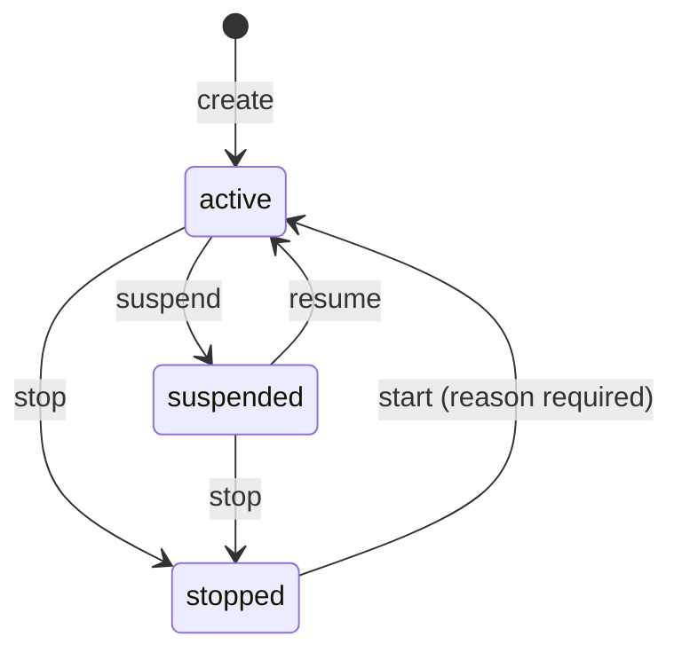

# Stop

Stop is the brake. When an agent goes wrong at 2 a.m., one command makes Deedglass refuse every
call from it, on every Deedglass instance, within 2 seconds. The stop itself is sealed as a deed.

```
$ deedglass agent stop support-bot --reason "Refund loop in staging"
✓ Stopped support-bot · deed_01k6vrddq2atgb2023qvhhct3h sealed
  Every call from support-bot is refused on every Deedglass instance within 2 seconds.
  Start it again with: deedglass agent start support-bot --reason "…"
```

From then on, the agent's key gets:

```json
HTTP/1.1 403 Forbidden
{ "error": { "type": "permission_error", "code": "agent_stopped",
  "message": "Agent \"support-bot\" is stopped. Deedglass refuses its calls until an admin starts it in Console › Agents.",
  "param": null, "request_id": "req_01k63z884jzfmyy0mxnbfmpp0t", "doc_url": "https://docs.deedglass.com/errors/agent_stopped" } }
```

Stop can't un-run an action that is already executing at a tool. It makes sure nothing new starts.

Code: `internal/identity` (`agents.go`, `cache.go`, `listener.go`, `guard.go`, `notify.go`) (S08).
Agents and keys: [AGENTS.md](AGENTS.md).

## 1. Suspend or Stop



| | Suspend | Stop |
|---|---|---|
| Meaning | a planned pause ("on hold") | the emergency brake |
| New calls | refused, `agent_suspended` | refused, `agent_stopped` |
| Actions already executing at a tool | finish | finish; Stop can't un-run them |
| Queued work (approved, long-polling) | continues after resume | re-checked with `Guard.CheckActive(fresh)` right before it runs, and refused (S13, S22) |
| `GET /v1/whoami` | allowed; shows the status | allowed; shows the status, so the agent can learn it was stopped |
| Reason | optional | optional to stop (speed matters); **required to start** (3 to 280 characters) |
| Console | neutral chip `Suspended` | red outline chip `Stopped` with the Stop icon; typed confirmation |
| Undo | `resume` | `start` |
| Deeds | `agent.suspended` / `agent.resumed` | `agent.stopped` / `agent.started` |

Routes: `POST /v1/agents/{id}/suspend`, `resume`, `stop` and `start`. Each needs an admin or owner
session, or an org admin key. Agent keys can't call them, not even on themselves
(`403 insufficient_scope`).

- **Repeating a stop changes nothing:** `200`, the agent unchanged, `"deed": null`, no second deed.
- **The wrong edge is `409 conflict`** and names the right call:
  `support-bot is stopped, not suspended. Start it with POST /v1/agents/agt_…/start.`
- **The API error never includes the stop reason or who stopped the agent.** The caller is the
  agent, and the reason may be sensitive. The Console and the deed show both.

## 2. Stop all

`POST /v1/org/stop-all {"reason": "…"}` sets the org's stop overlay. Every agent in the org is
then refused with `org_stopped`, whatever its own status.

```
$ deedglass org stop-all --reason "Investigating unexpected refunds"
Stop all 7 agents in Acme? Every agent call will be refused within 2 seconds,
and only an owner can start them again.
Type acme to confirm: acme
✓ All agents stopped · Acme · 7 agents · deed_01k6… sealed
  To start them again: an owner in Console › Settings, or `deedglass org start-all` on the server.
```

- The CLI asks you to type the org's slug. `--yes` skips that for scripts; without a terminal and
  without `--yes` it refuses (exit 2). A wrong slug stops nothing (exit 1).
- `agents_affected` counts the agents that weren't already stopped one by one.
- Sealed as `org.stopped_all`. Repeating it changes nothing and seals nothing.

**Who can start agents again.** Anyone trusted to pull the brake may pull it; only an owner releases
it.

| Action | Who |
|---|---|
| Stop one agent · Stop all | an admin or owner session, or an org admin key |
| Start one agent (reason required) | an admin or owner session, or an org admin key |
| Start all (`POST /v1/org/start-all`, reason required) | **an owner session**, or the server operator: `deedglass org start-all --org acme --reason "…"` (database-direct, sealed with actor `operator`) |

- **Start all clears only the overlay.** An agent that was stopped one by one stays stopped until
  someone starts it.
- **Org admin keys can't call start-all** (`403 insufficient_role`), so a stolen admin key can't
  release the brake.
- **While the org is stopped, agent keys are refused with `org_stopped` for everything.** Org admin
  keys keep read-only access (`GET`): listing agents and keys, whoami, deeds and the Ledger, so
  incident response can look around. Any admin-key request that changes state (`POST`, `PUT`,
  `PATCH`, `DELETE`) gets `403 org_stopped`. People signed in to the Console as admin or owner keep
  working as before.

## 3. How it propagates

Deedglass runs as one or more instances in front of one Postgres. Each instance caches keys, agents
and orgs, so authentication doesn't read Postgres on every call. Stop has to reach every cache.

1. **The change and its notification commit together.** Every change to who may act (agents, keys,
   the org overlay) runs in one org-scoped transaction: lock the row, update it, seal the admin
   deed, `pg_notify('deedglass_identity', …)`, commit. Postgres delivers a notification only at
   commit. If any step fails, including the NOTIFY, nothing changes and the API answers
   `500 internal_error`: `Deedglass couldn't record the stop, so nothing changed. Try again. If it
   keeps failing, revoke the agent's keys.` A stop is never reported that didn't commit.
2. **Every instance listens.** Each holds one dedicated connection (not from the pool) running
   `LISTEN deedglass_identity`. A notification evicts the matching cache entry: the agent, the key
   prefix or the org. The next call reads Postgres and is refused.
3. **The epoch guard.** A load that started before an invalidation is never cached. Each load
   notes the cache's epoch before it reads Postgres, and caches the value only if the epoch hasn't
   moved since; every notification and flush moves it. Without the guard, instance B could read
   "active", see A's notification evict nothing, then cache the stale "active" for a minute.
   `TestEpochGuard` forces exactly that interleaving: a hook pauses B's load between its database
   read and its cache write, the stop commits and reaches B meanwhile, then the load resumes. That
   in-flight request still answers 200 (it began before the stop), and B's next call is refused
   with `agent_stopped`: the stale value was never cached.
4. **Self-ping liveness.** A listener that dies quietly would miss notifications, so every instance
   checks its own:
   - Every 500 ms it sends `{"v":1,"t":"ping","from":"<instance>","n":<seq>}` through the pool.
   - If its own ping hasn't come back for 1.5 s, it **bypasses the cache**: every authentication
     reads Postgres.
   - A connection silent for 5 s is abandoned.
   - On any listener error: bypass, close, reconnect with backoff (100 ms doubling to 5 s), `LISTEN`,
     flush every cache, wait for its own ping, then use the cache again.
   - A new instance starts bypassed, until its first ping comes back.
5. **Work that started before the stop.** `Guard.CheckActive(ctx, org, agent, fresh)` skips every
   cache when `fresh` is true; the Gate (S13) and approvals (S22) call it right before executing
   anything that was queued, approved or long-polled. `Guard.Watch` returns a context that is
   cancelled with cause `ErrAgentStopped` or `ErrOrgStopped` when the agent or its org is stopped;
   long polls and MCP streams select on it (S13, S15). While the cache is bypassed, open watchers
   are re-checked every 500 ms.

**The worst case** is a listener that receives nothing and reports no error. Its instance notices the
missing ping within 1.5 s, bypasses the cache, and the next call reads Postgres. So a stop is
honoured on every instance within 2 seconds even when a notification is lost.

Notification payloads are at most 200 bytes and carry ids and states only, never secrets, names or
reasons ([DATA_MODEL.md](DATA_MODEL.md)).

### Measured

From `bench/results/2026-10-01-darwin-arm64-stop.json` (`make bench-stop`): Apple M1, Postgres 18.6,
two Deedglass instances with separate caches and listeners on one throwaway Postgres, 50 runs each.
Times run from the change's `200` on instance A to the first refusal on instance B, which was polled
every 2 ms.

| Case | p50 | p99 |
|---|---|---|
| Stop one agent | 0.136 ms | 0.61 ms |
| Revoke a key | 0.13 ms | 0.432 ms |
| Stop all | 0.123 ms | 0.334 ms |
| Stop, from sending the request to the refusal on B | 1.089 ms | 4.012 ms |
| Listener killed (`pg_terminate_backend`), then stop | 0.22 ms (1 run) | |
| Silent stall (the listener receives nothing, no error), then stop | 1,592 ms (1 run) | |

In the silent stall, B bypassed its cache 1,595 ms after the stall began, and refused the stopped
agent 1,592 ms after the stop's `200`: under the 2 s bound.

From `bench/results/2026-10-01-darwin-arm64-keyauth.json`:

| Measure | Result |
|---|---|
| Authenticate a key, warm cache, in process | 0.92 µs/op mean (20,000 ops) |
| Authenticate a key, cold (through Postgres) | p50 66 µs · p99 136 µs (1,000 runs) |
| The stop API over HTTP, including its sealed deed | p50 0.91 ms · p99 1.62 ms (200 runs) |

These are one laptop's numbers, with both instances next to their database. Networked deployments
add their round-trip times. The 2 s bound assumes every instance can reach Postgres.

## 4. What happens to in-flight work

| Work | After a stop |
|---|---|
| A new call with the agent's key | refused at authentication (`agent_stopped` or `org_stopped`) |
| A request that passed authentication before the stop | runs to its end; Stop doesn't interrupt a request mid-way |
| An action already executing at a tool | finishes. Stop can't recall a call a tool already received |
| A queued or approved action (S13, S22) | re-checked with `CheckActive(fresh)` right before it executes, and refused |
| A long poll or MCP stream (S13, S15) | its `Watch` context is cancelled with `ErrAgentStopped` or `ErrOrgStopped` |
| A suspended agent's open `Watch` | not cancelled; S22 decides what suspension does to pending approvals |

In S08 the Gate isn't built yet, so the calls an agent key can make today are `whoami` and reads of
its own actions and deeds. Stop refuses all of them except `whoami`.

## 5. What it doesn't do

- **It can't undo an action already executing at a tool.** A refund the tool already received
  happens. Stop makes sure nothing new starts; undo is S23.
- **If Postgres is down, agents can't act at all.** Deedglass fails closed: a key it can't check
  is refused (`503 service_unavailable`), never let through.
- **The 2 s bound assumes every instance can reach Postgres.** An instance cut off from its
  database stops trusting its cache once its pings go missing (1.5 s), then refuses the keys it
  can't check.
- **NOTIFY takes a global lock at commit.** Recall.ai's July 2025 write-up describes it serializing
  commits under load. That's fine for identity changes, which are rare, and for two pings a second
  per instance; Deedglass never sends a NOTIFY per action.
- **The API error never says why or by whom.** The agent sees `agent_stopped`; the reason and the
  person are in the Console and the deed.
- **`Watch` doesn't cancel work for a suspended agent.** Suspension is a planned pause; S22 decides
  what it means for pending approvals.
- **A stop that didn't commit is a 500, never a stopped agent.** Retry it; if it keeps failing,
  revoke the agent's keys.
