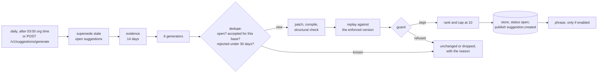
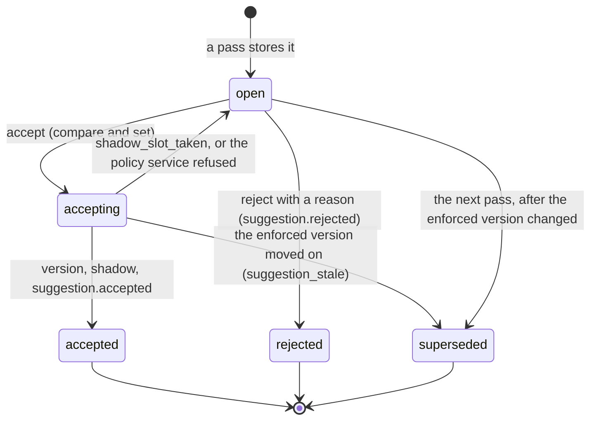

# Suggestions

**Status:** S28. Generators `internal/learn/suggest_rules.go`, the pass `suggest.go`, evidence `evidence.go`, accept and reject `lifecycle.go`, the schedule `schedule.go`, the copy `suggest_copy.go`; the patcher and the diff `internal/policy/patch.go` and `diff.go`; the store `internal/store/learnstore/suggestions.go`; migration `0025_suggestions_v2.sql`; the CLI `cmd/deedglass/insights_suggestions.go`. Decisions: ADR-058 (routes, events, the accept saga) and ADR-059 (the optional phrasing client).
**Audience:** anyone deciding whether to accept a policy change Deedglass suggested, and anyone who wants to know exactly how it got there.

Insights reads fourteen days of your agents' traffic and, when the numbers say a rule could be better, writes a suggestion: the numbers that triggered it, the exact change to your policy file as a diff, a replay of that change against the same fourteen days, and a plain risk note. **Deedglass proposes; people decide.** Nothing changes until a person accepts the suggestion, and even then the new version only runs in shadow until a person promotes it.

## Contents

1. [Principles](#principles)
2. [The six generators](#the-six-generators)
3. [The narrowest pattern](#the-narrowest-pattern)
4. [How the patch is written](#how-the-patch-is-written)
5. [The pass](#the-pass)
6. [Lifecycle](#lifecycle)
7. [Accept, the shadow slot and promote](#accept-the-shadow-slot-and-promote)
8. [The deeds, and how to verify them](#the-deeds-and-how-to-verify-them)
9. [The schedule and the sweeper](#the-schedule-and-the-sweeper)
10. [The CLI](#the-cli)
11. [The API](#the-api)
12. [A worked example: seed 7](#a-worked-example-seed-7)
13. [What suggestions don't do](#what-suggestions-dont-do)

## Principles

- **Proposed, never applied.** `internal/learn` is given a `PolicyWriter` with exactly two methods: add a version (origin `suggestion`) and run a version in shadow. It has no way to enforce anything. Three tests hold this: `TestNeverEnforceMethodSet` pins the method set by reflection; `TestNeverEnforceSource` parses every non-test file of `internal/learn` and fails on any mention of `policy.ModeEnforce` or any call to an `Activate` method; `TestNeverEnforceBehaviour` runs the schedule over 30 simulated days with nobody accepting anything and checks that every enforce activation in the org was a person's, or the onboarding bootstrap's.
- **Replayed.** Every suggestion that changes the policy carries a replay of the changed policy against the enforced version over the same fourteen days ([REPLAY.md](REPLAY.md)). Its `impact` is the number of recorded decisions that would come out differently.
- **Shadowed.** Accepting runs the new version in shadow next to the enforced one. You watch what it would decide on live traffic before anyone enforces it.
- **Sealed.** Accepting, rejecting and promoting are each sealed as admin deeds you can verify offline.
- **Conservative by construction.** A loosening suggestion covers only the narrowest pattern every approved action shares, and is dropped if its own replay would allow anything a person denied, anything that never went to a person, or more actions than people approved, let expire or left waiting.
- **Template wording first.** Every title, rationale and risk note is written by Deedglass's own templates and is complete on its own. Rewording by Claude is off by default and needs two separate switches ([INSIGHTS_PRIVACY.md](INSIGHTS_PRIVACY.md)).

## The six generators

Each generator is a pure function of the evidence: the enforced version and its YAML, the fourteen days of decisions under it, and the facts of each action a person decided (recomputed with `policy.Prepare` from the stored input, never from raw argument text). The thresholds are constants in `suggest_rules.go`, versioned as `GeneratorVersion` "1", which every suggestion stores.

| Generator | Kind | Fires when | Proposes | Dropped when |
|---|---|---|---|---|
| `loosen.approval_rate` | `loosen` | a `require_approval` rule of the enforced version has at least 30 decided approvals (`LoosenMinDecided`) in 14 days, **no** human denial, and an approve rate of at least 95% (`LoosenMinRate`); then, per tool under that rule, at least 30 approved actions | an `allow` rule inserted **before** the target rule, covering the narrowest pattern below. Its `verify` copies the target rule's level (or the policy default, or L0) | no narrow pattern exists; the inputs of some approved actions were pruned; or its replay would allow an action the policy denies today, an action a person denied, an action that never went to a person, more actions than were approved, expired and pending together, or nothing at all |
| `tighten.mismatch` | `tighten` | an `allow` rule of the enforced version let through at least one action that ended `MISMATCH` in 14 days (any count; one suggestion per rule and tool) | a `require_approval` rule inserted before that rule: the same `match` narrowed to the tool, the rule's own `when` in parentheses, and, when every mismatched statement had the same kind and tables (at most 3), those as conditions. The reason names the count. When the policy's defaults name no approvers, the new rule asks one `role:admin` with a 4h expiry | the rule matches on labels (a suggested rule doesn't copy them); or its replay changes nothing, or changes anything other than `allow` to `require_approval` |
| `tighten.verify_level` | `tighten` | an `allow` rule has at least 30 witnessed writes (`VerifyMinActions`; side effect `write` or `destructive`, with a verdict) and at least 90% of them (`VerifyMinShare`) were VERIFIED at L2 (or L1), while the rule asks for less | set `verify: L2` (or `L1`) on the rule | the writes never reached that level (it doesn't fire) |
| `budget.near_limit` | `budget` | a **policy** budget used at least 90% of its limit (`BudgetNearShare`) on at least 3 (`BudgetNearDays`) of the last 7 days it was used (`BudgetLookbackDays`) | raise `max_calls` or `max_spend` to `nice_ceil(p95 of daily use × 1.2)`, and at least one nice step above the current limit | an anomaly overlaps: see below |
| `explicit_rule.default_hit` | `explicit_rule` | a tool was decided by the policy's `defaults` at least 10 times (`DefaultHitMinActions`) on at least 2 days (`DefaultHitMinDays`) | an explicit rule appended after the last rule, with the **same** decision as the default and a reason to edit | its replay changes any decision (that would be a bug; the drop reason asks you to report it) |
| `advisory.deny_heavy` | `advisory` | an agent was denied on at least 30% (`DenyHeavyMinShare`) of at least 50 actions (`DenyHeavyMinActions`) in the last 7 days | no diff: "support-bot is denied 41% of the time … Its instructions may ask for things the policy forbids." | nothing to drop; it changes nothing |

**Budgets, as built.** "The last 7 days" are the 7 most recent days on which the budget was used, so an idle stretch just before the pass doesn't hide a busy week. The suggestion becomes an **advisory** instead ("Usage rose with an anomaly; check it before raising the budget.") when a `volume_spike` or `user_ref_burst` episode, of an agent that used the budget's tools, overlaps one of the near-limit days. **Agent budgets** (the `calls_per_day` and `spend_per_day` on the agent row, [AGENTS.md](AGENTS.md)) are never patched: their suggestion is an advisory that names the exact `PATCH /v1/agents/{id}` body or the Console screen.

**Nice values.** `nice_ceil` rounds up, and `nice_floor` down, to 1, 2, 2.5 or 5 × 10^k (in minor units for money). $4,000.00 becomes $5,000.00, not $4,812.00.

**Why the loosen rate threshold is moot today.** With zero denials required, the approve rate over decided approvals is always 100%. Expired and cancelled approvals aren't decisions, so they don't lower it; they count toward the guard's ceiling instead.

## The narrowest pattern

A `loosen` suggestion covers only what **every** approved action of that tool shares. If any approved action breaks a condition, there is no suggestion.

- **Tool:** exactly one tool. A rule whose approvals span several tools gets one suggestion per tool with at least 30 approvals, and the rule id gets the tool as a suffix.
- **SQL** (when every approved action carried SQL): one statement kind (`sql.kind`); the union of their tables has at most 3 tables (`LoosenMaxTables`), written `sql.tables == ["public.orders"]` for one table or `sql.tables.all(t, t in [...])` for several; and for every action `sql.statements == 1`, a `WHERE` clause, no unbounded write and no dangerous functions. All of these become conditions, plus `sql.tables_complete` when the classifier was sure of every table. Some actions with SQL and some without: no suggestion.
- **Amounts** (when no action carried SQL): if every approved action has a whole-number `args.amount` in one currency, the rule adds `args.amount <= N` and the currency. N is the 95th percentile of the approved amounts, rounded **down** to a nice value, and the evidence says how many approved amounts it covers ("The limit covers 383 of the 401 approved amounts."). Without amounts, the rule covers the tool itself, and the replay guard is what keeps it to the evidence.
- **Agents:** when at most 3 agents (`LoosenMaxAgents`) produced the approvals, `match.agent` lists them. With more, the rule doesn't name agents.

The rule is written in S10's key order. Its id is `allow-` plus the target's id without `approve-`, `require-approval-` or `approval-`, made unique in the file with `-2`, `-3`. The description says what it is based on. For seed 7's numbers, with a window ending 2026-10-09, the patcher writes:

```yaml
  # Accepted from Deedglass Insights suggestion sug_01k6z… · evidence sha256:7a1c…e9d0
  - id: allow-order-updates
    description: People approved 398 of 403 of these between 2026-09-25 and 2026-10-09.
    match: { tool: postgres.execute, agent: [ops-agent] }
    when: 'sql.kind == "update" && sql.tables == ["public.orders"] && sql.statements == 1 && sql.has_where && !sql.unbounded_write && size(sql.dangerous_functions) == 0 && sql.tables_complete'
    decision: allow
    verify: L0
```

"398 of 403" counts the approvals that concluded (approved, expired or cancelled); approvals still waiting are left out of that sentence and shown in the evidence.

## How the patch is written

The patcher (`policy.Patch`) edits your policy the way a careful person would: it splices whole lines into the original bytes, at positions it reads from the YAML tree. It never re-emits the file. So:

- **Every comment, blank line and style choice outside the edit survives byte for byte**, and the diff shows exactly the added or changed lines.
- **An inserted rule goes above the target rule's own leading comments**, so the comment stays with the rule it describes. In a list whose rules are separated by blank lines, the new rule gets its own paragraph too. Indentation comes from the column of the list's dashes.
- **The comment line above an inserted or appended rule** names the suggestion and its evidence digest, so the version reads back to where it came from: `# Accepted from Deedglass Insights suggestion sug_… · evidence sha256:7a1c…e9d0`.
- **Line endings:** a file written with CRLF throughout keeps CRLF on the spliced lines; LF stays LF; a byte-order mark is kept. **A file that mixes LF and CRLF is refused** ("the file mixes LF and CRLF line endings; run deedglass policy fmt and push it again").
- **Flow-style lists are refused.** A `rules` or `budgets` list written as `[…]`, an entry that doesn't start its own line, entries that aren't aligned, a rule or budget written as `{…}` that needs a field set, or a value written as a block scalar: each is refused with a message that says to run `deedglass policy fmt`.
- **Four edits exist:** insert a rule before another, append a rule, set `verify` on a rule (the only field it sets today), and set a budget's `max_calls` or `max_spend`.

Then the candidate must pass three checks, or the proposal is dropped with the reason:

1. **It compiles.** Any error-severity diagnostic drops it. Warnings (like `rule_unreachable`) are kept and shown with the suggestion.
2. **The structural check** (`policy.CheckPatch`): the compiled candidate must equal the compiled base, except for what the edit names. Every base rule keeps its normalized form and its order, an inserted rule sits exactly where it was put, and nothing else moves (the name, the defaults, the other budgets).
3. **It changes the policy.** A candidate with the base's `version_hash` is dropped.

The diff is `policy.Diff`, the one line diff in the codebase: Myers' O(ND) algorithm over lines (line endings ignored), as unified hunks with 3 lines of context. `deedglass policy diff` prints the same diff for any two files or versions.

## The pass



1. **No enforced policy, no pass.** The answer carries a `notice` saying to activate one.
2. **Supersede first.** Every `open` suggestion whose base isn't the live enforced version becomes `superseded` (`stale_reason: base_changed`).
3. **Evidence:** the window is the 14 days (`SuggestWindow`) ending now.
4. **Dedupe** by fingerprint, `sha256(JCS{generator, policy_id, target, pattern})`:
   - an `open` or `accepting` suggestion with the same fingerprint is left alone (`unchanged`);
   - one already **accepted for this enforced version** is dropped ("already accepted for this version of the policy; promote or clear its shadow first");
   - one **rejected less than 30 days ago** (`RejectionMemory`) is dropped, unless its main count (the approvals, mismatches, near-limit days or default hits it rests on) has at least doubled since.
5. **Patch, compile, check** (above). Advisories skip this and the replay.
6. **Replay** in the process through S27's engine, with the patched source as a draft candidate and the enforced version as the baseline. It is stored as a `replay_jobs` row with `purpose: suggestion` and `status: succeeded`, so `GET /v1/replays/{id}` reads it like any replay. A window over 1,000,000 actions is dropped.
7. **Guard:** the generator's own check on its replay (the table above).
8. **Rank and cap:** at most 10 (`MaxOpenSuggestions`) open suggestions per org, counting those already open. Candidates are ranked by `impact`, highest first, then by kind: tighten, loosen, budget, explicit rule, advisory. The rest are counted as `waiting` and come back on a later pass.
9. **Store** in one transaction with their replay rows, and publish `suggestion.created` in the same transaction. If another instance stored the same fingerprint first, the unique index keeps one and the other is counted `unchanged`.
10. **Phrase**, after the insert and in the background, only when the org opted in ([INSIGHTS_PRIVACY.md](INSIGHTS_PRIVACY.md)). It never delays or blocks a suggestion.

A pass for the seed-7 org takes about 0.3 s on a laptop, replays included. The route allows 60 s.

## Lifecycle



In words: `open → accepting → accepted | rejected | superseded`. `accepting` is the short state of the accept saga; a crash leaves a suggestion there until the sweeper finishes it. The database ties each status to its fields: an accepted suggestion has a resulting version, a decision deed and a time; a rejected one a deed, a time and a reason; a superseded one its `stale_reason`.

## Accept, the shadow slot and promote

**Accept** (`POST /v1/suggestions/{id}/accept`, `{"reason":"…","replace_shadow":false}`; the reason is optional, at most 280 characters on one line). Admins and org admin keys only. It is a saga of idempotent steps, so retrying repairs a crash between any two:

1. Compare and set `open → accepting`, recording who, the reason and `replace_shadow`. Any other status is 409 `suggestion_decided` ("This suggestion was already accepted on 2026-10-09 by priya@acme.com. It created acme-sim v3.").
2. The base must still be the enforced version. Otherwise the suggestion becomes `superseded` and the answer is 409 `suggestion_stale` ("acme-sim v2 has been enforced since this suggestion was written for v1. Generate suggestions again: POST /v1/suggestions/generate.").
3. **The shadow slot.** An org runs at most one shadow. If one is live and `replace_shadow` is false, the suggestion goes back to `open` and the answer is 409 `shadow_slot_taken` with `param: replace_shadow` ("acme-sim v2 is already running in shadow. Promote or clear it first, or accept with replace_shadow: true to replace it."). With `replace_shadow: true` the new version replaces it.
4. Add the stored candidate source as a new policy version with `origin: suggestion` and `suggestion_id` set. Identical content gives back the existing version, and the answer's `note` says so.
5. Run that version in shadow: S12 seals `policy.activated` (mode `shadow`), with the reason "Accepted suggestion sug_…: <your reason>".
6. One org transaction: `accepting → accepted`, the resulting version, and the `suggestion.accepted` deed.

The answer is the suggestion with `resulting_version`, `deeds` (the ids sealed), `replaced_shadow_version` when a shadow was replaced, and `note` when the version already existed. An advisory can't be accepted (409 `conflict`: "This is advice, not a policy change, so there is nothing to accept. Dismiss it with reject and a reason."). Because the candidate source is stored with the suggestion, accepting creates exactly what you reviewed, even if the generators changed since.

**Reject** (`POST /v1/suggestions/{id}/reject`, `{"reason":"…"}`, 3 to 280 characters, required): one transaction moves `open → rejected` and seals `suggestion.rejected`. Deedglass won't suggest it again for 30 days unless the numbers double.

**Promote** is not part of suggestions. It is S12's activation, typed by a person: in the Console, the Insights screen's Shadow section shows the shadow report for that version and the Promote sheet asks you to type the policy name and a reason; from the CLI, `deedglass policy activate acme-sim --version 3 --mode enforce --reason "…"`. S12 seals `policy.deactivated` (the shadow) and `policy.activated` (enforce) in one transaction ([POLICIES_GUIDE.md](POLICIES_GUIDE.md#suggested-versions)). After a promote, open suggestions written for the old base are superseded on the next pass.

## The deeds, and how to verify them

| Step | Deed | Actor | Data (numbers and ids only) |
|---|---|---|---|
| accept | `policy.activated` (mode `shadow`), sealed by S12 | the person or admin key that accepted | the version, its `version_hash` and `source_hash`, the mode, the activation |
| accept | `suggestion.accepted`, target `{suggestion, sug_…}`, with the reason | the same | `suggestion`, `kind`, `generator`, `fingerprint`, `evidence_digest`, `replay_result_digest`, `policy_id`, `version_id`, `version`, `version_hash`, `replaced_shadow_version_id` |
| reject | `suggestion.rejected`, target `{suggestion, sug_…}`, with the reason | the person or admin key | `suggestion`, `kind`, `generator`, `fingerprint`, `evidence_digest` |
| promote | `policy.deactivated` (shadow) and `policy.activated` (enforce), sealed by S12 | the person who promoted | as any activation |

One acceptance seals one `suggestion.accepted`, never two: the last step locks the row and checks it is still `accepting`. Generating suggestions seals nothing, because nothing was decided.

To check them offline, export the org's chain and verify it:

```
deedglass deeds export --out acme-sim.tar.gz
deedglass verify acme-sim.tar.gz
```

`verify` checks every seal and the chain links, and ends with `chain intact` ([VERIFYING_DEEDS.md](VERIFYING_DEEDS.md)). The `evidence_digest` and `replay_result_digest` in the accept deed let anyone holding the suggestion and its replay match them to what was accepted.

## The schedule and the sweeper

Every `deedglass serve` instance runs the schedule loop: the first tick 2 minutes after start, then every 5 minutes, over each org with a decision in the last 15 days (and orgs with anomaly facts on). For each org, a tick:

1. **Sweeps:** finishes any suggestion stuck in `accepting` for more than 2 minutes (`StuckAfter`), running steps 4 to 6 again as the person who started it. If the enforced version moved on meanwhile, it supersedes the suggestion instead; if the policy service refuses, it goes back to `open`.
2. **Runs the daily pass** once the org-local time is 03:00 or later, once per org-local date: a `learn_runs` row `(suggest, 2026-10-09)` is claimed with insert-on-conflict-skip, so only one instance runs it.
3. **Queues the weekly digest** on Monday from 09:00 org-local, for the ISO week that just ended, once per org and week (`learn_runs (digest, 2026-W41)`; [EMAIL.md](EMAIL.md#the-weekly-insights-digest)).

A manual `POST /v1/suggestions/generate` records its own `learn_runs` row (`m-<time>-<suffix>`). A second pass for the same org while one runs on the same instance is 409 `conflict` ("Suggestions are already being generated for this org. Try again in a minute."). The daily pass runs as `system`; the suggestions it stores say so in `requested_by` of their replays.

## The CLI

Every `insights suggestions` command calls the server with an org admin key (`--api-key` or `DEEDGLASS_API_KEY`). Details and exit codes are in [CLI.md](CLI.md#suggestions-insights-suggestions-insights-digest-and-policy-diff-s28).

```
$ deedglass insights suggestions generate
◐ Read 14 days of acme-sim traffic (5,890 actions) against acme-sim v1
✓ 3 suggestions
  loosen   approve-order-updates  Allow updates to public.orders without approval                  411 would change
  tighten  allow-db-writes        Send updates to public.inventory to approval after 3 mismatches  180 would change
  budget   refunds-per-day        Raise refunds-per-day from $4,000.00 to $5,000.00                0 would change
  next      deedglass insights suggestions show sug_01k6z…
```

Titles longer than 60 characters are cut with `…` in this table; `show` prints them whole. A dropped proposal prints its own line, like `· dropped loosen.approval_rate on refund-approval: its replay would allow 2 actions a person denied`. A second run prints `✓ 0 suggestions` and `· 3 already open, unchanged`.

```
$ deedglass insights suggestions accept sug_01k6z… --reason "Ops approves these every time" --replace-shadow
◐ acme-sim v3 created from sug_01k6z… · running in shadow (replaced v2)
✓ 2 deeds sealed · policy.activated (shadow) · suggestion.accepted
  Nothing is enforced yet. Watch it: deedglass insights shadow · promote: deedglass policy activate acme-sim --version 3 --mode enforce
```

`list [--status …] [--kind …]`, `show sug_… [--no-diff]` (the evidence, the replay transitions with what people did, the risk note, warnings and the diff) and `reject sug_… --reason "…"` complete the set.

## The API

| Route | Role | Notes |
|---|---|---|
| `GET /v1/suggestions` | viewer+ | a list, ordered by impact then creation; `?status=open\|accepting\|accepted\|rejected\|superseded\|all` (default open and accepting), `kind`, `limit`, `cursor` |
| `GET /v1/suggestions/{id}` | viewer+ | one `suggestion` |
| `POST /v1/suggestions/generate` | admin+ | no body; optional `Idempotency-Key`; a `learn_run` |
| `POST /v1/suggestions/{id}/accept` | admin+ | `{"reason","replace_shadow"}`; the suggestion with `deeds` |
| `POST /v1/suggestions/{id}/reject` | admin+ | `{"reason"}`; the suggestion with its deed |

Agent keys get 403 on every one, reads included. The objects (`suggestion`, `learn_run`), the errors and the `suggestion.created` event are in [API.md](API.md#suggestions-s28); the schemas in `api/openapi.yaml`; each error code in [api/errors.md](api/errors.md).

## A worked example: seed 7

The simulated Acme week ([SIMULATOR.md](SIMULATOR.md)), run with `scripts/insights_e2e.sh` on a throwaway stack:

```
deedglass dev simulate --days 7 --end <two days ago, 06:30Z> --seed 7
deedglass insights detect --backfill 9d            # 5 episodes
deedglass insights suggestions generate            # 3 suggestions in about 0.3 s
```

| Kind | Target | Title | Replay |
|---|---|---|---|
| `loosen` | `approve-order-updates` | Allow updates to public.orders without approval | 411 would change: `require_approval → allow`, humans approved 398, expired 5, pending 8, denied 0 |
| `tighten` | `allow-db-writes` | Send updates to public.inventory to approval after 3 mismatches | 180 would change: every inventory update that `allow-db-writes` allows waits for a person, not only the 3 that mismatched |
| `budget` | `refunds-per-day` | Raise refunds-per-day from $4,000.00 to $5,000.00 | 0 would change (below) |

The loosen rationale reads: "People approved 398 of 403 updates to public.orders by ops-agent in the last 14 days and denied none. Each waited a median of 19 minutes." The budget's: the budget was at 95% of its limit on 3 of the last 7 days it was used.

A second `generate` creates nothing. Accepting the loosen suggestion without `replace_shadow` is 409 `shadow_slot_taken`, because the scenario runs acme-sim v2 in shadow; with `--replace-shadow` it creates acme-sim v3 (`origin: suggestion`, `suggestion_id` set) and seals 2 deeds: `policy.activated` (shadow), then `suggestion.accepted`. The script then simulates two more days, shows the shadow report, promotes v3 with `policy activate --mode enforce`, exports the deeds and verifies them.

## What suggestions don't do

- **No automatic changes.** Nothing is accepted, activated or promoted except by a person (or an org admin key a person holds). The worst a bug in `internal/learn` can do is start a shadow, which only records what a version would have decided.
- **No learning across orgs.** Every suggestion reads one org's own history. No org's data informs another's.
- **No machine learning.** The generators are counts, percentiles and fixed thresholds you can recompute with SQL. The same history gives the same suggestions. The optional Claude phrasing rewords text; it never decides what is suggested.
- **Only 14 days.** A rule used rarely, or a pattern older than the window, isn't seen. Inputs pruned by retention can't support a loosen suggestion at all.
- **They can't see intent.** People approving every order update doesn't say why they did, or whether they looked. Read the evidence and the risk note before you accept.
- **Budget changes replay as 0 changes.** Replay re-decides each recorded action with the usage it recorded, so it can't show what a higher limit would have let through later in a day. The budget suggestion's numbers are the near-limit days, not a replay.
- **Agent budgets are advice only.** They live on the agent, and the suggestion tells you the command; it never changes them.
- **The patcher refuses some files.** Flow-style lists and mixed line endings are refused; run `deedglass policy fmt` and push the result.
- **Wording is the template's** unless your org opted in to phrasing and the operator set a key ([INSIGHTS_PRIVACY.md](INSIGHTS_PRIVACY.md)).
