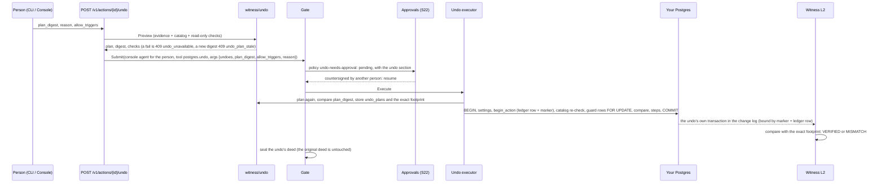

# Undo a Postgres write

**Status:** S23. The Console panel arrives with S25; until then, use the CLI or the API.
**Audience:** anyone who saw a write go wrong in the Ledger and wants the rows back.

Undo puts rows back the way Postgres recorded them before an action. It reads only what Postgres
committed for that action (the old and new row images the decoder kept for its transaction), never
what the agent said it did, so when an agent's one-row UPDATE made a legacy trigger change 50 more
rows, the plan puts back all 51. Before anything runs, twelve checks decide whether the undo is
safe; if any check fails, the undo isn't available and each failing check names its fix. An undo is
an action like any other: it passes through the Gate and your policy, a second person countersigns
it, Postgres runs it in one transaction, the L2 witness compares what Postgres committed with the
plan row by row, and it gets its own deed. The original action's deed is never touched.

## When undo is available

An undo is available when all twelve checks below pass or warn. In short, that means:

- The action wrote to Postgres through a native Postgres connector in gateway mode, and Deedglass
  witnessed it at **L2**: its transaction is in the decoder's change log, bound to the action by
  the Deedglass marker and the ledger row, with full old row images.
- The action was sealed within the last 7 days (`undo.max_age`, 168h) and its row images haven't
  been pruned.
- No other undo of it is waiting, running or applied.
- At most 1,000 rows change (`undo.max_rows`).
- The tables are still the same tables: same primary key, same columns and types, `REPLICA
  IDENTITY FULL`, no enabled triggers or rules, no foreign key that would cascade, and
  `deedglass_agent` holds the privileges the plan needs.
- Every row still holds exactly what the action wrote, and every row the undo puts back is still
  absent.

To see the answer for one action, preview it. A preview writes nothing and takes no locks.

```
deedglass undo preview act_…                 # exit 0 available, 1 not available
deedglass undo preview act_… --json          # the API object
deedglass undo preview act_… --steps 50      # show more sample steps
deedglass undo preview act_… --allow-triggers
```

The same preview is `POST /v1/actions/{id}/undo/preview` (body `{"allow_triggers": false}`, both
optional). `GET /v1/actions/{id}` carries a cheap hint, `undo: {undoes, undone_by, pending,
eligible}`: `eligible` is true when the action has L2 evidence from a native Postgres connector,
isn't undone and is within the age limit. It only decides whether the Console offers **Preview
undo**; the preview is always the full answer.

**Who can undo.** A person: an admin or owner signed in to the Console, or an org admin key. Agent
keys get `403 insufficient_scope`: "Agent keys can't undo actions. A person starts an undo from the
Console or with an admin key." An agent that calls the internal tool `postgres.undo` through the
Gate gets a sealed `tool_unknown`, like any tool that doesn't exist for it.

## The twelve checks

Each check is `pass` ✓, `warn` ○ or `fail` ✕ (and `skip` when an earlier failure kept it from
running). **Available means no check failed.** A warning doesn't block the undo; it appears in the
preview, the approval and the CLI. The preview runs every check read-only. The undo transaction
runs checks 6 to 12 again under row locks.

| id | Passes when | Fix when it fails |
|---|---|---|
| `evidence` | The action is sealed and changed something; exactly one committed transaction is bound to it by the Deedglass marker **and** its ledger row (frame class `bound`, never `forged_marker` or `marker_*`); it truncated nothing and changed no table definition; every row has a full old image and the decoder kept every image; the changes add up row by row; no rows swapped keys; and no value the plan must write is in a sensitive column. | Nothing for this action: Deedglass doesn't know every row it changed, so restore from a backup. For later actions, `ALTER TABLE public.orders REPLICA IDENTITY FULL;` and run writes through the Gate. Example: `Undo needs L2 evidence from Postgres. This action was witnessed at L1, so Deedglass doesn't know every row it changed.` |
| `connector` | The action ran in gateway mode through a native Postgres connector that still exists, is active, has credentials and has the witness on. | Turn the connector back on, set its credentials in Console › Connectors, or turn on witness in its config. Example: `The "postgres" connector was deleted. Undo runs through the connector that made the change.` |
| `age` | The action was sealed within `undo.max_age` (7 days) and its row images weren't pruned. | Restore from a backup. Example: `This action is 9 days old; undo works for 7 days while the row images are kept.` |
| `not_undone` | No other undo of this action is pending, running or applied. | Countersign or cancel the waiting undo, or wait for the running one. An applied undo can itself be undone (a redo). Example: `act_01j9zx8… already undid this action at 10:14 IST.` |
| `row_limit` | The plan changes at most `undo.max_rows` rows (1,000). | `This undo touches 1,204 rows; the limit is 1,000. Restore from a backup, or raise undo.max_rows.` |
| `replica_identity` | Every table the plan touches is `REPLICA IDENTITY FULL` now, so the undo itself can be witnessed. | `ALTER TABLE public.orders REPLICA IDENTITY FULL;` |
| `primary_key` | Every table has a primary key, it is the same key the action's rows were keyed by, and every row's key is readable in the evidence (not NULL, not sensitive). | Nothing for this action. Example: `public.events has no primary key, so Deedglass can't point at one row safely.` |
| `columns` | Every table still exists under the same name, every column the plan writes or compares has the same type, no column was added that a re-inserted row would need, and every type name passes the strict pattern. | Put the column back the way it was, or restore from a backup. Example: `public.orders.status changed type since the action (now order_status).` |
| `triggers` | No enabled user trigger (`NOT tgisinternal AND tgenabled <> 'D'`) and no enabled non-SELECT rule on any table the plan touches. With `allow_triggers` (admins only, with a reason) this is a warning. | `ALTER TABLE public.orders DISABLE TRIGGER orders_ship_open_batch;` Undo would fire this trigger again. An admin can pass `allow_triggers` with a reason; the L2 witness then shows what the trigger did. |
| `cascades` | No foreign key that references a table the plan deletes from is `ON DELETE CASCADE`, `SET NULL` or `SET DEFAULT`, and none that references a column the plan changes acts `ON UPDATE`. `RESTRICT` and `NO ACTION` are fine: Postgres refuses the step and the whole undo rolls back cleanly. | Undo refuses a step that would change rows it didn't plan. Example: `public.order_items references public.orders ON DELETE CASCADE. Deleting public.orders id=1042 would change its rows in public.order_items too.` |
| `unchanged` | Every row still holds the values the action wrote, byte for byte, and every key the undo re-inserts is still absent. | Preview the undo again; the plan follows the rows as they are now. Example: `public.orders id=42 changed since the action: status is now 'cancelled'.` |
| `privileges` | `deedglass_agent` can SELECT each table and has the INSERT, UPDATE and DELETE the plan needs. Row-level security on a table, for a role without `BYPASSRLS`, is a warning: a row the role can't see fails the undo cleanly. | `GRANT DELETE ON public.orders TO deedglass_agent;` or add the table to `writable_tables` and run `deedglass connector postgres init` again. |

**Values printed differently count as changed, on purpose.** The guard compares each value as
Postgres prints it, under the same settings the decoder uses. A `numeric` that now reads `1.00`
where the action wrote `1.0` is equal in meaning, but undo treats it as changed and refuses. A
false refusal costs you a fresh preview; a false match could overwrite someone else's write.

**Sensitive columns.** For a column listed in the connector's `witness.sensitive_columns`, the
decoder kept only a digest of the value. If the undo must write such a value back, it can't, and
the `evidence` check fails: `public.customers.email is marked sensitive, so Deedglass kept only its
digest and can't put the old value back.` If the value is only compared in a guard, it is compared
by its digest and shown as `•••` in the preview, the approval and the CLI.

## How an undo runs



**1. Preview.** Deedglass loads the action's one bound transaction, collapses it to its net effect
per row (following a row through key changes), reads the catalog for those tables by their relation
ids, and builds a plan of single-row steps:

| What the action did to one row | The undo step |
|---|---|
| Inserted it | Delete it, if it still holds the inserted values |
| Updated it | Update only the changed columns back, if it still holds the new values |
| Deleted it | Insert the old row again, if its key is still free |
| Inserted, then updated it | Delete it, if it holds the last image |
| Updated, then deleted it | Insert the first old image |
| Inserted, then deleted it | No step (a note) |
| Deleted, then inserted the same key | Update every non-generated column back |
| Changed its key (42 to 1042) | Update the row at 1042 back to 42 with its old values, if 42 is free |
| Truncated a table, or changed its definition | Unavailable (`evidence`) |

The plan digest is `sha256:` over the plan's canonical JSON (without its notes). Same evidence,
same catalog, same digest.

**Step order.** Steps run in reverse order of each row's last change in the original transaction,
except that a key is always freed before a row takes it, parent rows (a foreign key on the parent's
primary key) are put back before their children, and children stop referencing a parent row
before that row is removed. Rows that swapped keys form a cycle that no order of single-row
statements can put back, so the undo refuses them.

**2. Request.** `deedglass undo run act_… --plan sha256:… --reason "…"` (or `POST
/v1/actions/{id}/undo` with `plan_digest`, `reason` of at most 280 characters, `allow_triggers` and
an optional `wait` of up to 25 seconds). Deedglass previews again; a failing check is `409
undo_unavailable` with `error.checks`, a different digest is `409 undo_plan_stale`, and another
live undo of the same action is `409 already_undone`.

**3. The action.** The undo is an action of your org's `console` system agent on behalf of you:
tool `<connector>.undo` (`postgres.undo` for a connector named `postgres`), `on_behalf_of` your
`usr_` id (for an org admin key, the person who minted it), arguments `{undoes, plan_digest,
allow_triggers, reason}`. The request digest, and so the deed, commits to the plan digest and to the
action it undoes. Policies see it like any other action; the starter rule `undo-needs-approval`
matches `{ tool: "*.undo", connector_type: postgres }` and asks a person to countersign. Because the
undo runs on your behalf, S22's self rule applies: unless the org sets `self_countersign: allow` in
its approval settings, **another** eligible person countersigns. A one-admin org sees
`approval_unsatisfiable` with its next step ([APPROVALS.md](APPROVALS.md)).

**4. Execution.** After the countersign, the executor plans again and compares the digest with the
one you sent (a difference fails the undo, nothing changed). It stores the plan in `undo_plans` and
its exact footprint in `actions.witness_expect`, then runs one transaction on your database as
`deedglass_agent`:

1. `TimeZone UTC`, `DateStyle ISO, YMD`, `IntervalStyle postgres`, `bytea_output hex`,
   `extra_float_digits 3` (the decoder's settings, so values print the same), `lock_timeout 2s`,
   `statement_timeout 10s`, and `SET CONSTRAINTS ALL DEFERRED`.
2. `deedglass.begin_action` as the first write: the ledger row and the transactional marker, with
   the plan digest as its `sql_digest`.
3. The catalog read again and checks 6 to 12 repeated.
4. The guard rows locked `FOR UPDATE`, one statement per table with keys in sorted order, and
   compared byte for byte with the plan.
5. Every step, each of which must change exactly one row.
6. `COMMIT`.

Any miss (a row changed, a row locked longer than 2 seconds, a step that changed 0 or 2 rows, a
catalog change, a Postgres error) rolls the whole transaction back. The undo is then `failed` with
`undo_conflict`, and nothing was changed: `Row public.orders id=42 changed after the plan was made
(status is now 'cancelled'). Nothing was changed. Preview the undo again.`

**5. Witness.** The undo's own transaction reaches the decoder like any other write and is compared
with the **exact footprint**: one planned row for every changed row, with the same key, operation
and values, and no other change. The verdict is `L2 · VERIFIED` only when Postgres committed exactly
the planned rows and values; the reason is `undo_restored`, "Restored 51 rows in public.orders
exactly as planned." Anything else is `MISMATCH` with the usual diff.

**One live undo per action.** A unique index allows one undo per action that isn't released. An
undo that is denied, expires, is cancelled or fails releases its slot when it is sealed, so you can
preview and request again.

### An example from start to finish

The hero from S21: an agent ran `UPDATE public.orders SET status = 'shipped' WHERE id = 42`, and a
legacy trigger, `orders_ship_open_batch`, shipped 50 more orders in the same transaction. Postgres
committed 51 changed rows; the agent reported 1. Ids and digests are shortened below and will
differ on your machine.

```
$ deedglass actions show act_01j9zw6k…
✕ executed · postgres.execute
  witness  L2 · MISMATCH · Postgres changed 51 rows in public.orders. The agent reported 1.
```

Preview with the trigger still on: refused, with the fix.

```
$ deedglass undo preview act_01j9zw6k…
✕ Undo not available · act_01j9zw6k… · postgres.execute
  Put back 51 rows in public.orders to the values Postgres recorded before this action.
  ✓ evidence          L2 · MISMATCH · 51 row images · xid 88213
  ✓ connector         postgres (native Postgres) · active
  ✓ age               sealed 6 min ago · limit 7 days
  ✓ not undone
  ✓ row limit         51 of 1,000
  ✓ replica identity  full on public.orders
  ✓ primary key       public.orders (id)
  ✓ columns           unchanged since the action
  ✕ triggers          public.orders has trigger orders_ship_open_batch. Undo would fire this trigger again.
                      Fix: ALTER TABLE public.orders DISABLE TRIGGER orders_ship_open_batch;
  ✓ cascades          no cascading foreign keys
  ✓ unchanged         51 of 51 rows still hold what the action wrote
  ✓ privileges        deedglass_agent can SELECT and UPDATE public.orders
  Next: fix the failing check, then preview again.
$ echo $?
1
```

Turn the trigger off (in the demo, `make demo-trigger-off`) and preview again: available.

```
$ deedglass undo preview act_01j9zw6k…
✓ Undo available · 51 rows in public.orders · 51 updates
  plan     sha256:c0a4…77e1
  sample   id 42   status  shipped → paid
           id 43   status  shipped → paid      … 49 more
  notes    Sequences are not rewound.
  policy   undo-needs-approval · a person countersigns first
  Next: deedglass undo run act_01j9zw6k… --plan sha256:c0a4…77e1 --reason "…"
```

Request it. It waits for a countersign (exit 2).

```
$ deedglass undo run act_01j9zw6k… --plan sha256:c0a4…77e1 --reason "Trigger bug touched 50 extra orders."
◐ pending approval · postgres.undo
  Waiting for approval under policy "undo-needs-approval": Undoing a write changes data again, so a human confirms it first.
  approval apr_01j9zx9…  ·  undo act_01j9zx8…
  Next: countersign it from the email or Console › Approvals, then run: deedglass actions show act_01j9zx8… --wait
```

Another admin countersigns from the email link or Console › Approvals. You can't countersign your
own undo. Then:

```
$ deedglass actions show act_01j9zx8… --wait
✓ executed · postgres.undo · 212 ms
  undo     51 rows restored in public.orders · undoes act_01j9zw6k…
  witness  L2 · VERIFIED · Restored 51 rows in public.orders exactly as planned
  deed     deed_01j9zxa… · sealed
```

If someone had changed order 43 between the preview and the run, the same command would show:

```
✕ failed · postgres.undo
  Row public.orders id=43 changed after the plan was made (status is now 'cancelled'). Nothing was changed.
  deed     deed_01j9zxb… · sealed
  Next: preview the undo again: deedglass undo preview act_01j9zw6k…
```

`deedglass undo run` exits 0 when the undo executed and is `VERIFIED`, 1 when it was refused,
failed or is `MISMATCH`, and 2 while it is pending. Add `--wait 25s` to wait for the outcome in
the same command, and `--json` for the action object.

### What Postgres does that this relies on

Re-checked 2026-10-02 against the PostgreSQL 16, 17 and 18 manuals.

- **Generated columns.** Stored generated columns are recomputed by Postgres and can't be written,
  so undo never writes or compares them. PostgreSQL 18 adds virtual generated columns and makes
  `VIRTUAL` the default; virtual columns are never in logical replication, and stored ones are
  published only with the publication parameter `publish_generated_columns = stored`. Undo never
  needs either.
- **Identity columns.** `INSERT … OVERRIDING SYSTEM VALUE` lets a row put back into a `GENERATED
  ALWAYS AS IDENTITY` column keep its original id. Sequences are not rewound. A key change on such a
  column can't be set back with UPDATE, so the plan deletes the row at the new key and inserts it at
  the old one, which the `cascades` check covers.
- **Triggers.** `pg_trigger.tgisinternal` marks triggers Postgres creates itself (such as those
  behind foreign keys); `tgenabled = 'D'` marks a disabled trigger. The `triggers` check counts
  user triggers that aren't disabled.
- **Foreign key actions.** `pg_constraint.confdeltype` and `confupdtype` hold the action: `a` no
  action, `r` restrict, `c` cascade, `n` set null, `d` set default.
- **Replica identity.** `pg_class.relreplident` is `d` default, `n` nothing, `f` full, `i` index.
  Only `f` logs every old value.
- **Privileges.** `has_table_privilege` answers for the current role, `deedglass_agent`.
- **Deferred constraints.** `SET CONSTRAINTS ALL DEFERRED` affects only constraints declared
  `DEFERRABLE`; the rest are still checked at each statement, which is why the step order matters.
- **Lock waits.** `lock_timeout` ends any statement that waits longer than the limit for a lock, so
  an undo never queues behind your traffic for more than 2 seconds.

## Undoing a watched session

Observe mode (docs/OBSERVE.md) groups the transactions Postgres committed on a connector's watched
tables while a session was open. The same planner undoes all of them at once: their changes are
read in commit order, each row's net effect is collapsed across transactions, and the plan puts
every row back newest change first. The twelve checks run on it like on an action's undo, with
"Observed evidence" in place of the L2 evidence check (a watched session has no level).

**Free: the undo SQL you run yourself.** `deedglass observe show obs_01k… --undo-sql` (or
`GET /v1/observe/sessions/{id}/undo_preview`, field `sql`) prints:

- one transaction, `BEGIN` … `COMMIT`, with the decoder's output settings set locally;
- each UPDATE or DELETE in its own `DO` block, naming its row by primary key and, in the WHERE
  clause, every value the session left there (compared through the type's output function,
  `format('%s', column)`, the way the decoder stored it). If the row changed since, nothing matches,
  the block raises `Deedglass undo stopped: … Nothing was undone.`, and Postgres rolls everything
  back;
- each INSERT putting back a deleted row; if the key exists again, the unique index refuses it and
  everything rolls back.

Run it with `psql "$DATABASE_URL" -v ON_ERROR_STOP=1 -f undo.sql`. Running it twice changes nothing
the second time. Where there is no SQL, the reason prints instead (exit 1): a TRUNCATE, rows past
the image cap, a sensitive column the plan would write, expired transactions.

**Pro: one step.** `deedglass observe undo obs_01k… --reason "…"` previews again and sends the plan
through the Gate as the `console` system agent's action `<connector>.undo_session`: the starter rule
`undo-session-needs-approval` asks for a countersign, the plan runs in one transaction with S23's
re-checked catalog and locked guards, and the undo gets its own record, checked at L2 against the
plan's exact footprint. Any row that changed after the session blocks it (`undo_conflict`); leave
out the transaction that touched it, or undo those rows by hand. Without Pro the route answers
`pro_required` and names the free path.

## What you'll see in the deeds

- **The original action's deed is unchanged.** Its bytes are identical before and after the undo,
  and `deedglass verify` accepts it as before. Its `GET /v1/actions/{id}` gains `undo.undone_by`.
- **The undo has its own deed.** Agent `console`, tool `postgres.undo`, `on_behalf_of` the person,
  the policy decision and rule (`undo-needs-approval`), the approval with whoever countersigned, and
  the L2 witness verdict against the exact footprint. The link to the original lives in the
  request digest: the arguments name the action it undoes (`args.undoes`) and the plan digest, so
  the deed commits to both. No new deed fields.
- **A failed undo is sealed too**, as `failed` with `undo_conflict`, never `UNVERIFIABLE` and never
  `succeeded`: Postgres rolled it back and nothing applied.
- **A refused or denied undo** is sealed like any refused action.
- **The ledger in your database** gets one `deedglass.ledger` row for the undo's transaction, with
  the plan digest as its `sql_digest`, and the Witness checks that it matches.
- **Undo of an undo** is a redo: another action with its own plan, countersign, witness and deed.

`deedglass deeds export --since 1h | deedglass verify -` shows the chain intact with both deeds.

## What undo can't do

- **DDL.** A transaction that changed a table's definition can't be undone, and undo never runs
  DDL itself.
- **TRUNCATE.** Postgres logs a truncate without its rows, so there is nothing to put back.
- **Sequence values.** Rows get their original ids back, but sequences are not rewound.
- **Rows changed since.** If any row the undo touches changed after the action, or a removed key
  was taken again, the undo is refused. Preview again for a plan from the rows as they are now.
- **Tables without a primary key.** Undo needs a key to point at exactly one row.
- **More than 1,000 rows** (`undo.max_rows`). Restore from a backup, or raise the limit.
- **Actions older than 7 days, or whose evidence was pruned** (`undo.max_age`, and the decoder's
  retention).
- **Actions witnessed at L0 or L1**: REST, GitHub, Stripe and the other connectors without a change
  log, and Postgres writes the decoder didn't see. Without L2 evidence, Deedglass doesn't know every row that changed.
- **Proxy-mode actions** (a wrapped third-party Postgres MCP server): there is no Deedglass marker
  in their transactions to bind the evidence to the action.
- **Sensitive values it must write.** Deedglass kept only their digest.
- **Rows that swapped keys** (or depend on each other in a circle): no order of single-row steps
  puts them back.
- **Anything outside Postgres.** Emails sent, payments made, webhooks fired, caches filled,
  downstream copies of the data (replicas you fed elsewhere, exports, search indexes). Those need
  new actions a person chooses, such as a refund.
- **Equal values printed differently.** A `numeric` stored as `1.0` that now reads `1.00` counts as
  changed, on purpose; see [the twelve checks](#the-twelve-checks).

The full list of design limits is in [LIMITATIONS.md](LIMITATIONS.md#undo-s23).

## Why not just run the reverse SQL yourself?

You can, and for a one-row mistake you found a minute later it is often fine. Undo exists for the
cases where hand-written reverse SQL goes wrong:

- **You'd write it from what the agent said.** The agent reported 1 row; Postgres changed 51. Undo
  works from Postgres's own row images, so it puts back the 50 rows the trigger touched too.
- **Rows move on.** Between the bad write and your fix, the app or a person may have changed some of
  those rows. Your reverse UPDATE would overwrite their work. Undo locks each row and refuses unless
  it still holds exactly what the action wrote.
- **The reverse can do more harm.** It can fire the same trigger again, cascade a delete into child
  tables, or fail halfway. Undo checks triggers, rules and foreign key actions first, runs every
  step in one transaction, and requires each step to change exactly one row.
- **Nobody signs off.** Undo goes through your policy and a second person's countersign, with a
  reason the approver and the Ledger read.
- **Nobody checks the result.** Undo is witnessed at L2 against the exact plan, and both deeds
  verify offline. A hand fix is just another write.
- **No SQL from a request.** Every identifier comes from the catalog and is quoted, every type name
  must pass a strict pattern, and every value is a parameter taken from the evidence. The request
  carries only ids, a digest, a flag and a reason.

See also: [APPROVALS.md](APPROVALS.md), [WITNESS.md](WITNESS.md), [GATE.md](GATE.md#the-console-system-agent-s23),
[POSTGRES.md](POSTGRES.md), [the error codes](api/errors.md#undo_unavailable) and the
[policy recipe for billing tables](POLICY_COOKBOOK.md#18-require-two-people-to-undo-writes-to-billing-tables).
