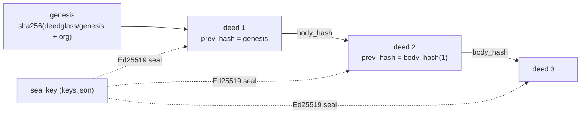

# Verifying deeds

A five-minute guide for auditors, customers and anyone who does not want to take Deedglass's word
for it. You need the deeds (an export) and the issuer's public seal keys. You do not need an
account, a database or a network connection, except to fetch the keys.

## 1. What a deed shows, and what it does not

A deed is the signed record of one thing that happened: an agent's action, a person's change, or a
later witness verdict. It names the agent, who it acted for, the tool, the policy decision, the
execution and what the Witness saw, as digests rather than payloads. Each deed is sealed with
Ed25519 and linked to the one before it, per org (`spec/v1/DEED_SPEC.md`).

Checking a deed shows that **nothing changed after it was sealed** and, with the issuer's pinned
keys, **which Deedglass deployment sealed it**. It does not show that the action was wise, that the
agent's request was honest, or that a `VERIFIED` verdict inside the deed is true: `verify` checks
seals and the chain; it does not re-run the Witness.



## 2. Install

Until signed release binaries ship (S35), build from source with Go 1.27:

```sh
go install github.com/deedglass/deedglass/cmd/deedglass@latest
```

## 3. Verify an export in one command

```
$ deedglass verify deeds.jsonl --keys https://api.deedglass.com/.well-known/deedglass/keys.json
✓ 1,204 deeds · chain intact · 2 seal keys · 2026-10-01 → 2026-10-02
```

`deedglass verify` reads one deed (`deed.json`), one deed per line (`deeds.jsonl`), stdin (`-`), a
directory of deed files, or an export bundle (`.tar.gz`, `spec/v1/BUNDLE_FORMAT.md`). The exit code
is the answer: **0** every check passed, **1** something failed, **2** it could not decide (no
keys, a newer deed format, an unreadable file). Add `-v` for the details, `--json` for the full
`verification_report`, `--all` to list every break instead of stopping at the first. `docs/CLI.md`
lists every flag.

When something is wrong you get the deed, the reason and the next step:

```
✕ Deed 812 was changed after it was sealed.
  deed       deed_01j9zt3q5s7v9w1y3a5c7e9g1j (line 812)
  sealed     body_hash sha256:3f9a…c21e
  computed   sha256:9b1d…04aa
  before it  811 deeds intact · stopped at the first break
  next       Get a fresh export from the issuer and compare deed 812. Add --all to list every break.
```

## 4. Pin the issuer's keys

Every bundle carries the keys that sealed it, so it can be checked offline. Those keys came from
the exporter. Checking against them shows that nothing changed since export, not who sealed the
deeds, and the output says so:

```
○ Seal keys came from the bundle itself. This shows nothing changed since export, not who sealed it.
  next       Pin the issuer's keys: --keys https://api.deedglass.com/.well-known/deedglass/keys.json
```

To check authenticity, pass the issuer's published key set with `--keys` (a file or an https URL),
or pin key thumbprints you received out of band with `--pin sha256:…`. With `--strict`, an
unpinned check exits 2. A key set that holds even one unsafe key (small-order or non-canonical
Ed25519) is refused whole. `docs/SEAL_KEYS.md` explains rotation and thumbprints.

The network is used only to fetch a `--keys` URL: https only (http for localhost), 10 seconds, at
most 1 MiB, redirects only to the same host, no cookies, no proxy, no retries.

## 5. Read a failure

Each code, the sentence you see, and the next step. The CLI and the browser verifier print exactly
these.

<!-- codes:begin (generated from internal/deed/messages.go; go test ./internal/deed -run TestVerifyingDocs -update) -->

| Code | You see | Next step | Exit |
|---|---|---|---|
| `malformed` | {Deed} is not valid strict JSON ({detail}). | Export it again from the issuer; do not edit deeds by hand. | 1 |
| `unsupported_version` | {Deed} uses deed format v{v}, which this verifier can't read. | Update deedglass. | 2 |
| `schema_invalid` | {Deed} has an invalid field: {field}. | Export it again from the issuer. | 1 |
| `id_mismatch` | {Deed}'s id does not match its body. | Export it again from the issuer. | 1 |
| `body_hash_mismatch` | {Deed} was changed after it was sealed. | Get a fresh export from the issuer and compare {deed}. | 1 |
| `seal_key_mismatch` | {Deed} names two different seal keys. | Treat this deed as altered. | 1 |
| `seal_key_unknown` | {Deed} names seal key {key}, which is not in the key set. | Fetch the issuer's keys: --keys <issuer>/.well-known/deedglass/keys.json | 1 |
| `seal_key_rejected` | The key set contains an unsafe key ({key}). | Do not use this key set. Fetch it again from the issuer. | 1 |
| `seal_key_not_valid_at` | {Deed} was sealed at {issued_at}, outside seal key {key}'s active window. | Treat this deed as altered, or check you have the issuer's full key set. | 1 |
| `seal_key_revoked` | {Deed} was sealed by revoked key {key}. | Ask the issuer which deeds they re-sealed after the revocation. | 1 |
| `seal_invalid` | {Deed}'s seal does not match its contents. | Treat this deed as altered. | 1 |
| `non_canonical` | {Deed} is not in canonical form (--strict). | Re-export it; canonical bytes come straight from the Ledger. | 1 |
| `keys_missing` | Cannot check {deed}: no seal keys were given. | Add --keys <file or https URL>. Issuers publish them at /.well-known/deedglass/keys.json | 2 |
| `bundle_invalid` | {detail} Nothing was extracted. | Do not use this file. Ask the issuer for a new export. | 1 |
| `bundle_seal_invalid` | The bundle manifest's seal does not match the manifest. | Treat this bundle as altered. Ask the issuer for a new export. | 1 |
| `chain_genesis_mismatch` | Deed 1 does not start this org's chain. | Check the org id; the export may belong to another org. | 1 |
| `chain_seq_gap` | Deed {want} is missing. The chain jumps from {prev} to {seq}. | A deed was removed or the export is incomplete. Ask the issuer for seq {prev}–{seq}. | 1 |
| `chain_seq_out_of_order` | {Deed} appears out of order (after {prev}). | Sort by seq, or export again. | 1 |
| `chain_prev_hash_mismatch` | {Deed} does not link to deed {prev}. | A deed before it was changed or replaced. Get a fresh export. | 1 |
| `chain_org_mismatch` | {Deed} belongs to {org}, not {want_org}. | Verify each org's deeds separately. | 1 |
| `chain_time_regression` | {Deed} was sealed before deed {prev}. | Treat the chain as altered from {deed}. | 1 |
| `unsupported_algorithm` | {Deed} is sealed with an algorithm this verifier can't check ({detail}). | Update deedglass, or check it with a verifier that supports that algorithm. | 2 |
| `seal_missing` | {Deed} is missing a seal it must carry ({detail}). | Treat this deed as altered, or ask the issuer for the deed as it was sealed. | 1 |

`{Deed}` reads "Deed 812", or "The deed" when the deed is too damaged to read its seq. A missing
first deed reads: "The deeds start at deed {seq}, not deed 1."
<!-- codes:end -->

## 6. Verify two exports as one chain

Pass them in order. The second must start where the first ended:

```
$ deedglass verify part1.tar.gz part2.tar.gz --keys keys.json
✓ 1,204 deeds · chain intact · 2 seal keys · 2026-10-01 → 2026-10-02
```

To check a partial export on its own, give the deed before it with
`--anchor <seq>:<body_hash>`, which you kept from the earlier export.

## 7. Keep the head

A chain cut at the end looks complete: deeds 1–800 of 1,204 verify. Two things catch it. A sealed
bundle manifest names the head (the last deed's seq and `body_hash`) and the count, so a cut bundle
fails. And you can keep the head of every export you receive (`-v` and `--json` show it, and
`deedglass ledger check` prints the live head, S06) and compare the next export against it.

Neither helps when the exporter itself cuts the chain and seals a new manifest. For that, the issuer
can timestamp heads with TSAs and a transparency service you choose (opt-in, TY-03): keep the
`timestamps.json` and pass it with `--timestamps`, and a head the export no longer reaches is
`chain_tail_missing` ([`TIMESTAMPS.md`](TIMESTAMPS.md)).

## 8. Verify in the browser

`web/verify` is the same check as a page: paste a deed or drop `deeds.jsonl`, paste or fetch the
keys, and press Verify. Everything runs on your machine; nothing is uploaded or stored. It returns
the same answer as the CLI on every published test vector and on a 500-case corpus of tampered
deeds. Bundles (`.tar.gz`) are CLI-only for now. The CLI is the reference verifier.

## 9. FAQ

**Can Deedglass forge deeds?** Yes, whoever holds a seal key can seal any deed with any time. That
is why seal keys are published, pinned by customers, rotated, and revoked on suspicion, and why a
revoked key fails every deed it sealed (`docs/THREAT_MODEL.md`).

**Does verify re-run the Witness?** No. It checks that each deed is intact and sealed, and that the
chain is complete. The verdict inside a deed is what the Witness recorded at the time.

**Does it need the network?** Only to fetch keys from a URL you name. With `--keys keys.json` it
runs fully offline.

**What about the test keys in the docs?** They are public on purpose. `verify` warns when a deed was
sealed by one of them: such a deed means nothing outside tests.
